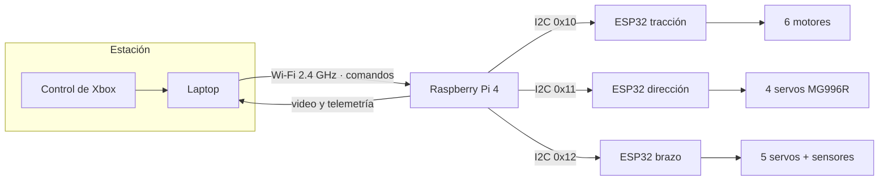
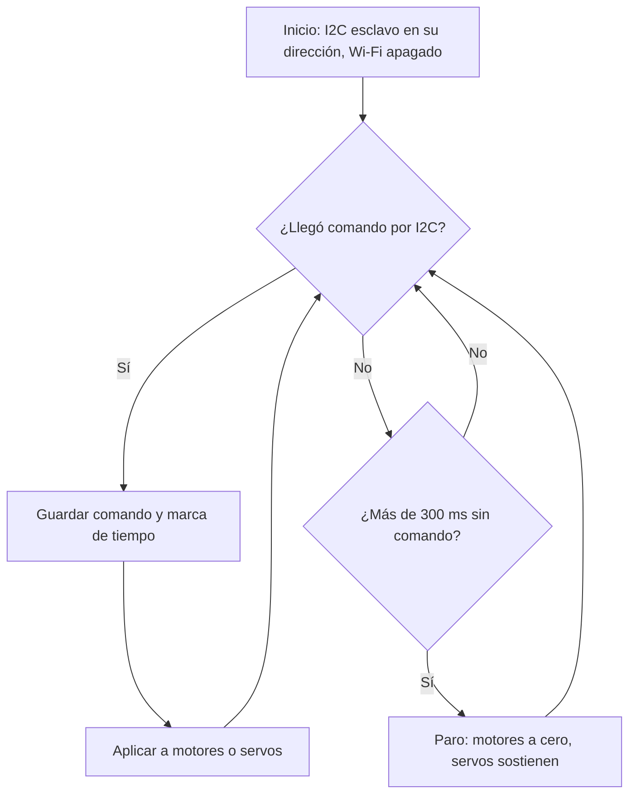

# Electrónica y software

Esta página baja el [diagrama eléctrico v2]({{ '/02-diagramas-a-bloques/' | relative_url }}) a lo que hay que comprar, cablear y programar. Todo lo que aparece aquí **sale del diagrama v2**; lo que el diagrama no define se marca como **propuesta** y se confirma con el equipo antes de comprar.

{: .note }
> **Estado: en diseño.** Ya están definidos el diagrama de bloques, la lista de componentes y la arquitectura del software. El esquemático, la tarjeta y el código se publican en esta misma página conforme se terminen.

Contenido:
- [1) Diagrama de bloques (B13)](#1-diagrama-de-bloques-b13)
- [2) Lista de materiales electrónicos (B14)](#2-lista-de-materiales-electrónicos-b14)
- [3) Esquemático, tarjeta y montaje (B15–B17)](#3-esquemático-tarjeta-y-montaje-b15b17)
- [4) Pruebas por bloques (B18)](#4-pruebas-por-bloques-b18)
- [5) Arquitectura del software (B19)](#5-arquitectura-del-software-b19)
- [6) Diagrama de flujo (B20)](#6-diagrama-de-flujo-b20)
- [7) Interfaz y operación (B21)](#7-interfaz-y-operación-b21)
- [8) Librerías, funciones y código (B22–B24)](#8-librerías-funciones-y-código-b22b24)

---

## 1) Diagrama de bloques (B13)

El diagrama vigente es la **versión 2** (19-oct-2026), documentado en [Diagramas a bloques]({{ '/02-diagramas-a-bloques/' | relative_url }}#1-diagrama-eléctrico--electrónico-b13). En resumen:

- Una **Raspberry Pi 4** es el maestro: recibe los comandos por Wi-Fi y manda video y telemetría.
- **Tres ESP32** esclavos en un bus **I2C a 100 kHz**: tracción `0x10`, dirección `0x11` y brazo `0x12`. Su Wi-Fi queda apagado.
- **Cuatro rieles de potencia** separados desde un LiPo 3S: VBAT directo para motores, BEC A y BEC B para servos y un buck de 5.1 V para la lógica.

---

## 2) Lista de materiales electrónicos (B14)

Cantidades tomadas del diagrama v2. Los precios se agregan al cotizar.

| Subsistema | Componente | Especificación del diagrama | Cant. |
|:-----------|:-----------|:----------------------------|:--:|
| Control | Raspberry Pi 4 | Maestro I2C, 5.1 V · 3 A | 1 |
| Control | Cámara | USB o CSI | 1 |
| Control | IMU BNO055 | I2C, cerca del centro de gravedad | 1 |
| Control | INA219 | I2C, voltaje y corriente de batería | 1 |
| Control | LIDAR 2D | USB · **opcional**, para mapeo futuro | (0–1) |
| Subsistemas | ESP32 | Esclavos I2C `0x10` / `0x11` / `0x12`, alimentados a 5 V | 3 |
| Tracción | Driver dual de motor DC | ≥4 A por canal (ver nota) | 3 |
| Tracción | Motorreductor DC 12 V | 2 A por motor (hipótesis); encoders en MI y MD | 6 |
| Tracción | Sensor ultrasónico | Al ESP32 de tracción | Por definir |
| Dirección | Servo MG996R | Ruedas de esquina | 4 |
| Brazo | Servo de base | 20 kg·cm | 1 |
| Brazo | Servo de hombro | 60 kg·cm | 1 |
| Brazo | Servo de codo | 35 kg·cm | 1 |
| Brazo | Servo de pinza | MG90S | 1 |
| Brazo | Servo de tolva | MG996R | 1 |
| Brazo | Sensor de color TCS34725 | 2.º bus I2C del ESP32, en la pinza | 1 |
| Brazo | Sensor de distancia VL53L1X | ToF, 2.º bus I2C del ESP32, en la pinza | 1 |
| Brazo | HX711 + celda de carga | Peso bajo la tolva, 2 GPIO | 1 |
| Potencia | Batería LiPo 3S | 5000 mAh, 9.9–12.6 V, **≥5C** (ver nota) | 1 |
| Potencia | Fusible | 30 A | 1 |
| Potencia | Interruptor principal | | 1 |
| Potencia | Paro de emergencia | Corta actuadores, no la lógica | 1 |
| Potencia | BEC A | 6 V, ≥10 A | 1 |
| Potencia | BEC B | 6–7.4 V, ≥10 A | 1 |
| Potencia | Convertidor buck | 5.1 V, 5 A | 1 |

**Lo que el diagrama deja abierto** (ya señalado en [Consistencia con las especificaciones]({{ '/02-diagramas-a-bloques/' | relative_url }}#consistencia-con-las-especificaciones)):

1. **Driver:** el diagrama pide ≥4 A por canal y la métrica 28 pide ≥5 A continuos y ≥15 A pico. Se compra el que cumpla la métrica.
2. **Batería:** a 19 A de consumo, la métrica 61 (≥25 A continuos) pide un pack de **≥5C**.
3. **Motor:** la propuesta mecánica supone cuerpo **Ø37 mm** y flecha de 6 mm en D ([Mecánica y materiales]({{ '/03-mecanica-materiales/' | relative_url }})). Al elegir el motor hay que confirmar ambas medidas.

---

## 3) Esquemático, tarjeta y montaje (B15–B17)

| Criterio | Qué se va a entregar | Base |
|:---------|:---------------------|:-----|
| B15 · Esquemático | Esquemático de KiCad con los 4 rieles, el paro, el bus I2C y los conectores de cada subsistema | Diagrama v2 y la tabla de la sección 2 |
| B16 · Tarjeta | Tarjeta de distribución: entrada de batería con fusible, bornes por riel, conectores I2C con su tierra trenzada | Mismo flujo de trabajo que la [tarjeta de los brazos]({{ '/brazos/electronica-programacion/' | relative_url }}#4-diseño-de-la-tarjeta-b16) |
| B17 · Montaje | Fotos del montaje y del cableado dentro del cuerpo; los cables de motor viajan **por dentro de los tubos** de la suspensión | |

**Reglas de cableado que ya fija el diagrama:** tierra en **un solo punto estrella**; tramos de I2C de **menos de 1 m**, trenzados y lejos de los cables de motor; los pull-ups de 1.8 kΩ ya vienen en la Pi.

---

## 4) Pruebas por bloques (B18)

| # | Bloque | Prueba | Criterio de aceptación |
|:-:|:-------|:-------|:-----------------------|
| E-1 | Rieles | Medir cada riel en vacío y con su carga | 5.1 V ±0.1 en el buck; BEC A 6 V; VBAT ≥9.9 V |
| E-2 | Paro de emergencia | Accionarlo con motores y servos encendidos | Los actuadores se detienen y la Pi **sigue** transmitiendo |
| E-3 | Bus I2C | Escaneo desde la Pi | Responden `0x10`, `0x11`, `0x12`, la IMU y el INA219 |
| E-4 | Failsafe | Desconectar el I2C con los motores girando | El ESP32 de tracción para los motores en ≤300 ms |
| E-5 | Consumo | Ciclo de misión registrado con el INA219 | Corriente continua ≤19 A; si es mayor, se revisa el presupuesto |
| E-6 | Corte por bajo voltaje | Fuente variable bajando de 12.6 V | Corte a 9.9 V |

---

## 5) Arquitectura del software (B19)

Tres niveles, como en el diagrama v2:

| Nivel | Dónde corre | Responsabilidad |
|:------|:------------|:----------------|
| **Estación** | Laptop con control de Xbox | Lee el control, muestra el video y la telemetría, manda comandos por Wi-Fi |
| **Maestro** | Raspberry Pi 4 | Recibe comandos, los traduce a escrituras I2C para cada esclavo, transmite video, lee IMU e INA219, corta por bajo voltaje |
| **Esclavos** | 3 × ESP32 | Tracción: 6 motores, encoders, ultrasónicos y **failsafe de 300 ms**. Dirección: 4 servos. Brazo: 5 servos, color, distancia y peso |

---

## 6) Diagrama de flujo (B20)

El lazo de cada ESP32 esclavo. La regla de seguridad (**sin I2C durante 300 ms → paro**) viene del diagrama v2.

---

## 7) Interfaz y operación (B21)

Procedimiento de operación con la arquitectura del diagrama v2:

1. **Antes de encender:** batería cargada y balanceada, fusible puesto, **paro de emergencia presionado**.
2. Encender el interruptor principal: arranca la lógica (Pi y ESP32); los actuadores siguen sin energía.
3. Conectar la laptop al Wi-Fi del rover y abrir la vista de video y telemetría.
4. Verificar en la telemetría: voltaje de batería, respuesta de los 3 esclavos e IMU.
5. **Liberar el paro de emergencia**: ya hay energía en los actuadores.
6. Operar con el control de Xbox mirando el video.
7. Al terminar: paro presionado, luego interruptor principal.

---

## 8) Librerías, funciones y código (B22–B24)

| Criterio | Propuesta |
|:---------|:----------|
| B22 · Librerías | **Pi:** Python 3 con un cliente I2C (por ejemplo `smbus2`) y la librería de la cámara. **ESP32:** Arduino-ESP32 con `Wire` en modo esclavo y `ESP32Servo`. Se confirma al escribir el código |
| B23 · Funciones | Un módulo por subsistema, con la misma organización que el [firmware de los brazos]({{ '/brazos/electronica-programacion/' | relative_url }}#11-organización-en-funciones-b23): lectura de comando, aplicación al actuador, failsafe y telemetría separados |
| B24 · Código | Se publica como descarga en esta sección al tener la primera versión que pase las pruebas E-3 y E-4 |

---

## Navegación

[← Mecánica y materiales]({{ '/03-mecanica-materiales/' | relative_url }}) · [Integración y conclusiones →]({{ '/05-integracion-conclusiones/' | relative_url }})
