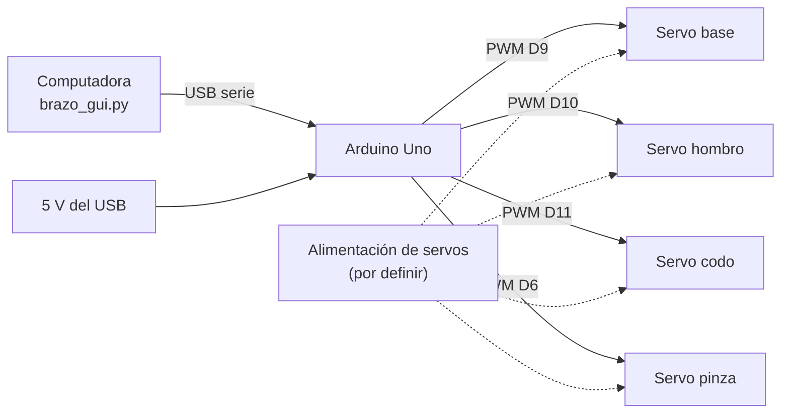
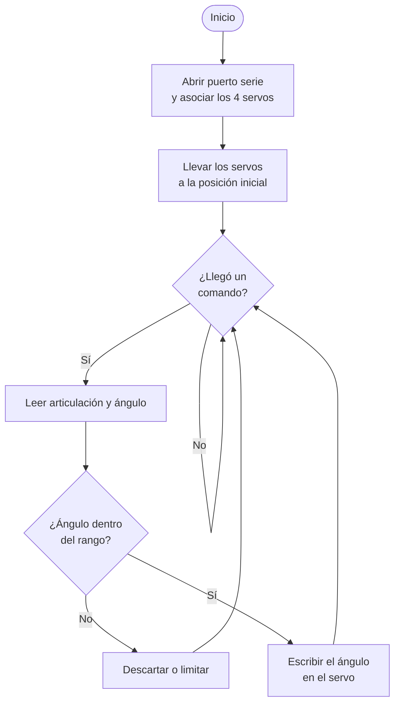

# Brazo impreso en 3D

Brazo de **3 GDL más pinza**, fabricado por **impresión 3D (FDM) en PLA**. Parte de un diseño publicado por RACBOTS; el equipo lo laminó, lo imprimió, lo armó y le hizo su electrónica.

> **Cómo usar los visores 3D:** arrastra para girar, rueda del ratón (o pellizco) para acercar y clic derecho (o dos dedos) para desplazar. **Reiniciar vista** regresa a la vista inicial.

| Rúbrica | Entregable | Estado |
|:--|:---|:---|
| R1 | Planos de las piezas | ✅ 9 planos A4 + resumen |
| R2 | Render de cada pieza | ✅ 9 renders |
| R3 | Ensamble en CAD | ⚠️ Captura de Inventor y posiciones reales; el STEP exportado viene sin geometría |
| R4 | Render del ensamble | ✅ 3 vistas |
| R5 | Visor 3D en la página | ✅ |
| R6 | Proceso de fabricación | ✅ Parámetros de impresión; faltan fotos y video |
| R7 | Ensamble físico | ⏳ faltan fotos |
| R8 | Prueba tomando un objeto | ⏳ falta video |

La tabla R1–R8 resume los entregables de diseño mecánico. El avance contra los **31 criterios de la rúbrica resumida del curso** está en la [autoevaluación]({{ '/brazos/evaluacion/' | relative_url }}); cada sección de esta página indica entre paréntesis qué criterio cubre (B##).

---

## 1) Descripción general

| Dato | Valor |
|:-----|:------|
| Grados de libertad | **3 GDL + pinza** (base, hombro, codo y apertura de pinza) |
| Material | **PLA** (Creality Hyper PLA, 1.75 mm) |
| Piezas impresas | **9** |
| Volumen de PLA | **54.43 cm³**, masa máxima **67.5 g** sin servos ni tornillería |
| Actuadores | **4 servos SG90** |
| Control | **Arduino Uno** por USB |
| Envolvente del ensamble CAD | 174.0 × 58.1 × 117.5 mm en la pose exportada |
| Medidas del brazo armado | **[Pendiente]** <!-- PENDIENTE: medir el brazo físico. --> |
| Foto del brazo armado | **[Pendiente]** <!-- PENDIENTE: foto en assets/img/brazos/impreso3d/ --> |

---

## 2) Arquitectura

### Cadena cinemática
| Orden | Pieza | Función en el brazo |
|:-----:|:------|:--------------------|
| 1 | Base | Aloja el **servo de giro** de la base; se fija a la superficie de montaje con 3 orejas atornilladas. |
| 2 | Tapa | Plato giratorio sobre el servo de la base, con una **horquilla** de dos postes donde articula el brazo 1. |
| 3 | Brazo 1 | Primer eslabón (80 mm). Un extremo con ranura para el eje de la horquilla y otro con ventana para el servo del codo. |
| 4 | Brazo 2 | Segundo eslabón (90 mm), con alojamiento para el siguiente servo en el extremo. |
| 5 | Soporte de pinza | Marco con ventana rectangular para el **servo de la pinza**. |
| 6 | Piñón del servo | Engrane motriz montado en el eje del servo de la pinza. |
| 7 | Piñón de pinza | Engrane conducido que transmite el giro a las mordazas. |
| 8 | Pinza derecha | Mordaza con sector dentado que engrana con el piñón de pinza; el filo serrado sujeta la muestra. |
| 9 | Pinza izquierda | La misma pieza en espejo. Las dos cierran a la vez, movidas por el mismo piñón. |

- **Grados de libertad:** el brazo articula en la base (giro), el hombro (horquilla de la tapa) y el codo (brazo 1 → brazo 2), más la apertura de la pinza: **3 GDL + pinza**.
- **Alcance:** los dos eslabones suman **170 mm** (80 + 90) más la pinza.
- **Masa:** como máximo **67 g** de piezas impresas, sin servos ni tornillería.
- **Transmisión de la pinza:** el servo mueve la pinza a través de un par de engranes (piñón del servo de 20 mm → piñón de pinza de 28 mm), que reduce la velocidad y aumenta el par de cierre.
- **Apertura de la pinza:** en la pose del ensamble CAD las dos mordazas quedan separadas **19.3 mm** entre centros. Es el dato a contrastar con el diámetro de la pelota de la prueba.

---

## 3) Origen del diseño y créditos

El brazo impreso **no es un diseño original del equipo**. Parte de un modelo publicado por terceros, al que se le hicieron cambios cosméticos.

| Dato | Valor |
|:-----|:------|
| Diseño base | **"Brazo Robótico — Robotic Arm"**, modelo **#449747** en Printables |
| Autor del diseño base | **RACBOTS** |
| Fuente | <https://www.printables.com/model/449747> |
| Licencia del original | **[CC BY 4.0](https://creativecommons.org/licenses/by/4.0/)** (Atribución 4.0 Internacional), según declara la ficha de Printables |
| Qué permite esa licencia | Redistribuir, modificar y usar comercialmente, **siempre con atribución** |
| Modificaciones del equipo | **Sí**: cambios cosméticos sobre las piezas |
| Aporte del equipo | Cambios cosméticos sobre las piezas, laminado y parámetros de impresión, impresión, ensamble físico, electrónica y pruebas |

> **Atribución (CC BY 4.0).** Las piezas de esta página derivan de **"Brazo Robótico — Robotic Arm"** de **RACBOTS**, publicado en [Printables (#449747)](https://www.printables.com/model/449747) bajo [CC BY 4.0](https://creativecommons.org/licenses/by/4.0/). **El equipo modificó el diseño original** (cambios cosméticos). Los STL que se descargan desde esta página son obra derivada y se redistribuyen bajo la misma atribución.

<!-- Resuelto: son 9 piezas. El repositorio tenía 8 archivos porque las dos mordazas venían fundidas en pinzas.stl; el CAD las tiene como Pinza derecha v1 y Pinza izquierda v1_MIR_MIR3. -->

---

## 4) Piezas, planos y renders (R1 y R2)

Las 9 piezas se miden directamente sobre sus STL. La masa supone la pieza **100 % sólida** en PLA (1.24 g/cm³); con 2 paredes y 15 % de relleno la masa real será **menor**.

**Descargas:**

- [Plano completo, 9 páginas (PDF)]({{ '/assets/brazos/impreso3d/planos/planos-brazo-impreso-completo.pdf' | relative_url }})

| Render | Pieza | Nombre | Nombre en el CAD | Medidas (mm) | Volumen (cm³) | Masa máx. (g) | Archivos |
|:------:|:------|:-------|:-----------------|:-------------|--------------:|--------------:|:---------|
|  | **P-01** | Base (alojamiento servo) | `Base 2 v2` | 44.98 × 44.98 × 24.00 | 23.45 | 29.1 | [STL]({{ '/assets/stl/brazo-impreso/base.stl' | relative_url }}) · [Plano]({{ '/assets/brazos/impreso3d/planos/P-01.pdf' | relative_url }}) |
|  | **P-02** | Tapa giratoria | `Tapa v2` | 37.99 × 38.00 × 29.50 | 12.85 | 15.9 | [STL]({{ '/assets/stl/brazo-impreso/tapa.stl' | relative_url }}) · [Plano]({{ '/assets/brazos/impreso3d/planos/P-02.pdf' | relative_url }}) |
|  | **P-03** | Brazo 1 | `Brazo 1 v1` | 16.50 × 80.00 × 5.00 | 3.63 | 4.5 | [STL]({{ '/assets/stl/brazo-impreso/brazo-1.stl' | relative_url }}) · [Plano]({{ '/assets/brazos/impreso3d/planos/P-03.pdf' | relative_url }}) |
|  | **P-04** | Brazo 2 | `Brazo 2 v1_FINAL_FInal` | 17.00 × 90.00 × 12.02 | 5.93 | 7.4 | [STL]({{ '/assets/stl/brazo-impreso/brazo-2.stl' | relative_url }}) · [Plano]({{ '/assets/brazos/impreso3d/planos/P-04.pdf' | relative_url }}) |
|  | **P-05** | Soporte de pinza | `Soporte Pinza v1` | 29.00 × 44.00 × 4.00 | 2.43 | 3.0 | [STL]({{ '/assets/stl/brazo-impreso/soporte-pinza.stl' | relative_url }}) · [Plano]({{ '/assets/brazos/impreso3d/planos/P-05.pdf' | relative_url }}) |
|  | **P-06** | Piñón del servo | `Piñon Servo v1` | 20.00 × 20.00 × 5.00 | 0.64 | 0.8 | [STL]({{ '/assets/stl/brazo-impreso/pinon-servo.stl' | relative_url }}) · [Plano]({{ '/assets/brazos/impreso3d/planos/P-06.pdf' | relative_url }}) |
|  | **P-07** | Piñón de pinza | `Piñon pinza 1 v1` | 27.97 × 27.95 × 7.00 | 1.73 | 2.1 | [STL]({{ '/assets/stl/brazo-impreso/pinon-pinza.stl' | relative_url }}) · [Plano]({{ '/assets/brazos/impreso3d/planos/P-07.pdf' | relative_url }}) |
|  | **P-08** | Pinza derecha | `Pinza derecha v1` | 70.23 × 24.30 × 6.15 | 1.92 | 2.4 | [STL]({{ '/assets/stl/brazo-impreso/pinza-derecha.stl' | relative_url }}) · [Plano]({{ '/assets/brazos/impreso3d/planos/P-08.pdf' | relative_url }}) |
|  | **P-09** | Pinza izquierda | `Pinza izquierda v1_MIR_MIR3` | 70.23 × 24.77 × 6.15 | 1.85 | 2.3 | [STL]({{ '/assets/stl/brazo-impreso/pinza-izquierda.stl' | relative_url }}) · [Plano]({{ '/assets/brazos/impreso3d/planos/P-09.pdf' | relative_url }}) |

### Cómo se generaron

| Paso | Script |
|:-----|:-------|
| Medidas y render de cada pieza | `tools/f3_salidas_piezas_impreso.py` |
| Planos A4 y plano resumen | `tools/f3_planos_impreso.py` |

A diferencia del brazo de corte láser, estas piezas **no son planas**, así que cada plano lleva **tres vistas** (planta, alzado y lateral) a la misma escala. Son **siluetas proyectadas** de la malla: contorno exterior, sin aristas internas ni líneas ocultas. Sirven para identificar y acotar la pieza; no son planos de taller con cortes y tolerancias.

> **Una malla abierta.** P-04 (Brazo 2) no es una malla cerrada. Un STL no estanco puede dar problemas al laminar (relleno impredecible o paredes perdidas). Conviene repararlo antes de volver a imprimir esa pieza.

### Visores por pieza

  <figure>
    

    <figcaption><strong>Base</strong> · <a href="{{ '/assets/stl/brazo-impreso/base.stl' | relative_url }}" download>Descargar STL</a></figcaption>
  </figure>
  <figure>
    

    <figcaption><strong>Tapa</strong> · <a href="{{ '/assets/stl/brazo-impreso/tapa.stl' | relative_url }}" download>Descargar STL</a></figcaption>
  </figure>
  <figure>
    

    <figcaption><strong>Brazo 1</strong> · <a href="{{ '/assets/stl/brazo-impreso/brazo-1.stl' | relative_url }}" download>Descargar STL</a></figcaption>
  </figure>
  <figure>
    

    <figcaption><strong>Brazo 2</strong> · <a href="{{ '/assets/stl/brazo-impreso/brazo-2.stl' | relative_url }}" download>Descargar STL</a></figcaption>
  </figure>
  <figure>
    

    <figcaption><strong>Soporte de pinza</strong> · <a href="{{ '/assets/stl/brazo-impreso/soporte-pinza.stl' | relative_url }}" download>Descargar STL</a></figcaption>
  </figure>
  <figure>
    

    <figcaption><strong>Piñón del servo</strong> · <a href="{{ '/assets/stl/brazo-impreso/pinon-servo.stl' | relative_url }}" download>Descargar STL</a></figcaption>
  </figure>
  <figure>
    

    <figcaption><strong>Piñón de pinza</strong> · <a href="{{ '/assets/stl/brazo-impreso/pinon-pinza.stl' | relative_url }}" download>Descargar STL</a></figcaption>
  </figure>
  <figure>
    

    <figcaption><strong>Pinza derecha</strong> · <a href="{{ '/assets/stl/brazo-impreso/pinza-derecha.stl' | relative_url }}" download>Descargar STL</a></figcaption>
  </figure>
  <figure>
    

    <figcaption><strong>Pinza izquierda</strong> · <a href="{{ '/assets/stl/brazo-impreso/pinza-izquierda.stl' | relative_url }}" download>Descargar STL</a></figcaption>
  </figure>

---

## 5) Ensamble en CAD (R3)

El ensamble se armó en **Autodesk Inventor 2026** (`Assembly_PLA.iam`).

**Figura 1:** `Assembly_PLA.iam` en Inventor 2026, con el árbol de componentes visible.

| Dato del ensamble | Valor |
|:------------------|:------|
| Piezas impresas | 9 |
| Servos | 4 × SG90, colocados |
| Elementos en el visor | 13 |
| Envolvente | 174.0 × 58.1 × 117.5 mm |

> **De dónde salen estas posiciones.** El STEP que exportó Inventor para este ensamble **viene sin geometría**: trae la estructura, las posiciones y los colores, pero cero sólidos. Aun así sirve, porque sus **transformaciones de ensamble sí están completas**, y son las que se aplican a los STL. Lo genera `tools/f2_ensamble_impreso.py`.
>
> **Corrección de escala.** Las dos mordazas y el servo se exportaron aparte, y los tres salieron **2.54 veces más grandes** que el resto, así que se reescalan por 1/2.54. Cada corrección se comprobó contra un dato independiente:
>
> - **Mordazas:** a escala 1 un dedo medía 178 mm en un brazo con eslabones de 80 y 90 mm. Corregidas quedan en 70 × 25 × 6 mm, igual que las mordazas que traía fundidas el archivo `pinzas.stl`, y caen **simétricas** respecto al soporte, a 42.7 y 40.7 mm de su centro.
> - **Servo:** corregido queda en **12.0 × 31.5 × 32.6 mm**, que son las medidas de un SG90, y coincide con el modelo de SG90 del brazo de corte láser. El mismo archivo se instancia cuatro veces, una por cada posición del STEP.

- **Descarga del STEP: [Pendiente]** <!-- PENDIENTE: el STEP exportado no trae sólidos, así que no se publica. Reexportarlo cuando se resuelva. -->

### Archivos editables y de fabricación (B07)

| Archivo | Para qué sirve | Estado |
|:--------|:---------------|:-------|
| STL de las 9 piezas | Fabricación (laminado) | ✅ [Tabla de piezas](#4-piezas-planos-y-renders-r1-y-r2) |
| Planos en PDF | Fabricación y verificación | ✅ [Plano completo]({{ '/assets/brazos/impreso3d/planos/planos-brazo-impreso-completo.pdf' | relative_url }}) |
| Piezas de Inventor (`.ipt`) | Edición | **[Pendiente]** |
| Ensamble de Inventor (`Assembly_PLA.iam`) | Edición | **[Pendiente]** |
| STEP del ensamble con sólidos | Intercambio entre programas CAD | **[Pendiente]** (el exportado viene vacío) |
| Proyectos laminados (`.3mf`) de cada placa | Reimprimir con los mismos parámetros | **[Pendiente]** |



---

## 6) Renderizado del ensamble (R4)

**Figura 2:** Vista isométrica. Las 9 piezas impresas más los 4 servos SG90, en sus posiciones reales del CAD.

**Figura 3:** Vista lateral.

**Figura 4:** Vista superior.

---

## 7) Visor 3D (R5)

**Figura 5:** Ensamble interactivo: las **9 piezas impresas** y los **4 servos SG90**, en coordenadas reales del CAD. Usa **Separar piezas** para la vista explosionada.

---

## 8) Fabricación: impresión 3D (R6)

Los parámetros salen del proyecto de **Creality Print 6.3** que usó el equipo (archivo `Base_2_v2.3mf`, fecha 29/09/26). Es el perfil de fábrica **0.20mm Standard** para la Ender‑3 V3 KE, sin modificaciones de soporte ni relleno.

### Equipo y material

| Parámetro | Valor |
|:----------|:------|
| Impresora | **Creality Ender‑3 V3 KE** |
| Boquilla | **0.4 mm** |
| Cama | **PEI texturizada** |
| Material | **Creality Hyper PLA**, 1.75 mm |
| Densidad del filamento | 1.24 g/cm³ |
| Relación de flujo | 0.95 |
| Laminador | Creality Print 6.3.0 |

### Temperaturas y enfriamiento

| Parámetro | Valor |
|:----------|:------|
| **Temperatura de boquilla** | **220 °C** (primera capa y resto) |
| **Temperatura de cama** | **50 °C** (primera capa y resto) |
| Ventilador de capa | **100 %** a partir de la 2.ª capa (apagado en la 1.ª) |
| Reducción de velocidad por enfriamiento | Activada |

### Capas, paredes y relleno

| Parámetro | Valor |
|:----------|:------|
| **Altura de capa** | **0.20 mm** (primera capa 0.20 mm) |
| Ancho de línea | 0.45 mm (pared exterior 0.42 mm) |
| **Paredes (perímetros)** | **2** (generador Arachne) |
| **Capas superiores / inferiores** | **4 / 4** |
| **Relleno** | **15 %**, patrón **zig‑zag** a 45° |
| Patrón de superficie superior / inferior | Monotónico |
| Traslape relleno‑pared | 30 % |
| Planchado (ironing) | No |
| Costura | Alineada |

### Velocidades y movimiento

| Parámetro | Valor |
|:----------|:------|
| Primera capa | 50 mm/s |
| Pared exterior | 200 mm/s |
| Pared interior | 300 mm/s |
| Relleno | 270 mm/s |
| Relleno sólido interno | 250 mm/s |
| Superficie superior | 200 mm/s |
| Puentes | 50 mm/s |
| Desplazamiento | 300 mm/s |
| Aceleración por defecto | 5000 mm/s² |
| Flujo volumétrico máximo | 23 mm³/s |
| Retracción | 0.8 mm a 30 mm/s, con Z‑hop de 0.2 mm |

### Adhesión, soportes y compensaciones

| Parámetro | Valor |
|:----------|:------|
| **Soportes** | **Desactivados** |
| Brim | Automático |
| Falda (skirt) | No |
| Compensación de pata de elefante | 0.15 mm |
| Compensación XY de agujeros / contorno | 0 mm / 0 mm |
| Secuencia | Por capa |

### Por qué estos parámetros funcionan para estas piezas

- **Sin soportes:** todas las piezas están modeladas para imprimirse **acostadas sobre su cara plana** (eslabones de 5–12 mm de espesor, engranes de 5–7 mm, pinzas de 6 mm), así que no hay voladizos que los necesiten.
- **Compensación de pata de elefante (0.15 mm):** importa en los **engranes** y en las **pinzas**, donde un primer escalón ensanchado haría que los dientes rocen.
- **Compensación XY en 0:** los barrenos de ejes y tornillos salen al tamaño del modelo; si un eje o un cuerno de servo no entra, este es el primer parámetro a ajustar (o rimar el barreno).
- **2 paredes y 15 % de relleno:** suficiente para piezas de prueba. Para el brazo definitivo, los eslabones cargan momento flector en el servo del hombro; conviene probar **3–4 paredes** y **25–40 % de relleno** en `Brazo 1`, `Brazo 2` y la `Tapa`.

> **Nota de trazabilidad:** la placa laminada dentro de `Base_2_v2.3mf` contiene dos copias de una pieza llamada `linternass.stl` (2.08 g, 8 min 20 s), no la base del brazo. Por eso aquí se documentan los **parámetros del perfil**, pero **no** el tiempo ni el peso real de impresión de las piezas del brazo. Para completarlos hay que exportar el `.3mf` o el G‑code de cada placa del brazo.

### Registro de impresión por pieza (B09)

| Pieza | Placa | Orientación | Tiempo de impresión | Masa real (g) | Ajustes o reimpresiones |
|:------|:-----:|:------------|:--------------------|:--------------|:------------------------|
| P-01 Base | **[Pendiente]** | Sobre la cara de las orejas | **[Pendiente]** | **[Pendiente]** | **[Pendiente]** |
| P-02 Tapa | **[Pendiente]** | Sobre el disco | **[Pendiente]** | **[Pendiente]** | **[Pendiente]** |
| P-03 Brazo 1 | **[Pendiente]** | Acostada | **[Pendiente]** | **[Pendiente]** | **[Pendiente]** |
| P-04 Brazo 2 | **[Pendiente]** | Acostada | **[Pendiente]** | **[Pendiente]** | **[Pendiente]** (malla abierta: revisar el laminado) |
| P-05 Soporte de pinza | **[Pendiente]** | Acostada | **[Pendiente]** | **[Pendiente]** | **[Pendiente]** |
| P-06 Piñón del servo | **[Pendiente]** | Acostada | **[Pendiente]** | **[Pendiente]** | **[Pendiente]** |
| P-07 Piñón de pinza | **[Pendiente]** | Acostada | **[Pendiente]** | **[Pendiente]** | **[Pendiente]** |
| P-08 Pinza derecha | **[Pendiente]** | Acostada | **[Pendiente]** | **[Pendiente]** | **[Pendiente]** |
| P-09 Pinza izquierda | **[Pendiente]** | Acostada | **[Pendiente]** | **[Pendiente]** | **[Pendiente]** |

El tiempo y la masa salen del encabezado del G-code de cada placa (`estimated printing time` y `filament used [g]`), y la masa real se mide con una báscula.



---

## 9) Secuencia de ensamblaje (B10)

Orden de montaje **de la base hacia la pinza**, sacado de la jerarquía del ensamble CAD: cada servo se monta junto con la pieza que lo aloja. En cada imagen, lo gris ya está montado y lo de color se agrega en ese paso.

  <figure>
    
    <figcaption><strong>1.</strong> Meter el <strong>servo de giro</strong> en la <strong>base (P-01)</strong> y fijar la base a la mesa por sus 3 orejas.</figcaption>
  </figure>
  <figure>
    
    <figcaption><strong>2.</strong> Montar la <strong>tapa giratoria (P-02)</strong> sobre el eje del servo de giro.</figcaption>
  </figure>
  <figure>
    
    <figcaption><strong>3.</strong> Colocar el <strong>servo del hombro</strong> en la horquilla de la tapa y unirle el <strong>brazo 1 (P-03)</strong>.</figcaption>
  </figure>
  <figure>
    
    <figcaption><strong>4.</strong> Colocar el <strong>servo del codo</strong> en la ventana del brazo 1 y unirle el <strong>brazo 2 (P-04)</strong>.</figcaption>
  </figure>
  <figure>
    
    <figcaption><strong>5.</strong> Atornillar el <strong>soporte de pinza (P-05)</strong> al brazo 2 y meter el <strong>servo de la pinza</strong>.</figcaption>
  </figure>
  <figure>
    
    <figcaption><strong>6.</strong> Montar el <strong>piñón del servo (P-06)</strong> en el eje del servo y el <strong>piñón de pinza (P-07)</strong> engranado con él.</figcaption>
  </figure>
  <figure>
    
    <figcaption><strong>7.</strong> Colocar las <strong>pinzas derecha e izquierda (P-08, P-09)</strong> con sus sectores dentados engranados, simétricas respecto al soporte.</figcaption>
  </figure>

**Figura 6:** Secuencia de ensamblaje en 7 pasos. Generada con `tools/f6_secuencia_impreso.py` a partir de las posiciones reales del CAD.

> **Antes de montar cada cuerno de servo:** llevar el servo a **90°** desde el programa. Así cada articulación queda centrada en su recorrido y no hay que desarmar para corregir el ángulo.

> **Secuencia propuesta a partir del CAD.** El orden es el lógico para la geometría (cada pieza tapa el acceso a la anterior), pero falta confirmarlo con el armado real y anotar la tornillería de cada paso.



---

## 10) Ensamble físico (B11, R7)



---

## 11) Pruebas mecánicas (B12)

Pruebas de cada movimiento **antes** de integrar la electrónica final: se mueve cada articulación de extremo a extremo y se anota hasta dónde llega sin chocar ni forzar el servo.

| Prueba | Qué se mide | Resultado | Ajuste realizado |
|:-------|:------------|:----------|:-----------------|
| Giro de la base | Rango útil (°) sin que el cableado se enrede | **[Pendiente]** | **[Pendiente]** |
| Hombro | Rango útil (°) y si sostiene el brazo extendido sin vibrar | **[Pendiente]** | **[Pendiente]** |
| Codo | Rango útil (°) sin chocar con el brazo 1 | **[Pendiente]** | **[Pendiente]** |
| Apertura de la pinza | Apertura máxima entre mordazas (mm) | **[Pendiente]** (CAD: 19.3 mm entre centros) | **[Pendiente]** |
| Engranes de la pinza | Juego y si los dientes rozan | **[Pendiente]** | **[Pendiente]** |
| Holguras de los ejes | Juego en las articulaciones | **[Pendiente]** | **[Pendiente]** |



---

## 12) Lista de materiales (B06, B14)

### Mecánica

| Componente | Material o modelo | Medidas | Cantidad | Adquisición |
|:-----------|:------------------|:--------|:--------:|:------------|
| Piezas impresas P-01 a P-09 | PLA (Creality Hyper PLA, 1.75 mm) | Ver la [tabla de piezas](#4-piezas-planos-y-renders-r1-y-r2) | 9 | Fabricadas por el equipo |
| Filamento PLA | Creality Hyper PLA, 1.75 mm | — | 67 g como máximo | **[Pendiente]** (proveedor y precio) |
| Servo SG90 | Micro servo 9 g | 23 × 12 × 29 mm aprox. | 4 | **[Pendiente]** |
| Tornillos | **[Pendiente]** | **[Pendiente]** | **[Pendiente]** | **[Pendiente]** |
| Ejes o pasadores de articulación | **[Pendiente]** | **[Pendiente]** | **[Pendiente]** | **[Pendiente]** |

### Electrónica

| Componente | Valor o número de parte | Cantidad | Adquisición |
|:-----------|:------------------------|:--------:|:------------|
| Arduino Uno | **[Pendiente]** (original o clon, R3) | 1 | **[Pendiente]** |
| Servo SG90 | SG90 | 4 | **[Pendiente]** |
| Cable USB A–B | — | 1 | **[Pendiente]** |
| Fuente de 5 V para servos | **[Pendiente]** (si se usa) | **[Pendiente]** | **[Pendiente]** |
| Cables y conectores | **[Pendiente]** | **[Pendiente]** | **[Pendiente]** |

---

## 13) Electrónica (B13, B15–B18)

### Diagrama de bloques (B13)

**Figura 7:** Diagrama de bloques del brazo impreso. La alimentación de los servos va punteada porque **falta confirmarla**.

| Elemento | Valor |
|:---------|:------|
| Controlador | **Arduino Uno** |
| Actuadores | **4 servos SG90** |
| Pin base (giro) | **D9** |
| Pin hombro | **D10** |
| Pin codo | **D11** |
| Pin pinza | **D6** |
| Interfaz de control | **Por USB**, con el script `brazo_gui.py` desde la computadora |
| Alimentación de los servos | **[Pendiente]** <!-- PENDIENTE: ¿los 4 SG90 se alimentan del regulador de 5 V del Arduino o de una fuente externa? 4 SG90 pueden pedir más corriente de la que entrega el Uno. --> |

> **Ojo con la corriente.** Un SG90 puede pedir **cientos de miliamperes** al arrancar o al quedar trabado. Cuatro a la vez desde el pin de 5 V del Uno alimentado por USB pueden reiniciar la tarjeta. Si los servos se alimentan con una fuente externa, la **tierra** de la fuente debe unirse con la del Arduino.

### Esquemático (B15)



### Tarjeta (B16)

Este brazo **no usa tarjeta propia**: se controla con un **Arduino Uno comercial**. El criterio de diseño y fabricación de tarjeta se cubre con la [PCB del brazo de corte láser]({{ '/brazos/corte-laser/' | relative_url }}#13-electrónica-b13-b15b18).

### Montaje electrónico (B17)



### Pruebas por bloques (B18)

| Bloque | Prueba | Resultado esperado | Resultado |
|:-------|:-------|:-------------------|:----------|
| Comunicación USB | Mandar un comando desde el monitor serie | El Uno responde o mueve un servo | **[Pendiente]** |
| Cada servo por separado | Llevarlo a 0°, 90° y 180° | Se mueve sin vibrar ni calentarse | **[Pendiente]** |
| Cuatro servos a la vez | Mover los 4 al mismo tiempo | El Uno **no se reinicia** | **[Pendiente]** |
| Alimentación | Medir el voltaje en el bus de servos con los 4 en movimiento | No baja de 4.5 V | **[Pendiente]** |

---

## 14) Programación e interfaz (B19–B24)

### Arquitectura del software (B19)

El software tiene **dos programas**: la GUI en la computadora y el firmware en el Arduino, unidos por el puerto serie USB.

**Figura 8:** Arquitectura del software del brazo impreso.

| Componente | Entradas | Procesamiento | Salidas |
|:-----------|:---------|:--------------|:--------|
| `brazo_gui.py` | Controles de la interfaz | Convierte cada control en un ángulo y lo envía | Comandos por el puerto serie |
| Firmware del Arduino | Comandos por el puerto serie | Interpreta el comando y limita el ángulo al rango seguro | Señal PWM a cada servo |

**Formato de los comandos:** **[Pendiente]** <!-- PENDIENTE: documentar el protocolo exacto (por ejemplo "B90\n" o "90,45,120,20\n"). -->

### Diagrama de flujo (B20)

**Figura 9:** Flujo del firmware del Arduino.

> **Por verificar contra el código.** Este diagrama describe el comportamiento documentado (comandos por USB que mueven los servos). Cuando se publique el firmware, hay que ajustarlo a su lógica real.

### Interfaz y procedimiento de operación (B21)



**Procedimiento de operación:**

1. Conectar el Arduino Uno a la computadora por USB y alimentar los servos.
2. Identificar el puerto serie: `COM#` en Windows, `/dev/ttyACM0` en Linux o `/dev/cu.usbmodem*` en macOS.
3. Ejecutar `python brazo_gui.py` **[pendiente: argumentos o configuración del puerto]**.
4. Mover cada control y comprobar que la articulación correspondiente responde.
5. Para apagar: llevar el brazo a la posición de reposo, cerrar la GUI y desconectar la alimentación de los servos.

### Librerías y dependencias (B22)

| Programa | Librería | Función | Versión |
|:---------|:---------|:--------|:--------|
| Firmware | **[Pendiente]** | Control de servos | **[Pendiente]** |
| `brazo_gui.py` | **[Pendiente]** | Comunicación serie | **[Pendiente]** |
| `brazo_gui.py` | **[Pendiente]** | Interfaz gráfica | **[Pendiente]** |
| Entorno | Arduino IDE y Python | Compilar y ejecutar | **[Pendiente]** |

### Organización en funciones (B23)

| Programa | Función | Qué hace |
|:---------|:--------|:---------|
| Firmware | `setup()` | **[Pendiente]** |
| Firmware | `loop()` | **[Pendiente]** |
| Firmware | **[Pendiente]** | **[Pendiente]** |
| `brazo_gui.py` | **[Pendiente]** | **[Pendiente]** |

### Código fuente (B24)



---

## 15) Integración y pruebas (B25–B28, R8)

### Integración física (B25)



### Electrónica y software en el sistema real (B26)

| Entrada | Acción esperada | ¿Funciona? |
|:--------|:----------------|:-----------|
| Control de la base en la GUI | Gira la base | **[Pendiente]** |
| Control del hombro | Sube y baja el brazo 1 | **[Pendiente]** |
| Control del codo | Mueve el brazo 2 | **[Pendiente]** |
| Control de la pinza | Abre y cierra las mordazas | **[Pendiente]** |

### Modos de operación (B27)

| Modo | Cómo se accede | Evidencia |
|:-----|:---------------|:----------|
| Control desde la computadora por USB | Ejecutar `brazo_gui.py` con el Arduino conectado | **[Pendiente]** (video) |

### Prueba funcional completa (B28)

Secuencia: **tomar la pelota roja de espuma, levantarla, girar la base y soltarla en otro punto.**

| Dato | Valor |
|:-----|:------|
| Diámetro de la pelota | **[Pendiente]** |
| Apertura de la pinza en el CAD | 19.3 mm entre centros de mordaza |

| Intento | ¿La tomó? | ¿La soltó donde debía? | Observación |
|:-------:|:---------:|:----------------------:|:------------|
| 1 | **[Pendiente]** | **[Pendiente]** | |
| 2 | **[Pendiente]** | **[Pendiente]** | |
| 3 | **[Pendiente]** | **[Pendiente]** | |



---

## Referencias

1. Página de referencia del curso: <https://hubergiron.github.io/cnc/diseno-mecanico-cnc/>
2. RACBOTS, *Brazo Robótico — Robotic Arm*, Printables #449747 (CC BY 4.0): <https://www.printables.com/model/449747>
3. Licencia Creative Commons Atribución 4.0 Internacional: <https://creativecommons.org/licenses/by/4.0/>

---

## Sección anterior

[Brazos robóticos: proyecto y equipo]({{ '/brazos/' | relative_url }})

## Siguiente sección

[Brazo cortado con láser]({{ '/brazos/corte-laser/' | relative_url }})
