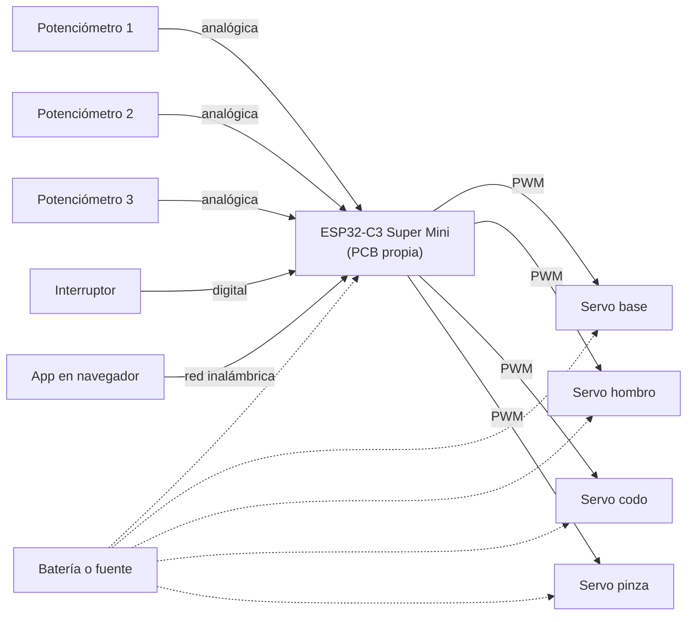
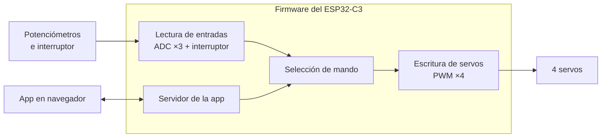
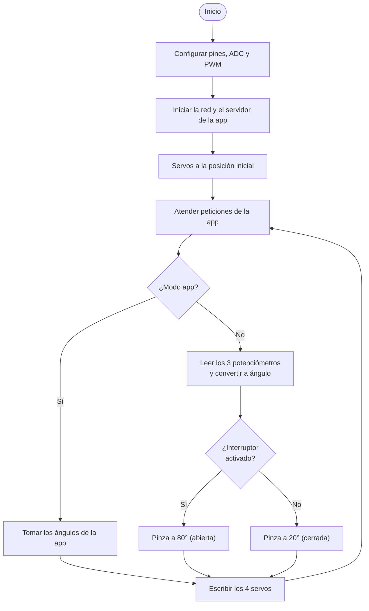

# Brazo cortado con láser

Brazo de **3 GDL más pinza**, cortado con láser en **MDF de 3 mm**. Es un **MeArm v1.0**, diseño de Benjamin Gray; el equipo lo ensambló en CAD, lo cortó, lo armó y le hizo su electrónica.

> **Cómo usar el visor 3D:** arrastra para girar, rueda del ratón (o pellizco) para acercar y clic derecho (o dos dedos) para desplazar. **Reiniciar vista** regresa a la vista inicial.

| Rúbrica | Entregable | Estado |
|:--|:---|:---|
| R1 | Planos de las piezas | ✅ 36 planos A4 + resumen |
| R2 | Render de cada pieza | ✅ 36 renders |
| R3 | Ensamble en CAD | ✅ STEP y captura de Inventor |
| R4 | Render del ensamble | ✅ 3 vistas |
| R5 | Visor 3D en la página | ✅ |
| R6 | Proceso de fabricación | ⏳ faltan parámetros, fotos y video |
| R7 | Ensamble físico | ⏳ faltan fotos |
| R8 | Prueba tomando un objeto | ⏳ falta video |

La tabla R1–R8 resume los entregables de diseño mecánico. El avance contra los **31 criterios de la rúbrica resumida del curso** está en la [autoevaluación]({{ '/brazos/evaluacion/' | relative_url }}); cada sección de esta página indica entre paréntesis qué criterio cubre (B##).

---

## 1) Descripción general

| Dato | Valor |
|:-----|:------|
| Grados de libertad | **3 GDL + pinza** (base, hombro, codo y apertura de pinza) |
| Material | **MDF de 3 mm** |
| Piezas cortadas | **36** (26 en la hoja A, 10 en la hoja B) |
| Hojas de corte | 2 de **150 × 200 mm** |
| Volumen de MDF | **94.8 cm³** sumando las 36 piezas |
| Actuadores | **4 servos SG90** |
| Control | PCB propia con **ESP32-C3 Super Mini** |
| Envolvente del ensamble CAD | 264.1 × 95.2 × 156.8 mm en la pose exportada |
| Medidas del brazo armado | **[Pendiente]** <!-- PENDIENTE: medir el brazo físico. La envolvente de arriba es la del modelo de GrabCAD, que no coincide del todo con lo cortado (sección 5). --> |
| Foto del brazo armado | **[Pendiente]** <!-- PENDIENTE: foto en assets/img/brazos/laser/ --> |

---

## 2) Arquitectura

| Articulación | Actuador | Mecanismo | Control manual |
|:-------------|:---------|:----------|:---------------|
| **Base** (giro) | Servo SG90 | Plato giratorio sobre la base | Potenciómetro |
| **Hombro** | Servo SG90 | Eslabón accionado desde la base | Potenciómetro |
| **Codo** | Servo SG90 | Eslabón accionado desde la base | Potenciómetro |
| **Pinza** | Servo SG90 | Mordazas accionadas por eslabones | Interruptor |

El MeArm resuelve el hombro y el codo con **eslabones en paralelogramo**: los dos servos van montados abajo, en la base, y mueven el brazo a distancia. Eso mantiene la **orientación de la pinza constante** sin importar la posición del brazo, y evita cargar los eslabones con el peso de los servos.

<!-- PENDIENTE: confirmar contra el brazo físico qué servo mueve qué articulación y con qué rango angular útil. El dato del paralelogramo viene del diseño del MeArm, no de una medición propia. -->

---

## 3) Origen del diseño y créditos

Este brazo **no es un diseño original del equipo**.

| Dato | Valor |
|:-----|:------|
| Diseño | **MeArm v1.0** |
| Autor | **Benjamin Gray** (Mime Industries) |
| Licencia declarada | **CC BY 4.0**, según la página del autor en Hackster [[3](#referencias)] |
| Archivos usados | Descargados de **GrabCAD**, "MeArm v1.0 robot arm" [[2](#referencias)] |
| Quién los subió a GrabCAD y bajo qué licencia | **[Pendiente]** <!-- PENDIENTE (L3): esa página de GrabCAD bloquea la lectura automática. Hay que abrirla y anotar el uploader y la licencia declarada. Hasta entonces los .SLDPRT no se republican aquí: solo se enlaza a GrabCAD. --> |
| Material del diseño original | Acrílico de 3 mm (el autor indica que admite madera) |
| Material que usó el equipo | **MDF de 3 mm** |

**Lo que aportó el equipo:** el ensamble en Autodesk Inventor 2026, el corte en MDF, el armado físico, la PCB con ESP32-C3 con su app de control, y las pruebas.

---

## 4) Piezas, planos y renders (R1 y R2)

Los contornos salen de **las dos hojas DXF**, que es lo que realmente se cortó, no del modelo 3D (ver la sección 5). Cada pieza se extruyó a 3 mm para su render, y su plano se dibuja a escala normalizada.

**Descargas:**

- [Plano completo, 38 páginas (PDF)]({{ '/assets/brazos/laser/planos/planos-mearm-completo.pdf' | relative_url }}) — las dos hojas numeradas más un A4 por pieza
- [Hoja A de corte (DXF)]({{ '/assets/brazos/laser/corte/mearm-hoja-a.dxf' | relative_url }}) · [Hoja B de corte (DXF)]({{ '/assets/brazos/laser/corte/mearm-hoja-b.dxf' | relative_url }}) — sin modificar, tal como se mandaron a la máquina

### Hojas numeradas

**Figura 1:** Hoja A, 26 piezas. Haz clic para verla a tamaño completo.

**Figura 2:** Hoja B, 10 piezas.

### Tabla de piezas

Las medidas son de la caja envolvente del contorno; el espesor es 3 mm en todas. La columna de nombre solo se llena cuando la pieza cortada coincide con una placa del modelo CAD dentro de 2 mm: **11 de 36**. Un guion significa que el modelo de GrabCAD no tiene equivalente cercano.

| Render | Pieza | Nombre en el modelo CAD | Medidas (mm) | Agujeros | Volumen (cm³) | Archivos |
|:------:|:------|:------------------------|:-------------|---------:|--------------:|:---------|
|  | **A-01** | — | 2.64 × 2.66 | 0 | 0.02 | [DXF]({{ '/assets/brazos/laser/piezas-dxf/A-01.dxf' | relative_url }}) · [Plano]({{ '/assets/brazos/laser/planos/A-01.pdf' | relative_url }}) |
|  | **A-02** | — | 3.00 × 3.00 | 0 | 0.02 | [DXF]({{ '/assets/brazos/laser/piezas-dxf/A-02.dxf' | relative_url }}) · [Plano]({{ '/assets/brazos/laser/planos/A-02.pdf' | relative_url }}) |
|  | **A-03** | — | 5.40 × 3.14 | 0 | 0.05 | [DXF]({{ '/assets/brazos/laser/piezas-dxf/A-03.dxf' | relative_url }}) · [Plano]({{ '/assets/brazos/laser/planos/A-03.pdf' | relative_url }}) |
|  | **A-04** | — | 3.00 × 3.00 | 0 | 0.02 | [DXF]({{ '/assets/brazos/laser/piezas-dxf/A-04.dxf' | relative_url }}) · [Plano]({{ '/assets/brazos/laser/planos/A-04.pdf' | relative_url }}) |
|  | **A-05** | Part 14-1 | 49.80 × 29.76 | 3 | 1.92 | [DXF]({{ '/assets/brazos/laser/piezas-dxf/A-05.dxf' | relative_url }}) · [Plano]({{ '/assets/brazos/laser/planos/A-05.pdf' | relative_url }}) |
|  | **A-06** | Part 25 - Left Hand Central lever-1 | 90.00 × 12.00 | 3 | 2.28 | [DXF]({{ '/assets/brazos/laser/piezas-dxf/A-06.dxf' | relative_url }}) · [Plano]({{ '/assets/brazos/laser/planos/A-06.pdf' | relative_url }}) |
|  | **A-07** | — | 26.08 × 15.02 | 2 | 0.91 | [DXF]({{ '/assets/brazos/laser/piezas-dxf/A-07.dxf' | relative_url }}) · [Plano]({{ '/assets/brazos/laser/planos/A-07.pdf' | relative_url }}) |
|  | **A-08** | — | 47.84 × 21.58 | 1 | 1.39 | [DXF]({{ '/assets/brazos/laser/piezas-dxf/A-08.dxf' | relative_url }}) · [Plano]({{ '/assets/brazos/laser/planos/A-08.pdf' | relative_url }}) |
|  | **A-09** | — | 47.40 × 20.72 | 2 | 1.36 | [DXF]({{ '/assets/brazos/laser/piezas-dxf/A-09.dxf' | relative_url }}) · [Plano]({{ '/assets/brazos/laser/planos/A-09.pdf' | relative_url }}) |
|  | **A-10** | — | 103.38 × 15.70 | 7 | 3.25 | [DXF]({{ '/assets/brazos/laser/piezas-dxf/A-10.dxf' | relative_url }}) · [Plano]({{ '/assets/brazos/laser/planos/A-10.pdf' | relative_url }}) |
|  | **A-11** | — | 35.26 × 9.54 | 1 | 0.78 | [DXF]({{ '/assets/brazos/laser/piezas-dxf/A-11.dxf' | relative_url }}) · [Plano]({{ '/assets/brazos/laser/planos/A-11.pdf' | relative_url }}) |
|  | **A-12** | — | 8.00 × 3.00 | 0 | 0.07 | [DXF]({{ '/assets/brazos/laser/piezas-dxf/A-12.dxf' | relative_url }}) · [Plano]({{ '/assets/brazos/laser/planos/A-12.pdf' | relative_url }}) |
|  | **A-13** | — | 8.42 × 24.02 | 1 | 0.37 | [DXF]({{ '/assets/brazos/laser/piezas-dxf/A-13.dxf' | relative_url }}) · [Plano]({{ '/assets/brazos/laser/planos/A-13.pdf' | relative_url }}) |
|  | **A-14** | Part 22-2 | 25.68 × 25.44 | 2 | 0.77 | [DXF]({{ '/assets/brazos/laser/piezas-dxf/A-14.dxf' | relative_url }}) · [Plano]({{ '/assets/brazos/laser/planos/A-14.pdf' | relative_url }}) |
|  | **A-15** | — | 50.96 × 51.70 | 4 | 6.64 | [DXF]({{ '/assets/brazos/laser/piezas-dxf/A-15.dxf' | relative_url }}) · [Plano]({{ '/assets/brazos/laser/planos/A-15.pdf' | relative_url }}) |
|  | **A-16** | Part 10 - the Pig-1 | 54.20 × 34.60 | 1 | 3.06 | [DXF]({{ '/assets/brazos/laser/piezas-dxf/A-16.dxf' | relative_url }}) · [Plano]({{ '/assets/brazos/laser/planos/A-16.pdf' | relative_url }}) |
|  | **A-17** | — | 8.00 × 3.00 | 0 | 0.07 | [DXF]({{ '/assets/brazos/laser/piezas-dxf/A-17.dxf' | relative_url }}) · [Plano]({{ '/assets/brazos/laser/planos/A-17.pdf' | relative_url }}) |
|  | **A-18** | — | 31.40 × 24.80 | 3 | 1.37 | [DXF]({{ '/assets/brazos/laser/piezas-dxf/A-18.dxf' | relative_url }}) · [Plano]({{ '/assets/brazos/laser/planos/A-18.pdf' | relative_url }}) |
|  | **A-19** | — | 50.70 × 25.04 | 7 | 2.38 | [DXF]({{ '/assets/brazos/laser/piezas-dxf/A-19.dxf' | relative_url }}) · [Plano]({{ '/assets/brazos/laser/planos/A-19.pdf' | relative_url }}) |
|  | **A-20** | — | 12.00 × 56.90 | 4 | 1.20 | [DXF]({{ '/assets/brazos/laser/piezas-dxf/A-20.dxf' | relative_url }}) · [Plano]({{ '/assets/brazos/laser/planos/A-20.pdf' | relative_url }}) |
|  | **A-21** | — | 39.64 × 25.80 | 4 | 2.03 | [DXF]({{ '/assets/brazos/laser/piezas-dxf/A-21.dxf' | relative_url }}) · [Plano]({{ '/assets/brazos/laser/planos/A-21.pdf' | relative_url }}) |
|  | **A-22** | — | 35.04 × 29.74 | 4 | 1.61 | [DXF]({{ '/assets/brazos/laser/piezas-dxf/A-22.dxf' | relative_url }}) · [Plano]({{ '/assets/brazos/laser/planos/A-22.pdf' | relative_url }}) |
|  | **A-23** | Part 12 - Cradle Ends-1 | 19.00 × 51.70 | 1 | 2.21 | [DXF]({{ '/assets/brazos/laser/piezas-dxf/A-23.dxf' | relative_url }}) · [Plano]({{ '/assets/brazos/laser/planos/A-23.pdf' | relative_url }}) |
|  | **A-24** | Part 12 - Cradle Ends-2 | 19.00 × 51.70 | 3 | 2.43 | [DXF]({{ '/assets/brazos/laser/piezas-dxf/A-24.dxf' | relative_url }}) · [Plano]({{ '/assets/brazos/laser/planos/A-24.pdf' | relative_url }}) |
|  | **A-25** | — | 39.64 × 25.80 | 4 | 2.03 | [DXF]({{ '/assets/brazos/laser/piezas-dxf/A-25.dxf' | relative_url }}) · [Plano]({{ '/assets/brazos/laser/planos/A-25.pdf' | relative_url }}) |
|  | **A-26** | — | 36.60 × 24.98 | 5 | 1.33 | [DXF]({{ '/assets/brazos/laser/piezas-dxf/A-26.dxf' | relative_url }}) · [Plano]({{ '/assets/brazos/laser/planos/A-26.pdf' | relative_url }}) |
|  | **B-01** | — | 26.08 × 25.14 | 2 | 0.71 | [DXF]({{ '/assets/brazos/laser/piezas-dxf/B-01.dxf' | relative_url }}) · [Plano]({{ '/assets/brazos/laser/planos/B-01.pdf' | relative_url }}) |
|  | **B-02** | Part 20-2 | 32.76 × 25.14 | 4 | 1.17 | [DXF]({{ '/assets/brazos/laser/piezas-dxf/B-02.dxf' | relative_url }}) · [Plano]({{ '/assets/brazos/laser/planos/B-02.pdf' | relative_url }}) |
|  | **B-03** | — | 47.00 × 15.80 | 3 | 1.26 | [DXF]({{ '/assets/brazos/laser/piezas-dxf/B-03.dxf' | relative_url }}) · [Plano]({{ '/assets/brazos/laser/planos/B-03.pdf' | relative_url }}) |
|  | **B-04** | — | 90.70 × 145.00 | 9 | 28.99 | [DXF]({{ '/assets/brazos/laser/piezas-dxf/B-04.dxf' | relative_url }}) · [Plano]({{ '/assets/brazos/laser/planos/B-04.pdf' | relative_url }}) |
|  | **B-05** | Part 26 - Straight Lever-3 | 8.00 × 88.00 | 2 | 2.03 | [DXF]({{ '/assets/brazos/laser/piezas-dxf/B-05.dxf' | relative_url }}) · [Plano]({{ '/assets/brazos/laser/planos/B-05.pdf' | relative_url }}) |
|  | **B-06** | Part 26 - Straight Lever-2 | 8.00 × 88.00 | 2 | 2.03 | [DXF]({{ '/assets/brazos/laser/piezas-dxf/B-06.dxf' | relative_url }}) · [Plano]({{ '/assets/brazos/laser/planos/B-06.pdf' | relative_url }}) |
|  | **B-07** | Part 26 - Straight Lever-1 | 8.00 × 88.00 | 2 | 2.03 | [DXF]({{ '/assets/brazos/laser/piezas-dxf/B-07.dxf' | relative_url }}) · [Plano]({{ '/assets/brazos/laser/planos/B-07.pdf' | relative_url }}) |
|  | **B-08** | — | 15.80 × 93.90 | 5 | 3.21 | [DXF]({{ '/assets/brazos/laser/piezas-dxf/B-08.dxf' | relative_url }}) · [Plano]({{ '/assets/brazos/laser/planos/B-08.pdf' | relative_url }}) |
|  | **B-09** | — | 60.00 × 52.70 | 14 | 7.29 | [DXF]({{ '/assets/brazos/laser/piezas-dxf/B-09.dxf' | relative_url }}) · [Plano]({{ '/assets/brazos/laser/planos/B-09.pdf' | relative_url }}) |
|  | **B-10** | Part 05 - Rectangular Side Part-1 | 60.00 × 43.80 | 12 | 6.49 | [DXF]({{ '/assets/brazos/laser/piezas-dxf/B-10.dxf' | relative_url }}) · [Plano]({{ '/assets/brazos/laser/planos/B-10.pdf' | relative_url }}) |

### Cómo se generaron

Los planos y los renders se produjeron con scripts del repositorio, no a mano:

| Paso | Script |
|:-----|:-------|
| Separar los contornos de cada hoja | `tools/f3_piezas_dxf.py` |
| DXF, STL y render por pieza | `tools/f3_salidas_piezas.py` |
| Planos A4 y plano resumen | `tools/f3_planos.py` |

Dos decisiones que afectan la exactitud:

- Las curvas se aplanan con una **sagita de 0.02 mm** y los contornos se cierran redondeando a 0.02 mm. Eso está muy por debajo del ancho de corte del láser.
- En los DXF por pieza, los **agujeros redondos se escriben como círculos verdaderos**, no como polilíneas aplanadas, y con el diámetro nominal del diseño. Son archivos de corte: una circunferencia aplanada se cortaría poligonal.

---

## 5) Ensamble en CAD (R3)

El ensamble se armó en **Autodesk Inventor 2026** a partir de las piezas descargadas de GrabCAD y se exportó a STEP.

**Figura 3:** `Final Assembly.iam` en Inventor 2026, con el árbol de componentes visible.

| Dato del STEP | Valor |
|:--------------|:------|
| Cuerpos | 65 |
| Placas de 3.00 mm | 31 |
| Piezas distintas | 24 (`Part 04` ×5, `Part 26` ×3, `Part 12` ×2) |
| Servos | 4 × SG90 |
| Envolvente | 264.1 × 95.2 × 156.8 mm |

- [Descargar el ensamble (STEP, 4.8 MB)]({{ '/assets/brazos/laser/cad/mearm-mdf-ensamble.step' | relative_url }})
- Los archivos `.SLDPRT` de las piezas **no se republican aquí** mientras no se confirme su licencia en GrabCAD. Están en la fuente original [[2](#referencias)].

### Archivos editables y de fabricación (B07)

| Archivo | Para qué sirve | Estado |
|:--------|:---------------|:-------|
| Hojas DXF de corte (A y B) | Fabricación, tal como se mandaron a la máquina | ✅ [Sección 4](#4-piezas-planos-y-renders-r1-y-r2) |
| DXF por pieza (36) | Recortar o reponer una pieza suelta | ✅ [Tabla de piezas](#tabla-de-piezas) |
| STEP del ensamble | Intercambio entre programas CAD | ✅ Arriba |
| Planos en PDF | Verificación | ✅ [Plano completo]({{ '/assets/brazos/laser/planos/planos-mearm-completo.pdf' | relative_url }}) |
| Ensamble de Inventor (`Final Assembly.iam`) | Edición | **[Pendiente]** |
| Archivo del software de corte (LightBurn u otro) | Recortar con los mismos parámetros | **[Pendiente]** |

### ⚠️ El modelo 3D no es exactamente lo que se cortó

Se compararon las **31 placas de 3 mm del STEP** contra los **36 contornos de las hojas**, midiendo en planta con el rectángulo mínimo rotado y emparejando de forma óptima global:

| Diferencia máxima | Placas |
|:---|---:|
| ≤ 1.5 mm | 6 |
| 1.5 – 4 mm | 12 |
| > 4 mm | 13 |
| Contornos sin pareja | 5 (A-01, A-11, A-18, A-22, B-01) |

**Cómo leer la tabla:** el emparejamiento está obligado a asignar las 31 placas, así que una "pareja" de más de 4 mm quiere decir *no existe equivalente*, no que la pieza difiera en esa cantidad.

El caso más claro y verificable con un calibrador es **la base**: mide **145.00 × 95.00 mm en el STEP** y **145.00 × 90.70 mm en el contorno que se cortó** (pieza B-04). Son 4.3 mm.

> **Nota.** El ensamble 3D y los renders corresponden al **modelo de GrabCAD**. Los planos y los renders por pieza corresponden a **las piezas que se cortaron**. No son el mismo conjunto de geometría.

**Hipótesis** (sin confirmar): los `.SLDPRT` de GrabCAD son una variante del MeArm distinta de las hojas DXF v1.0.

---

## 6) Renderizado del ensamble (R4)

**Figura 4:** Vista isométrica. MDF en color madera, servos SG90 en azul.

**Figura 5:** Vista lateral. Se aprecian los eslabones en paralelogramo del hombro y el codo.

**Figura 6:** Vista superior, con la pinza y su sector dentado.

---

## 7) Visor 3D (R5)

**Figura 7:** Ensamble interactivo. Usa **Separar piezas** para apartar los servos de la estructura.

Las 31 placas van en una sola malla y cada servo por separado, para que la leyenda sea legible y la separación muestre dónde se montan los actuadores. Las coordenadas son las del ensamble CAD, no aproximadas: la reconstrucción devuelve la envolvente exacta de 264.08 × 95.20 × 156.81 mm.

---

## 8) Fabricación: corte láser (R6)

| Dato | Valor |
|:-----|:------|
| Material | MDF de **3 mm** |
| Hojas | 2 de 150 × 200 mm |
| Diámetros de agujero | **Ø2.65 mm** y **Ø3.0 mm** |
| Cortadora | **[Pendiente]** <!-- PENDIENTE: marca, modelo y área de trabajo. --> |
| Software | **[Pendiente]** <!-- PENDIENTE: LightBurn, RDWorks u otro, con versión. --> |
| Potencia | **[Pendiente]** <!-- PENDIENTE: % de potencia. --> |
| Velocidad | **[Pendiente]** <!-- PENDIENTE: mm/s. --> |
| Pasadas | **[Pendiente]** <!-- PENDIENTE: número de pasadas. --> |
| Kerf medido y compensación | **[Pendiente]** <!-- PENDIENTE: importante porque el MeArm usa uniones a presión y ejes de 3 mm. --> |
| ¿Se cortaron los DXF sin modificar? | **[Pendiente]** <!-- PENDIENTE: confirmar que se mandaron las hojas tal cual, sin reescalar ni compensar en el software de la máquina. --> |

> **Cambio de material respecto al diseño original.** El MeArm v1.0 está pensado para **acrílico de 3 mm** y aquí se cortó **MDF de 3 mm**. El MDF es más blando y más tolerante al apriete, pero se desgasta en los agujeros que giran; conviene revisar el juego en los pivotes después de las pruebas.

### Registro de corte por hoja (B09)

| Hoja | Piezas | Tiempo de corte | Resultado | Ajustes o recortes |
|:-----|:------:|:----------------|:----------|:-------------------|
| A | 26 | **[Pendiente]** | **[Pendiente]** | **[Pendiente]** |
| B | 10 | **[Pendiente]** | **[Pendiente]** | **[Pendiente]** |



---

## 9) Secuencia de ensamblaje (B10)

El armado sigue la **guía oficial de 13 pasos** del autor del MeArm [[3](#referencias)]. No se reproduce aquí para no republicar contenido ajeno; la tabla relaciona cada etapa con las piezas cortadas de este sitio.

| Etapa | Qué se arma | Piezas cortadas que intervienen |
|:------|:------------|:--------------------------------|
| 1. Base | Placa base y laterales donde se alojan los servos | B-04 (base), B-10 (lateral) y piezas por confirmar |
| 2. Servos de la base | Servo de giro y plato giratorio | **[Pendiente]** |
| 3. Hombro y codo | Servos de hombro y codo, y los eslabones del paralelogramo | A-06, B-05, B-06, B-07 y piezas por confirmar |
| 4. Antebrazo | Eslabones que llevan la pinza | **[Pendiente]** |
| 5. Pinza | Servo de la pinza y mordazas | **[Pendiente]** |

> **Para completar la tabla:** solo 11 de las 36 piezas cortadas tienen nombre identificado contra el modelo CAD (ver la [tabla de piezas](#tabla-de-piezas)). Al armar, conviene anotar el número de cada pieza (A-01 a B-10) en el paso de la guía donde se usa.

> **Antes de montar cada cuerno de servo:** llevar el servo a **90°**, igual que en el brazo impreso, para que cada articulación quede centrada en su recorrido.



---

## 10) Ensamble físico (B11, R7)



---

## 11) Pruebas mecánicas (B12)

| Prueba | Qué se mide | Resultado | Ajuste realizado |
|:-------|:------------|:----------|:-----------------|
| Giro de la base | Rango útil (°) | **[Pendiente]** | **[Pendiente]** |
| Hombro | Rango útil (°) antes de que el paralelogramo se trabe | **[Pendiente]** | **[Pendiente]** |
| Codo | Rango útil (°) antes de que el paralelogramo se trabe | **[Pendiente]** | **[Pendiente]** |
| Orientación de la pinza | Si se mantiene horizontal en todo el recorrido | **[Pendiente]** | **[Pendiente]** |
| Apertura de la pinza | Apertura máxima (mm) y ángulos de servo que la producen | **[Pendiente]** | **[Pendiente]** (los 20° y 80° son provisionales) |
| Juego en los pivotes | Holgura en los agujeros de MDF | **[Pendiente]** | **[Pendiente]** |
| Uniones a presión | Si las ranuras ajustan con el kerf real | **[Pendiente]** | **[Pendiente]** |



---

## 12) Lista de materiales (B06, B14)

### Mecánica

| Componente | Material o modelo | Medidas | Cantidad | Adquisición |
|:-----------|:------------------|:--------|:--------:|:------------|
| Piezas cortadas A-01 a B-10 | MDF de 3 mm | Ver la [tabla de piezas](#tabla-de-piezas) | 36 | Fabricadas por el equipo |
| Hoja de MDF | MDF de 3 mm | 150 × 200 mm | 2 | **[Pendiente]** (proveedor y precio) |
| Servo SG90 | Micro servo 9 g | 23 × 12 × 29 mm aprox. | 4 | **[Pendiente]** |
| Tornillos M3 | **[Pendiente]** (longitudes) | M3 | **[Pendiente]** | **[Pendiente]** |
| Tuercas M3 | **[Pendiente]** | M3 | **[Pendiente]** | **[Pendiente]** |

### Electrónica

| Componente | Valor o número de parte | Cantidad | Adquisición |
|:-----------|:------------------------|:--------:|:------------|
| ESP32-C3 Super Mini | ESP32-C3 | 1 | **[Pendiente]** |
| PCB propia | Diseño del equipo | 1 | **[Pendiente]** (dónde se fabricó) |
| Servo SG90 | SG90 | 4 | **[Pendiente]** |
| Potenciómetro | **[Pendiente]** (valor en kΩ) | 3 | **[Pendiente]** |
| Interruptor | **[Pendiente]** (tipo) | 1 | **[Pendiente]** |
| Conectores para servos | **[Pendiente]** | 4 | **[Pendiente]** |
| Capacitor de desacople | **[Pendiente]** (si lleva) | **[Pendiente]** | **[Pendiente]** |
| Batería o fuente | **[Pendiente]** | 1 | **[Pendiente]** |

---

## 13) Electrónica (B13, B15–B18)

### Diagrama de bloques (B13)

**Figura 8:** Diagrama de bloques del brazo de láser. La alimentación va punteada porque falta documentar cómo se reparte la corriente entre el ESP32-C3 y los servos.

| Elemento | Valor |
|:---------|:------|
| Controlador | **PCB propia** con **ESP32-C3 Super Mini** |
| Actuadores | **4 servos SG90** |
| Control manual | **3 potenciómetros** (uno por servo de movimiento) y **1 interruptor** para la pinza |
| Control remoto | **App servida por el propio ESP32-C3** |
| Alimentación | Batería o fuente de laboratorio |
| Pinout | **[Pendiente]** <!-- PENDIENTE: qué GPIO del ESP32-C3 va a cada servo, a cada potenciómetro y al interruptor. --> |
| Alimentación de los servos | **[Pendiente]** <!-- PENDIENTE: 4 SG90 en movimiento simultáneo pueden pedir picos de varios amperes. Documentar de dónde sale esa corriente y si hay capacitor de desacople. --> |

> **Niveles de voltaje.** El ESP32-C3 trabaja a **3.3 V** y su ADC no admite 5 V: los potenciómetros deben ir alimentados a 3.3 V. La señal PWM de 3.3 V suele bastar para un SG90 alimentado a 5 V, siempre que las **tierras** estén unidas.

### Mapeo de los controles

Cada uno de los 4 servos tiene su propio control: los **3 servos de movimiento** se manejan con un potenciómetro cada uno, de forma proporcional, y el **servo de la pinza** con un interruptor de dos posiciones.

| Control | Tipo de señal | Actúa sobre |
|:--------|:--------------|:------------|
| Potenciómetro 1 | Analógica, proporcional | Servo de la **base** (giro) |
| Potenciómetro 2 | Analógica, proporcional | Servo del **hombro** |
| Potenciómetro 3 | Analógica, proporcional | Servo del **codo** |
| Interruptor | Digital, dos posiciones | Servo de la **pinza** |

El interruptor **no lleva el servo de la pinza de extremo a extremo de su recorrido**: alterna entre **dos ángulos fijos**, provisionalmente **20°** (cerrada) y **80°** (abierta). Eso evita que el SG90 quede empujando contra el tope mecánico de la mordaza, que es lo que lo calienta y le hace consumir corriente sin estar moviéndose.

> **Los valores 20° y 80° son provisionales**, no medidos sobre el brazo armado. Hay que ajustarlos a la apertura real que necesita la pelota de la prueba.

### Esquemático (B15)



### Diseño de la tarjeta y archivos de fabricación (B16)



### Manufactura y montaje electrónico (B17)



### Pruebas por bloques (B18)

| Bloque | Prueba | Resultado esperado | Resultado |
|:-------|:-------|:-------------------|:----------|
| Alimentación | Medir 5 V y 3.3 V en la PCB sin carga y con los servos | Dentro de ±5 % | **[Pendiente]** |
| Potenciómetros | Leer el ADC de extremo a extremo | De 0 a 4095 sin saltos | **[Pendiente]** |
| Interruptor | Leer el pin en las dos posiciones | 0 y 1 estables, sin rebotes | **[Pendiente]** |
| Cada servo | Llevarlo a 0°, 90° y 180° | Se mueve sin vibrar | **[Pendiente]** |
| Red inalámbrica | Conectarse a la app | La página carga | **[Pendiente]** |

---

## 14) Programación e interfaz (B19–B24)

### Arquitectura del software (B19)

**Figura 9:** Arquitectura del firmware. Todo corre en el ESP32-C3: lee los controles físicos, sirve la app y decide qué mando mueve los servos.

| Componente | Entradas | Procesamiento | Salidas |
|:-----------|:---------|:--------------|:--------|
| Lectura de entradas | 3 potenciómetros, 1 interruptor | Convierte la lectura del ADC en ángulo; el interruptor elige 20° u 80° | Ángulos objetivo |
| Servidor de la app | Peticiones del navegador | Recibe los ángulos que manda la app | Ángulos objetivo |
| Selección de mando | Ángulos de las dos fuentes | **[Pendiente]**: cómo se decide si manda el control manual o la app | Ángulo final por servo |
| Escritura de servos | Ángulo final | Genera el PWM | 4 señales de servo |

### Diagrama de flujo (B20)

**Figura 10:** Flujo del firmware del ESP32-C3.

> **Por verificar contra el código.** El diagrama sigue el comportamiento documentado (potenciómetros, interruptor de dos posiciones y app). La forma en que se elige entre el control manual y la app es una suposición: hay que corregirla cuando se publique el firmware.

### Interfaz y procedimiento de operación (B21)



**Procedimiento de operación:**

1. Conectar la batería o la fuente a la PCB.
2. **Modo manual:** girar cada potenciómetro para mover base, hombro y codo; usar el interruptor para abrir o cerrar la pinza.
3. **Modo app:** conectarse a la red **[pendiente: nombre de la red, contraseña o si el ESP32-C3 es punto de acceso]** y abrir **[pendiente: dirección IP]** en el navegador.
4. Para apagar: llevar el brazo a la posición de reposo y desconectar la alimentación.

### Librerías y dependencias (B22)

| Librería | Función | Versión |
|:---------|:--------|:--------|
| Núcleo de ESP32 para Arduino (si se usó Arduino IDE) | Soporte del ESP32-C3 | **[Pendiente]** |
| **[Pendiente]** | Control de servos | **[Pendiente]** |
| **[Pendiente]** | Red inalámbrica y servidor web | **[Pendiente]** |

### Organización en funciones (B23)

| Función | Qué hace |
|:--------|:---------|
| `setup()` | **[Pendiente]** |
| `loop()` | **[Pendiente]** |
| **[Pendiente]** | Lectura de potenciómetros |
| **[Pendiente]** | Atención de la app |
| **[Pendiente]** | Escritura de servos |

### Código fuente (B24)



---

## 15) Integración y pruebas (B25–B28, R8)

### Integración física (B25)



### Electrónica y software en el sistema real (B26)

| Entrada | Acción esperada | ¿Funciona? |
|:--------|:----------------|:-----------|
| Potenciómetro 1 | Gira la base | **[Pendiente]** |
| Potenciómetro 2 | Mueve el hombro | **[Pendiente]** |
| Potenciómetro 3 | Mueve el codo | **[Pendiente]** |
| Interruptor | Abre y cierra la pinza | **[Pendiente]** |
| Controles de la app | Mueven las mismas articulaciones | **[Pendiente]** |

### Modos de operación (B27)

| Modo | Cómo se accede | Evidencia |
|:-----|:---------------|:----------|
| Manual con potenciómetros e interruptor | Encender la PCB | **[Pendiente]** (video) |
| Remoto con la app | Conectarse a la red del ESP32-C3 y abrir la app | **[Pendiente]** (video) |

### Prueba funcional completa (B28)

Secuencia: **tomar la pelota roja de espuma, levantarla, girar la base y soltarla en otro punto.**

| Intento | Modo | ¿La tomó? | ¿La soltó donde debía? | Observación |
|:-------:|:-----|:---------:|:----------------------:|:------------|
| 1 | Manual | **[Pendiente]** | **[Pendiente]** | |
| 2 | Manual | **[Pendiente]** | **[Pendiente]** | |
| 3 | App | **[Pendiente]** | **[Pendiente]** | |



---

## Referencias

1. Página de referencia del curso: <https://hubergiron.github.io/cnc/diseno-mecanico-cnc/>
2. *MeArm v1.0 robot arm*, GrabCAD: <https://grabcad.com/library/675982>
3. Benjamin Gray, *MeArm Robot Arm — Your Robot V1.0* (guía de armado, CC BY 4.0), Hackster: <https://www.hackster.io/benbobgray/mearm-robot-arm-your-robot-v1-0-326702>

---

## Sección anterior

[Brazo impreso en 3D]({{ '/brazos/impresion-3d/' | relative_url }})

## Siguiente sección

[Comparación y conclusiones]({{ '/brazos/comparacion/' | relative_url }})
