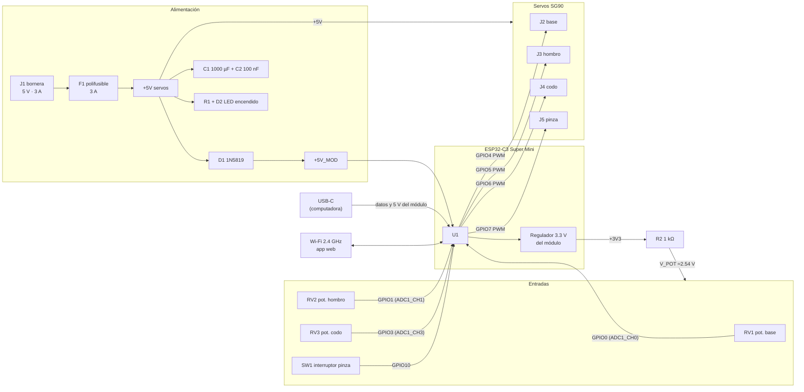
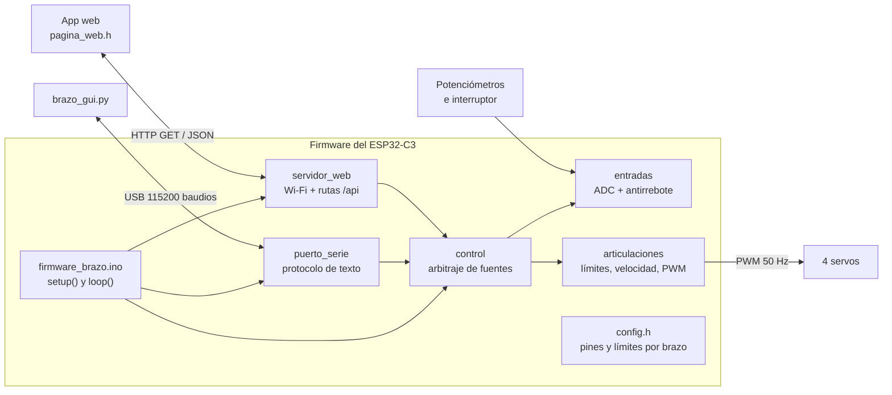
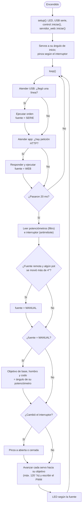

# Electrónica y programación

Los dos brazos usan **la misma tarjeta de control** y **el mismo firmware**. La tarjeta lleva un **ESP32-C3 Super Mini**, los conectores de los 4 servos, 3 potenciómetros, un interruptor y la entrada de alimentación. El firmware ofrece tres modos de mando (manual, app web y USB) y solo cambia una línea para pasar de un brazo al otro.

**Descargas:**

| Archivo | Contenido |
|:--------|:----------|
| [Proyecto de KiCad (.zip)]({{ '/assets/brazos/electronica/proyecto-kicad-tarjeta-brazo.zip' | relative_url }}) | Esquemático, PCB, símbolo y huella del ESP32-C3 Super Mini (KiCad 7) |
| [Esquemático (PDF)]({{ '/assets/brazos/electronica/fabricacion/esquematico.pdf' | relative_url }}) | Hoja A4 con bloques y notas de diseño |
| [Gerber y barrenos (.zip)]({{ '/assets/brazos/electronica/fabricacion/gerber-tarjeta-brazo.zip' | relative_url }}) | Listo para mandar a fabricar |
| [Capas de la PCB (PDF)]({{ '/assets/brazos/electronica/fabricacion/pcb-capas.pdf' | relative_url }}) | Cobre, serigrafía y contorno |
| [Posiciones de componentes (CSV)]({{ '/assets/brazos/electronica/fabricacion/posiciones.csv' | relative_url }}) | Referencia, valor, huella y coordenadas |
| [Firmware (.zip)]({{ '/assets/brazos/codigo/firmware_brazo.zip' | relative_url }}) | Sketch de Arduino para el ESP32-C3 |
| [brazo_gui.py (.zip)]({{ '/assets/brazos/codigo/brazo_gui.zip' | relative_url }}) | Interfaz de escritorio por USB |

---

## 1) Diagrama de bloques (B13)



**Figura 1:** Diagrama de bloques de la tarjeta. Los servos toman la corriente directo de la fuente; el ESP32-C3 se alimenta por el diodo D1 o por su propio USB.

### Asignación de pines

| GPIO | Función | Tipo | Conector | Nota |
|:----:|:--------|:-----|:---------|:-----|
| 4 | Servo de la base | PWM 50 Hz | J2 | LEDC, 14 bits |
| 5 | Servo del hombro | PWM 50 Hz | J3 | |
| 6 | Servo del codo | PWM 50 Hz | J4 | |
| 7 | Servo de la pinza | PWM 50 Hz | J5 | |
| 0 | Potenciómetro de la base | Analógica | RV1 | ADC1: funciona con el Wi-Fi encendido |
| 1 | Potenciómetro del hombro | Analógica | RV2 | |
| 3 | Potenciómetro del codo | Analógica | RV3 | |
| 10 | Interruptor de la pinza | Digital, pull-up | SW1 | Cerrado a GND = pinza abierta |
| 8 | LED de la placa | Digital | — | Indica el modo de mando |
| 2, 9 | Sin usar | — | — | Pines de arranque del ESP32-C3 |
| 20, 21 | Sin usar | — | — | UART0; quedan libres para depurar |

### Cálculos de diseño

| Punto | Cálculo | Resultado |
|:------|:--------|:----------|
| Corriente de los servos | 4 SG90 × ≈0.7 A al arrancar o bloquearse | ≈2.8 A de pico → fuente de **5 V, 3 A** |
| Protección | Polifusible MF-RG300: 3.0 A de mantenimiento, 5.1 A de disparo | Corta antes de dañar pistas o fuente |
| Alimentación del ESP32-C3 | 5 V − 0.45 V del 1N5819 a 0.35 A | ≈4.55 V a la entrada del regulador de 3.3 V del módulo |
| Retorno al USB | D1 bloquea el paso de +5V_MOD hacia +5V | La computadora no alimenta a los servos |
| Tope de los potenciómetros | 3.3 V × 3.33 kΩ / (1 kΩ + 3.33 kΩ), con los 3 pots de 10 kΩ en paralelo | **≈2.54 V**: dentro del rango útil del ADC del ESP32-C3 (0–2.5 V); 0.76 mA en total |
| Filtro del ADC | 10 kΩ (máx. 2.5 kΩ de Thévenin) × 100 nF | τ ≤ 0.25 ms: quita ruido sin retraso visible |
| LED de encendido | (5 V − 2.1 V) / 1 kΩ | ≈2.9 mA |
| Pistas de potencia | 1.2 mm, 35 µm de cobre, capa externa | ≈2.7 A continuos con 10 °C de aumento (IPC-2221); el pico de 2.8 A dura milisegundos y la tierra va por los planos |

---

## 2) Lista de materiales electrónicos (B14)

Una tarjeta controla un brazo. Precios de referencia en pesos mexicanos, de tiendas de electrónica en línea.

| Ref. | Componente | Valor o número de parte | Huella | Cant. | Precio ref. (MXN) |
|:-----|:-----------|:------------------------|:-------|:-----:|------------------:|
| U1 | Módulo ESP32-C3 Super Mini | ESP32-C3FH4, USB-C | 2 tiras hembra 1×8, 2.54 mm | 1 | 95 |
| J1 | Bornera de 2 polos | Phoenix MKDS 1,5/2, paso 5.00 mm | TerminalBlock_Phoenix | 1 | 10 |
| F1 | Polifusible | Bourns MF-RG300 (3 A) | Fuse_Bourns_MF-RG300 | 1 | 8 |
| D1 | Diodo Schottky | 1N5819 (40 V, 1 A) | DO-41 | 1 | 3 |
| C1 | Capacitor electrolítico | 1000 µF, 10 V | Radial D10 mm, P5 mm | 1 | 10 |
| C2–C5 | Capacitor cerámico | 100 nF, 50 V | Disco 5 mm, P5 mm | 4 | 8 |
| R1, R2 | Resistencia | 1 kΩ, ¼ W | Axial, P10.16 mm | 2 | 2 |
| D2 | LED | Verde, 3 mm | LED_D3.0mm | 1 | 2 |
| RV1–RV3 | Potenciómetro | 10 kΩ lineal (B10K), Alps RK09K | RK09K vertical | 3 | 45 |
| SW1 | Interruptor deslizable | 1 polo 2 tiros, C&K OS102011MS2Q | SW_Slide_SPDT | 1 | 8 |
| J2–J5 | Tira macho para servo | 1×3, 2.54 mm | PinHeader_1x03 | 4 | 8 |
| M1–M4 | Servomotor | SG90, 9 g | — | 4 | 180 |
| — | PCB de 2 capas | 90 × 66 mm, FR-4 1.6 mm | — | 1 | 60 |
| — | Fuente de alimentación | 5 V, 3 A con plug o cables | — | 1 | 150 |
| — | Cable USB-C | Datos | — | 1 | 50 |
| | | | | **Total** | **≈639** |

La misma lista sale del esquemático en formato XML: [bom.xml]({{ '/assets/brazos/electronica/fabricacion/bom.xml' | relative_url }}).

---

## 3) Esquemático (B15)

[]({{ '/assets/brazos/electronica/render/esquematico.png' | relative_url }})
**Figura 2:** Esquemático completo en KiCad 7. Haz clic para verlo a tamaño completo o descarga el [PDF]({{ '/assets/brazos/electronica/fabricacion/esquematico.pdf' | relative_url }}).

El esquemático tiene seis bloques: **alimentación** (J1, F1, D1, C1, C2, R1, D2), **microcontrolador** (U1), **servos** (J2–J5), **potenciómetros** (RV1–RV3 alimentados por R2, con su filtro C3–C5), **interruptor** (SW1) y **barrenos de montaje** (H1–H4). Las conexiones entre bloques se hacen con etiquetas de red.

**Verificación de conectividad.** La netlist que calcula KiCad a partir del esquemático se compara pin por pin con la lista de conexiones del diseño: **62 pines, 15 redes, 0 diferencias** ([reporte]({{ '/assets/brazos/electronica/fabricacion/verificacion-netlist.txt' | relative_url }}), [netlist]({{ '/assets/brazos/electronica/fabricacion/netlist.net' | relative_url }})).

**Biblioteca propia.** KiCad no trae el ESP32-C3 Super Mini, así que el proyecto incluye su símbolo (`brazo.kicad_sym`) y su huella (`brazo.pretty`): dos filas de 8 pines a 15.24 mm, con el número de GPIO en la serigrafía.

---

## 4) Diseño de la tarjeta y archivos de fabricación (B16)

<div class="pasos" style="grid-template-columns: repeat(auto-fill, minmax(300px, 1fr));">
  <figure>
    
    <figcaption><strong>Cara superior.</strong> ESP32-C3 arriba al centro con el USB-C al borde, servos a la derecha, potenciómetros abajo y alimentación a la izquierda.</figcaption>
  </figure>
  <figure>
    
    <figcaption><strong>Cara inferior</strong>, vista desde abajo. Plano de tierra en las dos caras.</figcaption>
  </figure>
</div>

**Figura 3:** Render de la tarjeta a partir de los Gerber (tracespace).

| Característica | Valor |
|:---------------|:------|
| Medidas | **90 × 66 mm**, esquinas redondeadas de 3 mm, 4 barrenos M3 |
| Capas | 2, cobre de 35 µm (1 oz), FR-4 de 1.6 mm |
| Componentes | 20, todos de inserción (THT) para soldar a mano |
| Pistas de potencia (VIN, +5V, +5V_MOD, GND) | **1.2 mm** |
| Pistas de señal | **0.4 mm** |
| Separación mínima | 0.25 mm |
| Plano de tierra | Cara superior e inferior, con alivio térmico en los pads |
| Ruteo | Freerouting 2.1, 100 % de las conexiones |
| Revisión de reglas (DRC) | **0 violaciones, 0 pads sin conectar** ([reporte]({{ '/assets/brazos/electronica/fabricacion/drc.rpt' | relative_url }})) |

**Archivos de fabricación** ([.zip]({{ '/assets/brazos/electronica/fabricacion/gerber-tarjeta-brazo.zip' | relative_url }})): cobre (`.gtl`, `.gbl`), máscara (`.gts`, `.gbs`), serigrafía (`.gto`, `.gbo`), pasta (`.gtp`, `.gbp`), contorno (`.gm1`), barrenos con y sin metalizar (`.drl`) y sus mapas en PDF. Se suben tal cual a cualquier fabricante de PCB con las opciones por defecto: 2 capas, 1.6 mm, HASL, máscara verde.

Todo el proyecto se genera con `tools/f7_tarjeta.py`: el script tiene una sola lista de componentes y conexiones, de la que salen el esquemático y la PCB, así que no pueden contradecirse.

```bash
python3 tools/f7_tarjeta.py esquematico   # esquemático y biblioteca
python3 tools/f7_tarjeta.py pcb           # coloca componentes y asigna redes
python3 tools/f7_tarjeta.py rutear        # Freerouting y planos de tierra
python3 tools/f7_tarjeta.py exportar      # verificación, DRC, PDF, Gerber y barrenos
```

---

## 5) Manufactura y montaje electrónico (B17)

### Fabricación de la PCB

1. Subir el `.zip` de Gerber al fabricante. Opciones: 2 capas, FR-4 1.6 mm, 1 oz, HASL, máscara verde, serigrafía blanca.
2. Revisar en el visor del fabricante que el contorno mida 90 × 66 mm y que los 4 barrenos M3 sean de 3.2 mm.

### Orden de soldadura

De menor a mayor altura, para que la tarjeta se apoye plana en cada paso:

| Paso | Componentes | Cuidado |
|:----:|:------------|:--------|
| 1 | R1, R2, D1 | D1: la franja (cátodo) va hacia el lado marcado **K** |
| 2 | C2–C5 | Sin polaridad |
| 3 | D2 | Pata larga (ánodo) hacia R1 |
| 4 | Tiras hembra 1×8 de U1 | Soldar con el módulo puesto para que queden alineadas |
| 5 | J2–J5, SW1 | Pin 1 de cada servo = GND (cable café) |
| 6 | F1, C1 | C1: la pata `+` al pad cuadrado |
| 7 | RV1–RV3 | También soldar las dos pestañas de sujeción |
| 8 | J1 | Entrada de los cables hacia el borde |

### Revisión antes de energizar

| Revisión | Cómo | Resultado esperado |
|:---------|:-----|:-------------------|
| Corto en la alimentación | Multímetro en continuidad entre +5V y GND, sin módulo | Sin continuidad (la lectura sube al cargarse C1) |
| Polaridad de C1 y D1 | Inspección visual | `+` de C1 en el pad cuadrado; franja de D1 hacia K |
| Puentes de soldadura | Lupa en las tiras de U1 | Sin estaño entre pines vecinos |
| Primer encendido | Fuente de laboratorio a 5 V con límite de 0.3 A, sin módulo ni servos | D2 enciende; consumo < 10 mA |

---

## 6) Pruebas por bloques (B18)

Cada bloque se prueba antes de conectar los servos al brazo. Las pruebas de programa corren con el firmware cargado.

| Bloque | Prueba | Criterio de aceptación |
|:-------|:-------|:-----------------------|
| Alimentación | Medir +5V y +5V_MOD con la fuente de 5 V | +5V entre 4.75 y 5.25 V; +5V_MOD 0.3–0.5 V abajo de +5V |
| Regulador del módulo | Medir +3V3 con U1 puesto | 3.25–3.35 V |
| Referencia de los potenciómetros | Medir V_POT (pata derecha de R2) | 2.45–2.65 V |
| Potenciómetros | Orden `E` por USB girando cada potenciómetro de tope a tope | Su articulación recorre todo su rango sin saltos |
| Interruptor | Orden `E` en las dos posiciones de SW1 | `"interruptor":true` y `false`; la pinza cambia una sola vez por movimiento |
| PWM de cada servo | Orden `J <art> 0`, `J <art> 90`, `J <art> 180` con un servo suelto | El servo va a cada posición sin vibrar; el ángulo se recorta a los límites del brazo |
| Cuatro servos a la vez | Orden `A 0 30 20 30` y luego `H` | El ESP32-C3 no se reinicia; +5V no baja de 4.5 V |
| Wi-Fi | Conectar el celular a la red del brazo y abrir `http://192.168.4.1` | La app carga y muestra el modo de mando |

### Pruebas automáticas del firmware

La lógica del firmware se prueba en la computadora: los mismos archivos `.cpp` se compilan con g++ contra un `Arduino.h` simulado, y un programa de prueba revisa 26 condiciones por brazo. Resultado actual:

| Grupo | Qué comprueba | Impreso | Láser |
|:------|:--------------|:-------:|:-----:|
| Arranque | Modo manual, ángulos de inicio, pinza según el interruptor, PWM inicial | 4 / 4 | 4 / 4 |
| Conversión a PWM | 0° = 500 µs = 410 de 16 383; 180° = 2400 µs = 1966 de 16 383 | 2 / 2 | 2 / 2 |
| Modo manual | Cada potenciómetro lleva su articulación a sus límites | 2 / 2 | 2 / 2 |
| Velocidad máxima | No avanza más de 12° en 100 ms (120 °/s) | 1 / 1 | 1 / 1 |
| Mando por USB | `J`, `A`, `P`, `H`, `E`, recorte de ángulos y errores | 11 / 11 | 11 / 11 |
| Regreso al manual | El ruido del ADC no quita el mando; girar un potenciómetro sí | 2 / 2 | 2 / 2 |
| Mando web | Una orden de la app toma el control | 1 / 1 | 1 / 1 |
| Interruptor | Un rebote de 20 ms se ignora; abrir y cerrar | 3 / 3 | 3 / 3 |
| **Total** | | **26 / 26** | **26 / 26** |

```bash
cd assets/brazos/codigo/pruebas
make            # compila y corre las pruebas de los dos brazos
```

---

## 7) Arquitectura del software (B19)

Hay tres programas: el **firmware** del ESP32-C3, la **app web** (una página que sirve el propio ESP32-C3) y **`brazo_gui.py`** en la computadora.



**Figura 4:** Módulos del firmware y su relación con las entradas, las interfaces y los servos.

| Componente | Entradas | Procesamiento | Salidas |
|:-----------|:---------|:--------------|:--------|
| `entradas` | 3 potenciómetros, interruptor | Filtro exponencial del ADC (α = 0.2), antirrebote de 30 ms, conversión a grados dentro de los límites | Ángulos de los potenciómetros, estado y cambios del interruptor |
| `control` | Entradas, órdenes de la app y del USB | Decide la fuente de mando: la última que dio una orden; girar un potenciómetro más de 4° devuelve el mando al modo manual | Ángulos objetivo |
| `articulaciones` | Ángulos objetivo | Recorta a los límites y avanza hacia el objetivo a 120 °/s como máximo | PWM de 50 Hz y 14 bits en GPIO4–7 |
| `puerto_serie` | Líneas de texto por USB | Interpreta `J`, `A`, `P`, `H`, `E`, `?` | Respuestas `OK` / `ERR` y estado en JSON |
| `servidor_web` | Peticiones HTTP | Punto de acceso Wi-Fi y rutas `/api/...` | Página de la app y estado en JSON |

### Protocolo por USB

Una orden por línea, a 115 200 baudios:

| Orden | Ejemplo | Efecto | Respuesta |
|:------|:--------|:-------|:----------|
| `J <art> <grados>` | `J hombro 120` | Mueve una articulación (0–3 o base, hombro, codo, pinza) | `OK` |
| `A <b> <h> <c> <p>` | `A 90 60 100 30` | Mueve las cuatro articulaciones | `OK` |
| `P A` / `P C` | `P C` | Abre o cierra la pinza | `OK` |
| `H` | `H` | Posición de inicio | `OK` |
| `E` | `E` | Estado | `OK {"brazo":"impreso","fuente":"serie",...}` |
| `?` | `?` | Ayuda | `OK ordenes: ...` |

### API de la app

| Ruta | Parámetros | Efecto |
|:-----|:-----------|:-------|
| `GET /` | — | Página de la app |
| `GET /api/estado` | — | Estado en JSON |
| `GET /api/mover` | `art`, `grados` | Mueve una articulación |
| `GET /api/pinza` | `accion=abrir` o `cerrar` | Abre o cierra la pinza |
| `GET /api/inicio` | — | Posición de inicio |

---

## 8) Diagrama de flujo (B20)



**Figura 5:** Flujo del firmware. El ciclo de control corre cada 20 ms, igual que el periodo del PWM de los servos; el USB y la app se atienden en cada vuelta de `loop()`.

---

## 9) Interfaz y procedimiento de operación (B21)

### Modos de mando

| Modo | Cómo se usa | LED de la placa |
|:-----|:------------|:----------------|
| **Manual** | Girar RV1 (base), RV2 (hombro), RV3 (codo); SW1 abre y cierra la pinza | Encendido fijo |
| **App web** | Conectarse a la red del brazo y abrir la app | Parpadeo lento (1 Hz) |
| **USB** | Ejecutar `brazo_gui.py` con el brazo conectado | Parpadeo rápido (4 Hz) |

El brazo arranca en modo manual. Una orden de la app o del USB toma el mando; girar cualquier potenciómetro lo regresa al modo manual. El interruptor de la pinza funciona en cualquier modo.

### Datos de acceso

| Dato | Brazo impreso | Brazo de láser |
|:-----|:--------------|:---------------|
| Red Wi-Fi | `Brazo-Impreso` | `Brazo-Laser` |
| Contraseña | `brazo2026` | `brazo2026` |
| Dirección de la app | `http://192.168.4.1` | `http://192.168.4.1` |
| Puerto USB | `COM#` en Windows, `/dev/ttyACM0` en Linux, `/dev/cu.usbmodem*` en macOS | Igual |
| Velocidad | 115 200 baudios | 115 200 baudios |

### App web

<div class="pasos" style="grid-template-columns: repeat(auto-fill, minmax(260px, 1fr));">
  <figure>
    
    <figcaption><strong>App web</strong> en un celular. Deslizadores de base, hombro y codo con sus límites; botones de pinza e inicio; el encabezado muestra qué fuente tiene el mando.</figcaption>
  </figure>
  <figure>
    
    <figcaption><strong><code>brazo_gui.py</code></strong>: selección del puerto, deslizadores, botones de pinza e inicio, y el modo de mando actual.</figcaption>
  </figure>
</div>

**Figura 6:** Las dos interfaces, capturadas mientras controlaban el firmware compilado para la computadora (`pruebas/simulador`), que habla el mismo protocolo que el ESP32-C3.

### Procedimiento de operación

1. **Conectar:** los 4 servos a J2–J5 (cable café al pin G) y la fuente de 5 V, 3 A a J1. D2 enciende.
2. **Arranque:** los servos van a su ángulo de inicio y el LED de la placa queda fijo (modo manual).
3. **Modo manual:** girar los potenciómetros y usar el interruptor.
4. **Modo app:** en el celular, conectarse a la red del brazo con la contraseña y abrir `http://192.168.4.1`.
5. **Modo USB:** conectar el USB-C a la computadora y ejecutar `python brazo_gui.py`; elegir el puerto y oprimir **Conectar**.
6. **Apagar:** oprimir **Inicio** (app o GUI) para dejar el brazo en reposo y desconectar la fuente.

---

## 10) Librerías y dependencias (B22)

| Programa | Librería o herramienta | Función | Versión |
|:---------|:-----------------------|:--------|:--------|
| Firmware | Núcleo **esp32** de Espressif para Arduino | Soporte del ESP32-C3, PWM por LEDC, ADC calibrado | 3.3.12 |
| Firmware | `WiFi` (incluida en el núcleo) | Punto de acceso Wi-Fi | 3.3.12 |
| Firmware | `WebServer` (incluida en el núcleo) | Servidor HTTP de la app | 3.3.12 |
| Firmware | Arduino IDE o arduino-cli | Compilar y cargar | IDE 2.x · arduino-cli 1.3.1 |
| `brazo_gui.py` | Python | Lenguaje | 3.8 o mayor (probado en 3.12) |
| `brazo_gui.py` | `pyserial` | Comunicación por USB | 3.5 |
| `brazo_gui.py` | `tkinter` (incluida en Python) | Interfaz gráfica | Tk 8.6 |
| App web | HTML, CSS y JavaScript sin librerías | Interfaz en el navegador | — |
| Pruebas | g++ y make | Pruebas del firmware en la computadora | C++17 |
| Tarjeta | KiCad | Esquemático y PCB | 7.0 |

El firmware **no necesita librerías externas**: los servos se manejan directo con el periférico LEDC del ESP32-C3.

---

## 11) Organización en funciones (B23)

| Archivo | Función | Qué hace |
|:--------|:--------|:---------|
| `firmware_brazo.ino` | `setup()` | Inicia el LED, el USB, el control y el servidor web |
| | `loop()` | Atiende USB y app en cada vuelta; cada 20 ms corre `control::ciclo()` y actualiza el LED |
| | `actualizarLed()` | Fijo, lento o rápido según la fuente de mando |
| `config.h` | — | Pines, límites de cada articulación, ángulos de la pinza, red Wi-Fi y constantes de tiempo; elige el brazo con `BRAZO` |
| `control.cpp` | `iniciar()` | Inicia entradas y servos; pone la pinza según el interruptor |
| | `ciclo(dt)` | Lee entradas, decide la fuente, aplica el interruptor y mueve los servos |
| | `mover()`, `pinza()`, `inicio()` | Órdenes de la app y del USB; toman el mando |
| | `estadoJson()` | Estado completo para la app, la GUI y las pruebas |
| `articulaciones.cpp` | `iniciar()` | Configura el LEDC a 50 Hz y 14 bits en GPIO4–7 |
| | `fijarObjetivo()`, `limitar()` | Recorta el ángulo pedido al rango de la articulación |
| | `actualizar(dt)` | Avanza hacia el objetivo a 120 °/s como máximo |
| | `gradosADuty()` | 0–180° → pulso de 500–2400 µs → ciclo de trabajo |
| `entradas.cpp` | `leer()` | Filtro exponencial del ADC y antirrebote del interruptor |
| | `anguloPot()` | Lectura en mV → ángulo dentro de los límites |
| | `interruptorCambio()` | Avisa una sola vez por cada cambio |
| `puerto_serie.cpp` | `atender()`, `ejecutar()` | Junta caracteres en líneas e interpreta las órdenes |
| `servidor_web.cpp` | `iniciar()`, `atender()` | Crea la red Wi-Fi y registra las rutas `/api/...` |
| `pagina_web.h` | — | HTML, CSS y JavaScript de la app, guardados en flash |
| `brazo_gui.py` | `EnlaceSerie` | Puerto serie en un hilo aparte para no congelar la ventana |
| | `Aplicacion` | Ventana, deslizadores y botones; pide el estado cada 500 ms |

---

## 12) Código fuente (B24)

| Archivo | Descarga |
|:--------|:---------|
| Firmware completo | [firmware_brazo.zip]({{ '/assets/brazos/codigo/firmware_brazo.zip' | relative_url }}) |
| `brazo_gui.py` y `requirements.txt` | [brazo_gui.zip]({{ '/assets/brazos/codigo/brazo_gui.zip' | relative_url }}) |
| Pruebas y simulador | [carpeta `pruebas/`](https://github.com/sebastiux/portafolio-just-the-docs/tree/main/assets/brazos/codigo/pruebas) |
| Todo el código | [carpeta `assets/brazos/codigo/`](https://github.com/sebastiux/portafolio-just-the-docs/tree/main/assets/brazos/codigo) |

### Compilar y cargar el firmware

1. Instalar el **Arduino IDE 2** y, en el gestor de tarjetas, el núcleo **esp32** de Espressif (3.3.x).
2. Abrir `firmware_brazo/firmware_brazo.ino`.
3. En `config.h`, elegir el brazo: `#define BRAZO BRAZO_IMPRESO` o `BRAZO_LASER`.
4. Tarjeta: **ESP32C3 Dev Module**; opción **USB CDC On Boot: Enabled**.
5. Conectar el ESP32-C3 por USB-C, elegir su puerto y **Subir**. Si no entra en modo de carga, mantener **BOOT**, presionar **RESET** y soltar **BOOT**.

Con arduino-cli:

```bash
arduino-cli compile --fqbn esp32:esp32:esp32c3:CDCOnBoot=cdc \
  --build-property "compiler.cpp.extra_flags=-DBRAZO=BRAZO_LASER" firmware_brazo
arduino-cli upload -p /dev/ttyACM0 --fqbn esp32:esp32:esp32c3:CDCOnBoot=cdc firmware_brazo
```

| Compilación | Flash | RAM |
|:------------|------:|----:|
| Brazo impreso | 1 033 447 bytes (78 %) | 38 328 bytes (11 %) |
| Brazo de láser | 1 033 439 bytes (78 %) | 38 328 bytes (11 %) |

Las dos versiones compilan sin advertencias con el núcleo esp32 3.3.12 y `--warnings all`.

### Ejecutar la interfaz de escritorio

```bash
pip install -r requirements.txt
python brazo_gui.py                 # elegir el puerto en la ventana
python brazo_gui.py --puerto COM5   # o indicarlo
```

### Probar sin el brazo

```bash
cd pruebas
make simulador && ./simulador       # imprime el puerto virtual, por ejemplo /dev/pts/3
python ../gui/brazo_gui.py --puerto /dev/pts/3
```

---

## Sección anterior

[Brazo cortado con láser]({{ '/brazos/corte-laser/' | relative_url }})

## Siguiente sección

[Comparación y conclusiones]({{ '/brazos/comparacion/' | relative_url }})
