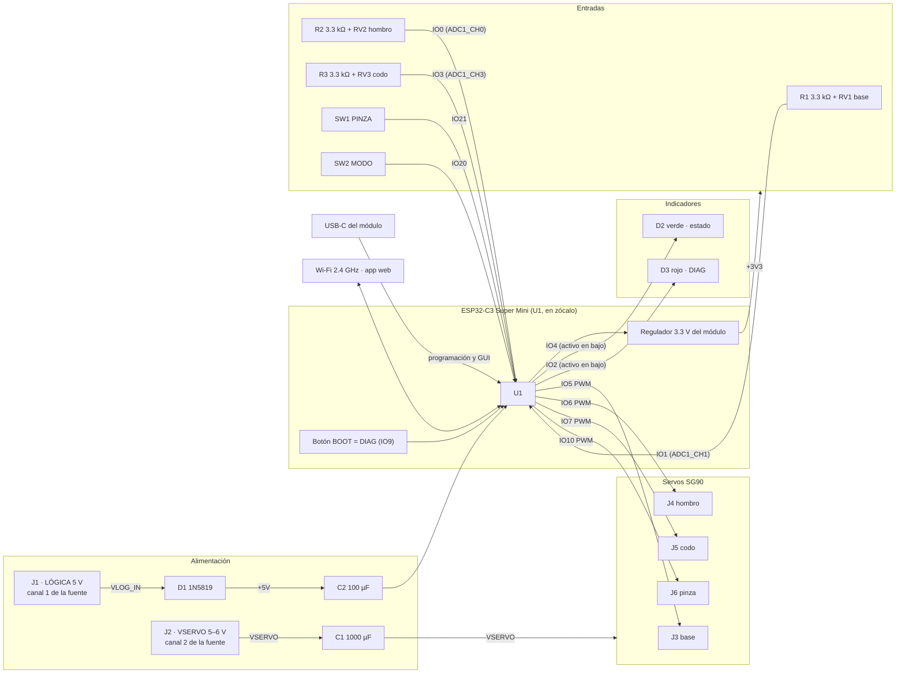
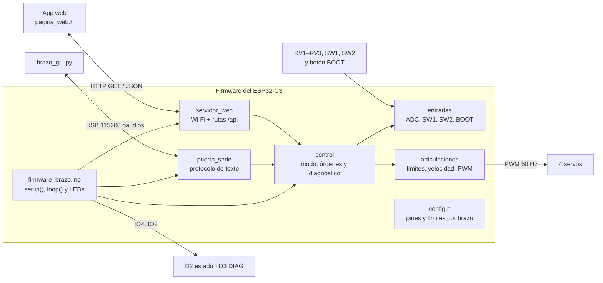
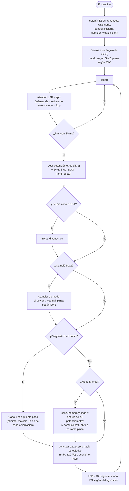

# Electrónica y programación

Los dos brazos usan **la misma tarjeta de control**, `brazo_control` **v3**, y **el mismo firmware**. La tarjeta lleva un **ESP32-C3 Super Mini** en zócalo, los conectores de los 4 servos, 3 potenciómetros, los interruptores **PINZA** y **MODO**, dos LEDs (estado y diagnóstico) y dos entradas de alimentación separadas: una para la lógica y otra para los servos. Es una placa de **una sola cara, de 58 × 48 mm**, fresada en CNC sobre fenólica.

**Descargas:**

| Archivo | Contenido |
|:--------|:----------|
| [Proyecto completo (.zip)]({{ '/assets/brazos/electronica/brazo_control_pcb_v3_58x48.zip' | relative_url }}) | Proyecto de KiCad, Gerber, archivos para CNC, BOM y documentación |
| [Esquemático (PDF)]({{ '/assets/brazos/electronica/brazo_control_pcb/docs/esquematico.pdf' | relative_url }}) | Hoja A3 con notas de diseño |
| [Esquemático (.kicad_sch)]({{ '/assets/brazos/electronica/brazo_control_pcb/brazo_control.kicad_sch' | relative_url }}) · [PCB (.kicad_pcb)]({{ '/assets/brazos/electronica/brazo_control_pcb/brazo_control.kicad_pcb' | relative_url }}) | KiCad 7, con su biblioteca `brazos` |
| [Lista de materiales (CSV)]({{ '/assets/brazos/electronica/brazo_control_pcb/docs/bom.csv' | relative_url }}) | Cantidad, referencias, valor, huella y función |
| [Archivos para CNC](https://github.com/sebastiux/portafolio-just-the-docs/tree/main/assets/brazos/electronica/brazo_control_pcb/cnc) | Cobre, taladros y contorno ya espejados |
| [Gerber](https://github.com/sebastiux/portafolio-just-the-docs/tree/main/assets/brazos/electronica/brazo_control_pcb/fabricacion) | B.Cu, máscara, serigrafía, contorno y taladros |
| [LEEME de la tarjeta]({{ '/assets/brazos/electronica/brazo_control_pcb/LEEME.md' | relative_url }}) | Notas de diseño y de fabricación |
| [Firmware (.zip)]({{ '/assets/brazos/codigo/firmware_brazo.zip' | relative_url }}) | Sketch de Arduino para el ESP32-C3 |
| [brazo_gui.py (.zip)]({{ '/assets/brazos/codigo/brazo_gui.zip' | relative_url }}) | Interfaz de escritorio por USB |

---

## 1) Diagrama de bloques (B13)



**Figura 1:** Diagrama de bloques de la tarjeta. La lógica y los servos se alimentan por canales separados de la fuente, con tierra común en la placa.

### Asignación de pines

| GPIO | Función | Tipo | Componente | Nota |
|:----:|:--------|:-----|:-----------|:-----|
| IO5 | Servo de la base | PWM 50 Hz | J3 | LEDC, 14 bits |
| IO6 | Servo del hombro | PWM 50 Hz | J4 | |
| IO7 | Servo del codo | PWM 50 Hz | J5 | |
| IO10 | Servo de la pinza | PWM 50 Hz | J6 | |
| IO1 | Potenciómetro de la base | Analógica | RV1 (con R1) | ADC1: funciona con el Wi-Fi encendido |
| IO0 | Potenciómetro del hombro | Analógica | RV2 (con R2) | |
| IO3 | Potenciómetro del codo | Analógica | RV3 (con R3) | |
| IO21 | Interruptor PINZA | Digital, pull-up interno | SW1 | Común al GPIO, otra posición a GND |
| IO20 | Interruptor MODO | Digital, pull-up interno | SW2 | Manual / App |
| IO4 | LED de estado | Salida, activa en bajo | D2 (verde) con R4 | |
| IO2 | LED de diagnóstico | Salida, activa en bajo | D3 (rojo) con R5 | Pin de arranque: R6 de 10 kΩ lo mantiene en alto |
| IO9 | Botón DIAG | Digital | Botón **BOOT** del módulo | Se lee después del arranque |
| IO8 | Libre | — | — | LED azul del módulo |

**Conectores de servo:** orden **S V G** de izquierda a derecha, viendo desde los componentes; GND es el pin cuadrado. Cable naranja a S, rojo a V, café a G.

### Cálculos de diseño

| Punto | Cálculo | Resultado |
|:------|:--------|:----------|
| Tope de los potenciómetros | 3.3 V × 10 kΩ / (3.3 kΩ + 10 kΩ) | **≈2.48 V**: dentro del rango útil del ADC del ESP32-C3 (0–2.5 V); 0.25 mA por potenciómetro |
| Corriente de los servos | 4 SG90 × ≈0.7 A al arrancar o bloquearse | ≈2.8 A de pico → canal 2 de **5–6 V, 3 A** |
| Separación de alimentaciones | Lógica por J1, servos por J2, GND común | El ruido y las caídas de los servos no reinician el ESP32-C3 |
| Protección de la lógica | 1N5819 en serie con J1 | Protege contra polaridad invertida y evita que el USB alimente de regreso a la fuente; ≈4.6 V al módulo |
| Respaldo del Wi-Fi | C2 de 100 µF en +5V | Cubre los picos de corriente al transmitir |
| Respaldo de los servos | C1 de 1000 µF en VSERVO | Cubre los arranques simultáneos |
| LEDs | (3.3 V − 2.1 V) / 330 Ω y (3.3 V − 1.9 V) / 330 Ω | ≈3.6 mA (verde) y ≈4.2 mA (rojo), que el GPIO absorbe al ponerse en bajo |
| Pista de servos | 1.6 mm, 35 µm de cobre | ≈3.4 A continuos con 10 °C de aumento (IPC-2221) |
| Pistas de GND y 5 V | 1.2 mm | ≈2.7 A |
| Pistas de señal | 0.8 mm | Amplias para fresar sin romperlas |
| Aislamiento | 0.6 mm entre redes distintas | Lo que corta un V-bit de 20–30° en 2–3 pasadas |

---

## 2) Lista de materiales electrónicos (B14)

Una tarjeta controla un brazo. Precios de referencia en pesos mexicanos, de tiendas de electrónica en línea.

| Cant. | Referencias | Valor | Huella | Función | Precio ref. (MXN) |
|:-----:|:------------|:------|:-------|:--------|------------------:|
| 1 | U1 | ESP32-C3 Super Mini | ESP32C3_SuperMini_Socket | Módulo en zócalo 2 × (1×08) hembra | 95 |
| 2 | — | Tira hembra 1×08, 2.54 mm | — | Zócalo del módulo | 10 |
| 1 | J1 | Bornera 2 polos, paso 5.08 mm | TerminalBlock_bornier-2_P5.08mm | Canal 1 de la fuente: lógica 5 V | 10 |
| 1 | J2 | Bornera 2 polos, paso 5.08 mm | TerminalBlock_bornier-2_P5.08mm | Canal 2 de la fuente: servos 5–6 V | 10 |
| 1 | D1 | 1N5819 | D_DO-41_SOD81_P7.62mm | Polaridad inversa y retroalimentación del USB | 3 |
| 1 | C1 | 1000 µF 10 V | CP_Radial_D8.0mm_P3.50mm | Respaldo de los servos | 10 |
| 1 | C2 | 100 µF 10 V | CP_Radial_D5.0mm_P2.50mm | Respaldo del ESP32-C3 (picos del Wi-Fi) | 4 |
| 4 | J3–J6 | Tira macho 1×03 | PinHeader_1x03_P2.54mm_Servo | Servos base, hombro, codo y pinza (S V G) | 8 |
| 3 | RV1–RV3 | 10 kΩ lineal, Alps RK09K | RK09K vertical | Potenciómetros de base, hombro y codo | 45 |
| 3 | R1–R3 | 3.3 kΩ ¼ W | Axial vertical, 5.08 mm | Limitan el tope de cada potenciómetro a ≈2.5 V | 3 |
| 2 | R4, R5 | 330 Ω ¼ W | Axial horizontal, 7.62 mm | LEDs de estado y diagnóstico | 2 |
| 1 | R6 | 10 kΩ ¼ W | Axial horizontal, 7.62 mm | Pull-up del pin de arranque IO2 | 1 |
| 1 | D2 | LED verde 3 mm | LED_D3.0mm | Estado (activo en bajo) | 2 |
| 1 | D3 | LED rojo 3 mm | LED_D3.0mm | Diagnóstico (activo en bajo) | 2 |
| 2 | SW1, SW2 | Deslizable 1P2T, Würth WS-SLTV | SW_Slide-03, 2.54 mm | PINZA y MODO | 16 |
| 1 | — | Placa fenólica de una cara, 70 × 50 mm | — | Se fresa a 58 × 48 mm | 15 |
| 4 | M1–M4 | Servo SG90 | — | Base, hombro, codo y pinza | 180 |
| 1 | — | Fuente de laboratorio de 2 canales | — | Canal 1: 5 V lógica; canal 2: 5–6 V, 3 A servos | Del laboratorio |
| 1 | — | Cable USB-C de datos | — | Programación y `brazo_gui.py` | 50 |
| | | | | **Total** | **≈466** |

---

## 3) Esquemático (B15)

[]({{ '/assets/brazos/electronica/render/esquematico.png' | relative_url }})
**Figura 2:** Esquemático `brazo_control.kicad_sch` (KiCad 7, hoja A3). Haz clic para verlo a tamaño completo o descarga el [PDF]({{ '/assets/brazos/electronica/brazo_control_pcb/docs/esquematico.pdf' | relative_url }}).

El esquemático se organiza en: **alimentación** (J1, D1, C2 para la lógica; J2, C1 para los servos), **microcontrolador** (U1), **servos** (J3–J6), **potenciómetros** (RV1–RV3 con R1–R3), **indicadores** (D2, D3 con R4–R6) e **interruptores** (SW1, SW2). Las conexiones entre bloques se hacen con etiquetas de red; cada nota de diseño está escrita en la hoja.

**Redes:** 21 en total. **Verificación:** la netlist que exporta KiCad del esquemático se comparó pad por pad con las redes de la PCB: **69 pines, 0 diferencias**.

| Red | Conecta |
|:----|:--------|
| VLOG_IN | J1.1 → ánodo de D1 |
| +5V | Cátodo de D1, C2, pin 5V de U1 |
| VSERVO | J2.1, C1 y el pin V de J3–J6 |
| GND | J1.2, J2.2, C1, C2, pin G de J3–J6, RV1–RV3, SW1, SW2, U1 |
| +3V3 | Pin 3V3 de U1 → R1–R6 |
| VPOT_BASE / _HOMBRO / _CODO | R1–R3 → extremo superior de cada potenciómetro |
| POT_BASE / _HOMBRO / _CODO | Cursor de RV1–RV3 → IO1, IO0, IO3 |
| SRV_BASE / _HOMBRO / _CODO / _PINZA | IO5, IO6, IO7, IO10 → pin S de J3–J6 |
| SW_PINZA / SW_MODO | Común de SW1 → IO21; común de SW2 → IO20 |
| LED_STAT, LED_STAT_A | IO4 → cátodo de D2; ánodo de D2 → R4 |
| LED_DIAG_K, LED_DIAG_A | IO2 y R6 → cátodo de D3; ánodo de D3 → R5 |

**Biblioteca propia (`brazos`).** Incluye el símbolo del ESP32-C3 Super Mini, su huella de zócalo (dos filas de 8 pines a 15.24 mm) y la huella de los conectores de servo con GND en el pad cuadrado.

---

## 4) Diseño de la tarjeta y archivos de fabricación (B16)

<div class="pasos" style="grid-template-columns: repeat(auto-fill, minmax(300px, 1fr));">
  <figure>
    
    <figcaption><strong>Lado de componentes</strong>, con las pistas de B.Cu vistas a través de la placa. Arriba, las borneras y el ESP32-C3; abajo, los tres potenciómetros; a la derecha, los conectores de servo, PINZA y MODO.</figcaption>
  </figure>
  <figure>
    
    <figcaption><strong>Lado del cobre</strong> (B.Cu), visto desde abajo. Render de los Gerber con tracespace.</figcaption>
  </figure>
</div>

**Figura 3:** Tarjeta `brazo_control` v3.

| Característica | Valor |
|:---------------|:------|
| Medidas | **58 × 48 mm**, centrada en un blank de fenólica de 70 × 50 mm |
| Capas | **Una cara** (B.Cu); componentes de inserción por arriba |
| Vías y puentes | Ninguno |
| Pistas | 0.8 mm señales · 1.2 mm GND y 5 V · 1.6 mm alimentación de servos |
| Aislamiento mínimo | 0.6 mm entre redes distintas |
| Cobre al contorno | ≥ 0.8 mm |
| Componentes | 23 huellas |
| Taladros | 75 |
| Revisión de reglas (DRC) | **0 violaciones, 0 pads sin conectar** ([reporte]({{ '/assets/brazos/electronica/brazo_control_pcb/docs/drc_report.txt' | relative_url }})) |
| Revisiones de geometría | Cada red forma una sola isla; los 75 taladros espejados caen sobre su pad |

### Archivos de fabricación

| Carpeta | Archivo | Uso |
|:--------|:--------|:----|
| `cnc/` | `cobre_espejado.gbr` | Aislamiento de pistas en la CNC |
| `cnc/` | `taladros_espejado.drl` | Taladros, alineados con el cobre |
| `cnc/` | `contorno_espejado.gbr` | Corte del contorno de 58 × 48 mm |
| `cnc/` | `cobre_visto_desde_cobre.svg` | Revisión o impresión 1:1 |
| `fabricacion/` | Gerber de B.Cu, B.Mask, F.Silkscreen, Edge.Cuts y taladros | Para fabricante externo, si se prefiere |
| `docs/` | `vista.png`, `cobre_espejo.png` | Presentar las piezas reales a escala 1:1 antes de fresar |

Los archivos de `cnc/` **ya vienen espejados**, vistos desde el lado del cobre: no se vuelven a espejar en FlatCAM.

---

## 5) Manufactura y montaje electrónico (B17)

### Fresado de la PCB en la Genmitsu Cubiko

| Paso | Operación | Herramienta y parámetros |
|:----:|:----------|:-------------------------|
| 1 | Colocar el blank de 70 × 50 mm con el **cobre hacia arriba**, el lado largo en X y el borde del USB hacia el fondo (+Y) | Clamps en las franjas libres de 6 mm de cada lado en X |
| 2 | Fijar el origen (0, 0) en la **esquina frontal izquierda del blank** | — |
| 3 | Mapa de alturas | Sonda de la máquina |
| 4 | Aislamiento de pistas con `cobre_espejado.gbr` | V-bit de 20–30°, punta de 0.1 mm, 0.05–0.1 mm de profundidad (corta ≈0.13–0.16 mm); 2–3 pasadas sin pasar de 0.6 mm de ancho total |
| 5 | Taladrado con `taladros_espejado.drl` | Brocas de 0.8 mm (resistencias, capacitores, interruptores, LEDs), 1.0 mm (módulo, servos, potenciómetros, D1), 1.5 mm (borneras) y 2.0 mm (anclajes de los potenciómetros) |
| 6 | Contorno con `contorno_espejado.gbr`, al final | Fresa recta de 1–2 mm, por fuera de la línea, varias pasadas hasta 1.6 mm, con 2–4 pestañas |
| 7 | Limpieza | Aspiradora durante todo el fresado: el polvo de fenólica irrita |

Antes de fresar, se imprime `docs/vista.png` a escala 1:1 y se presentan encima las piezas reales: potenciómetros RK09K, interruptores a 2.54 mm, C1 de Ø8 mm, borneras de 5.08 mm y resistencias paradas a 5.08 mm.

### Orden de soldadura

De menor a mayor altura, para que la tarjeta se apoye plana en cada paso:

| Paso | Componentes | Cuidado |
|:----:|:------------|:--------|
| 1 | R4, R5, R6 (acostadas) y D1 | D1: la franja (cátodo) hacia el lado marcado **K** |
| 2 | R1–R3 (paradas, debajo de cada potenciómetro) | Cuerpo vertical, 5.08 mm entre patas |
| 3 | D2 (verde) y D3 (rojo) | Pata larga (ánodo) hacia R4 y R5 |
| 4 | Tiras hembra del zócalo de U1 | Soldar con el módulo puesto para que queden alineadas |
| 5 | J3–J6 | GND en el pad cuadrado |
| 6 | SW1 (PINZA, arriba) y SW2 (MODO, abajo) | |
| 7 | C2 y C1 | La pata `+` al pad marcado |
| 8 | J1 y J2 | J1 = lógica, J2 = servos; no intercambiarlas |
| 9 | RV1–RV3 | También soldar las dos pestañas de sujeción |

### Revisión antes de energizar

| Revisión | Cómo | Resultado esperado |
|:---------|:-----|:-------------------|
| Pistas cortadas o en corto | Continuidad entre redes vecinas, sobre todo en los pines del zócalo | Sin continuidad entre redes distintas |
| Polaridad de C1, C2 y D1 | Inspección visual | `+` en el pad marcado; franja de D1 hacia K |
| Corto en las alimentaciones | Continuidad VSERVO–GND y +5V–GND, sin módulo | Sin continuidad (sube al cargarse los capacitores) |
| Primer encendido | Canal 1 a 5 V con límite de 0.3 A, sin módulo ni servos | Consumo < 5 mA |

---

## 6) Pruebas por bloques (B18)

Cada bloque se prueba antes de conectar los servos al brazo. Las pruebas de programa corren con el firmware cargado.

| Bloque | Prueba | Criterio de aceptación |
|:-------|:-------|:-----------------------|
| Lógica | Medir +5V (cátodo de D1) con el canal 1 a 5 V | 4.5–4.7 V |
| Regulador del módulo | Medir +3V3 con U1 puesto | 3.25–3.35 V |
| Referencia de los potenciómetros | Medir VPOT en el extremo superior de cada potenciómetro | 2.40–2.55 V |
| Potenciómetros | Orden `E` por USB girando cada uno de tope a tope en modo Manual | Su articulación recorre todo su rango sin saltos |
| Interruptor MODO | Orden `E` en las dos posiciones de SW2 | `"modo":"manual"` y `"modo":"app"` |
| Interruptor PINZA | Orden `E` en las dos posiciones de SW1 | `"sw_pinza":true` y `false`; la pinza cambia una vez por movimiento |
| LEDs | Encender la tarjeta en cada modo | D2 fijo en Manual, parpadeando en App |
| Botón DIAG | Presionar BOOT con la tarjeta encendida | D3 encendido mientras cada servo va a su mínimo, a su máximo y a su inicio |
| Servos | En App: `J <art> 0`, `J <art> 90`, `J <art> 180` con un servo suelto | Va a cada posición sin vibrar; el ángulo se recorta a los límites |
| Cuatro servos a la vez | En App: `A 0 30 20 30` y luego `H` | El ESP32-C3 no se reinicia; VSERVO no baja de 4.5 V |
| Wi-Fi | Conectar el celular a la red del brazo y abrir `http://192.168.4.1` | La app carga y muestra el modo; D3 no parpadea |

### Pruebas automáticas del firmware

La lógica del firmware se prueba en la computadora: los mismos archivos `.cpp` se compilan con g++ contra un `Arduino.h` simulado, y un programa de prueba revisa 37 condiciones por brazo. Resultado actual:

| Grupo | Qué comprueba | Impreso | Láser |
|:------|:--------------|:-------:|:-----:|
| Arranque | Modo según SW2, ángulos de inicio, pinza según SW1, PWM inicial en IO5 | 4 / 4 | 4 / 4 |
| Conversión a PWM | 0° = 500 µs = 410 de 16 383; 180° = 2400 µs = 1966 de 16 383 | 2 / 2 | 2 / 2 |
| Modo Manual | Cada potenciómetro lleva su articulación a sus límites; el USB se rechaza | 4 / 4 | 4 / 4 |
| Velocidad máxima | No avanza más de 12° en 100 ms (120 °/s) | 1 / 1 | 1 / 1 |
| Interruptor PINZA | Un rebote de 20 ms se ignora; SW1 abre la pinza | 2 / 2 | 2 / 2 |
| Modo App por USB | Los potenciómetros no mueven el brazo; `J`, `A`, `P`, `H`, `E`, recorte de ángulos y errores | 13 / 13 | 13 / 13 |
| Modo App por la app | Una orden de la app se acepta y queda registrada | 2 / 2 | 2 / 2 |
| Regreso a Manual | El brazo vuelve a seguir a los potenciómetros y a SW1; la app se rechaza | 4 / 4 | 4 / 4 |
| Diagnóstico | BOOT arranca la secuencia, recorre los 12 pasos, rechaza órdenes y termina sola | 5 / 5 | 5 / 5 |
| **Total** | | **37 / 37** | **37 / 37** |

```bash
cd assets/brazos/codigo/pruebas
make            # compila y corre las pruebas de los dos brazos
```

---

## 7) Arquitectura del software (B19)

Hay tres programas: el **firmware** del ESP32-C3, la **app web** (una página que sirve el propio ESP32-C3) y **`brazo_gui.py`** en la computadora.



**Figura 4:** Módulos del firmware y su relación con las entradas, las interfaces, los servos y los LEDs.

| Componente | Entradas | Procesamiento | Salidas |
|:-----------|:---------|:--------------|:--------|
| `entradas` | 3 potenciómetros, SW1, SW2, botón BOOT | Filtro exponencial del ADC (α = 0.2), antirrebote de 30 ms en las tres entradas digitales, conversión a grados | Ángulos de los potenciómetros, posición de SW1 y SW2, pulsación de BOOT |
| `control` | Entradas, órdenes de la app y del USB | SW2 decide el modo: en Manual siguen a los potenciómetros y a SW1; en App acepta la app y el USB; BOOT corre el diagnóstico | Ángulos objetivo |
| `articulaciones` | Ángulos objetivo | Recorta a los límites y avanza hacia el objetivo a 120 °/s como máximo | PWM de 50 Hz y 14 bits en IO5, IO6, IO7 e IO10 |
| `puerto_serie` | Líneas de texto por USB | Interpreta `J`, `A`, `P`, `H`, `D`, `E`, `?` | Respuestas `OK` / `ERR` y estado en JSON |
| `servidor_web` | Peticiones HTTP | Punto de acceso Wi-Fi y rutas `/api/...` | Página de la app, estado en JSON y error 409 en Manual |
| `firmware_brazo.ino` | Modo y fuente de mando | Patrón de cada LED | D2 en IO4 y D3 en IO2 |

### Protocolo por USB

Una orden por línea, a 115 200 baudios. Las órdenes de movimiento solo se aceptan con SW2 en **App**.

| Orden | Ejemplo | Efecto | Respuesta |
|:------|:--------|:-------|:----------|
| `J <art> <grados>` | `J hombro 120` | Mueve una articulación (0–3 o base, hombro, codo, pinza) | `OK` |
| `A <b> <h> <c> <p>` | `A 90 60 100 30` | Mueve las cuatro articulaciones | `OK` |
| `P A` / `P C` | `P C` | Abre o cierra la pinza | `OK` |
| `H` | `H` | Posición de inicio | `OK` |
| `D` | `D` | Secuencia de diagnóstico | `OK` |
| `E` | `E` | Estado | `OK {"brazo":"impreso","modo":"app","fuente":"serie",...}` |
| `?` | `?` | Ayuda | `OK ordenes: ...` |
| (en Manual) | `J 0 45` | No mueve el brazo | `ERR modo manual: pasa el interruptor MODO a App` |

### API de la app

| Ruta | Parámetros | Efecto | En Manual |
|:-----|:-----------|:-------|:----------|
| `GET /` | — | Página de la app | — |
| `GET /api/estado` | — | Estado en JSON | Responde |
| `GET /api/mover` | `art`, `grados` | Mueve una articulación | 409 |
| `GET /api/pinza` | `accion=abrir` o `cerrar` | Abre o cierra la pinza | 409 |
| `GET /api/inicio` | — | Posición de inicio | 409 |
| `GET /api/diagnostico` | — | Secuencia de diagnóstico | Responde |

---

## 8) Diagrama de flujo (B20)



**Figura 5:** Flujo del firmware. El ciclo de control corre cada 20 ms, igual que el periodo del PWM de los servos; el USB y la app se atienden en cada vuelta de `loop()`.

---

## 9) Interfaz y procedimiento de operación (B21)

### Controles de la tarjeta

| Control | Función |
|:--------|:--------|
| **SW2 MODO** | **Manual**: los potenciómetros y SW1 mueven el brazo. **App**: lo mueven la app web o `brazo_gui.py` |
| **RV1, RV2, RV3** | Base, hombro y codo, en modo Manual |
| **SW1 PINZA** | Abre y cierra la pinza, en modo Manual |
| **BOOT** (en el módulo) | Diagnóstico: cada articulación va a su mínimo, a su máximo y a su inicio. Si se mantiene presionado **al encender**, el módulo entra en modo de carga de programa |

### LEDs

| LED | Patrón | Significado |
|:----|:-------|:------------|
| D2 verde (estado) | Fijo | Modo Manual |
| | Parpadeo lento (1 Hz) | Modo App, mandando la app web o en espera |
| | Parpadeo rápido (4 Hz) | Modo App, la última orden llegó por USB |
| D3 rojo (DIAG) | Encendido | Diagnóstico en curso |
| | Parpadeo rápido | No se pudo crear la red Wi-Fi |

### Datos de acceso

| Dato | Brazo impreso | Brazo de láser |
|:-----|:--------------|:---------------|
| Red Wi-Fi | `Brazo-Impreso` | `Brazo-Laser` |
| Contraseña | `brazo2026` | `brazo2026` |
| Dirección de la app | `http://192.168.4.1` | `http://192.168.4.1` |
| Puerto USB | `COM#` en Windows, `/dev/ttyACM0` en Linux, `/dev/cu.usbmodem*` en macOS | Igual |
| Velocidad | 115 200 baudios | 115 200 baudios |

### App web y `brazo_gui.py`

<div class="pasos" style="grid-template-columns: repeat(auto-fill, minmax(260px, 1fr));">
  <figure>
    
    <figcaption><strong>App web</strong> en un celular: modo y fuente de mando, deslizadores de base, hombro y codo con sus límites, botones de pinza, inicio y diagnóstico. En modo Manual los deslizadores se bloquean y la app explica por qué.</figcaption>
  </figure>
  <figure>
    
    <figcaption><strong><code>brazo_gui.py</code></strong>: selección del puerto, deslizadores, botones de pinza, inicio y diagnóstico, y el modo actual.</figcaption>
  </figure>
</div>

**Figura 6:** Las dos interfaces, capturadas mientras controlaban el firmware compilado para la computadora (`pruebas/simulador`), que habla el mismo protocolo que el ESP32-C3.

### Procedimiento de operación

1. **Conectar:** los 4 servos a J3–J6 (S V G, GND en el pad cuadrado); el canal 1 de la fuente a 5 V en **J1 (LÓGICA)** y el canal 2 a 5–6 V en **J2 (VSERVO)**.
2. **Arranque:** los servos van a su ángulo de inicio; D2 indica el modo.
3. **Modo Manual (SW2 en Manual):** girar RV1–RV3 y usar SW1 para la pinza.
4. **Modo App (SW2 en App):**
   - **App web:** en el celular, conectarse a la red del brazo con la contraseña y abrir `http://192.168.4.1`.
   - **USB:** conectar el USB-C del módulo, ejecutar `python brazo_gui.py`, elegir el puerto y oprimir **Conectar**.
5. **Diagnóstico:** presionar BOOT (o el botón **Diagnóstico** de la app o de la GUI) con el brazo despejado.
6. **Apagar:** en App, oprimir **Inicio**; en Manual, dejar los potenciómetros al centro. Apagar primero el canal 2 (servos) y después el 1.

> **No conectar el USB y J1 al mismo tiempo sin D1.** D1 evita que el USB alimente de regreso a la fuente.

---

## 10) Librerías y dependencias (B22)

| Programa | Librería o herramienta | Función | Versión |
|:---------|:-----------------------|:--------|:--------|
| Firmware | Núcleo **esp32** de Espressif para Arduino | Soporte del ESP32-C3, PWM por LEDC, ADC calibrado | 3.3.12 |
| Firmware | `WiFi` (incluida en el núcleo) | Punto de acceso Wi-Fi | 3.3.12 |
| Firmware | `WebServer` (incluida en el núcleo) | Servidor HTTP de la app | 3.3.12 |
| Firmware | Arduino IDE o arduino-cli | Compilar y cargar | IDE 2.x · arduino-cli 1.3.1 |
| `brazo_gui.py` | Python | Lenguaje | 3.8 o mayor (probado en 3.12) |
| `brazo_gui.py` | `pyserial` | Comunicación por USB | 3.5 |
| `brazo_gui.py` | `tkinter` (incluida en Python) | Interfaz gráfica | Tk 8.6 |
| App web | HTML, CSS y JavaScript sin librerías | Interfaz en el navegador | — |
| Pruebas | g++ y make | Pruebas del firmware en la computadora | C++17 |
| Tarjeta | KiCad | Esquemático y PCB | 7.0.11 |
| Tarjeta | FlatCAM y Genmitsu Cubiko | Fresado de la PCB | — |

El firmware **no necesita librerías externas**: los servos se manejan directo con el periférico LEDC del ESP32-C3.

---

## 11) Organización en funciones (B23)

| Archivo | Función | Qué hace |
|:--------|:--------|:---------|
| `firmware_brazo.ino` | `setup()` | Configura los LEDs, el USB, el control y el servidor web |
| | `loop()` | Atiende USB y app en cada vuelta; cada 20 ms corre `control::ciclo()` y actualiza los LEDs |
| | `actualizarLeds()` | D2 según el modo y la fuente; D3 según el diagnóstico y el Wi-Fi |
| `config.h` | — | Pines de la tarjeta v3, nivel de SW1 y SW2, límites de cada articulación, ángulos de la pinza, red Wi-Fi y tiempos; elige el brazo con `BRAZO` |
| `control.cpp` | `iniciar()` | Inicia entradas y servos; toma el modo de SW2 y la pinza de SW1 |
| | `ciclo(dt)` | Lee entradas, aplica el modo o el diagnóstico y mueve los servos |
| | `mover()`, `pinza()`, `inicio()` | Órdenes de la app y del USB; devuelven si se aceptaron o por qué no |
| | `diagnostico()` | Arranca la secuencia de 12 pasos |
| | `estadoJson()` | Estado completo para la app, la GUI y las pruebas |
| `articulaciones.cpp` | `iniciar()` | Configura el LEDC a 50 Hz y 14 bits en IO5, IO6, IO7 e IO10 |
| | `fijarObjetivo()`, `limitar()` | Recorta el ángulo pedido al rango de la articulación |
| | `actualizar(dt)` | Avanza hacia el objetivo a 120 °/s como máximo |
| | `gradosADuty()` | 0–180° → pulso de 500–2400 µs → ciclo de trabajo |
| `entradas.cpp` | `leer()` | Filtro exponencial del ADC y antirrebote de SW1, SW2 y BOOT |
| | `anguloPot()` | Lectura en mV → ángulo dentro de los límites |
| | `pinzaCambio()`, `botonDiagPresionado()` | Avisan una sola vez por cada cambio o pulsación |
| `puerto_serie.cpp` | `atender()`, `ejecutar()` | Junta caracteres en líneas e interpreta las órdenes |
| `servidor_web.cpp` | `iniciar()`, `atender()`, `activo()` | Crea la red Wi-Fi, registra las rutas `/api/...` e informa si la red está activa |
| `pagina_web.h` | — | HTML, CSS y JavaScript de la app, guardados en flash |
| `brazo_gui.py` | `EnlaceSerie` | Puerto serie en un hilo aparte para no congelar la ventana |
| | `Aplicacion` | Ventana, deslizadores y botones; pide el estado cada 500 ms |

---

## 12) Código fuente (B24)

| Archivo | Descarga |
|:--------|:---------|
| Firmware completo | [firmware_brazo.zip]({{ '/assets/brazos/codigo/firmware_brazo.zip' | relative_url }}) |
| `brazo_gui.py` y `requirements.txt` | [brazo_gui.zip]({{ '/assets/brazos/codigo/brazo_gui.zip' | relative_url }}) |
| Pruebas y simulador | [carpeta `pruebas/`](https://github.com/sebastiux/portafolio-just-the-docs/tree/main/assets/brazos/codigo/pruebas) |
| Todo el código | [carpeta `assets/brazos/codigo/`](https://github.com/sebastiux/portafolio-just-the-docs/tree/main/assets/brazos/codigo) |

### Compilar y cargar el firmware

1. Instalar el **Arduino IDE 2** y, en el gestor de tarjetas, el núcleo **esp32** de Espressif (3.3.x).
2. Abrir `firmware_brazo/firmware_brazo.ino`.
3. En `config.h`, elegir el brazo: `#define BRAZO BRAZO_IMPRESO` o `BRAZO_LASER`.
4. Tarjeta: **ESP32C3 Dev Module**; opción **USB CDC On Boot: Enabled**.
5. Conectar el ESP32-C3 por USB-C, elegir su puerto y **Subir**. Si no entra en modo de carga, mantener **BOOT**, presionar **RESET** y soltar **BOOT**.

Con arduino-cli:

```bash
arduino-cli compile --fqbn esp32:esp32:esp32c3:CDCOnBoot=cdc \
  --build-property "compiler.cpp.extra_flags=-DBRAZO=BRAZO_LASER" firmware_brazo
arduino-cli upload -p /dev/ttyACM0 --fqbn esp32:esp32:esp32c3:CDCOnBoot=cdc firmware_brazo
```

| Compilación | Flash | RAM |
|:------------|------:|----:|
| Brazo impreso | 1 035 181 bytes (78 %) | 38 360 bytes (11 %) |
| Brazo de láser | 1 035 181 bytes (78 %) | 38 360 bytes (11 %) |

Las dos versiones compilan sin advertencias con el núcleo esp32 3.3.12 y `--warnings all`.

### Ejecutar la interfaz de escritorio

```bash
pip install -r requirements.txt
python brazo_gui.py                 # elegir el puerto en la ventana
python brazo_gui.py --puerto COM5   # o indicarlo
```

### Probar sin el brazo

```bash
cd pruebas
make simulador && ./simulador       # imprime el puerto virtual, por ejemplo /dev/pts/3
python ../gui/brazo_gui.py --puerto /dev/pts/3
```

---

## Sección anterior

[Brazo cortado con láser]({{ '/brazos/corte-laser/' | relative_url }})

## Siguiente sección

[Comparación y conclusiones]({{ '/brazos/comparacion/' | relative_url }})
