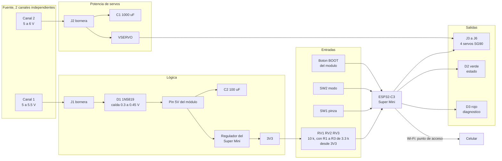
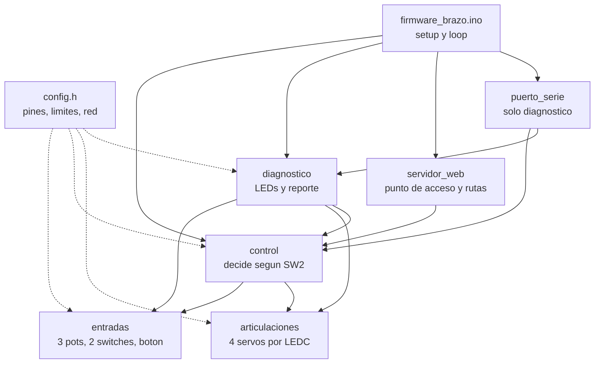
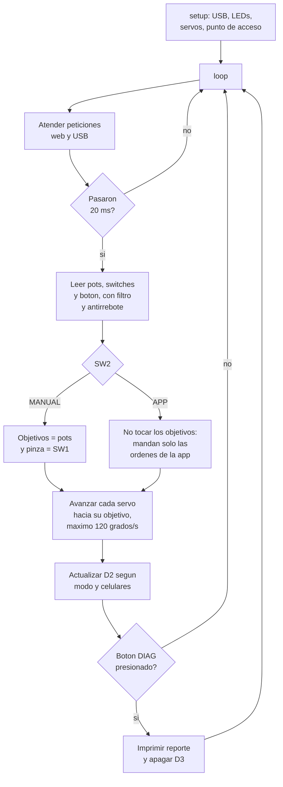

# Electrónica y programación

Los dos brazos usan **la misma tarjeta** y **el mismo firmware**: una por brazo, idénticas. La tarjeta lleva un **ESP32-C3 Super Mini**, los conectores de los 4 servos, 3 potenciómetros, 2 switches y dos entradas de alimentación separadas. Para pasar de un brazo al otro solo cambia una línea de `config.h`.

El brazo se maneja de **dos maneras**, y cuál manda lo decide un switch de la tarjeta, no el programa:

- **MANUAL** — mandan los tres potenciómetros (base, hombro, codo) y el switch de la pinza.
- **APP** — manda un celular conectado a la red del brazo, en `http://192.168.4.1`.

**Descargas:**

| Archivo | Contenido |
|:--------|:----------|
| [Proyecto de KiCad (.zip)]({{ '/assets/brazos/electronica/v3/proyecto-kicad-v3.zip' | relative_url }}) | Esquemático, PCB, biblioteca propia, archivos de fresado y Gerber (KiCad 7) |
| [Esquemático (PDF)]({{ '/assets/brazos/electronica/v3/esquematico.pdf' | relative_url }}) | Hoja A3 con las notas de diseño |
| [Archivos de fresado (.zip)]({{ '/assets/brazos/electronica/v3/cnc-tarjeta-v3.zip' | relative_url }}) | Cobre, contorno y taladros, ya espejados para la fresadora |
| [Gerber estándar (.zip)]({{ '/assets/brazos/electronica/v3/gerber-tarjeta-v3.zip' | relative_url }}) | Por si se manda a fabricar en vez de fresarla |
| [Lista de materiales (CSV)]({{ '/assets/brazos/electronica/v3/bom.csv' | relative_url }}) | Generada del esquemático |
| [Generador de la tarjeta](https://github.com/sebastiux/portafolio-just-the-docs/tree/main/assets/brazos/electronica/generador-v3) | Los scripts de Python que colocaron, rutearon y verificaron la placa |
| [Firmware (.zip)]({{ '/assets/brazos/codigo/firmware_brazo.zip' | relative_url }}) | Sketch de Arduino para el ESP32-C3 |

---

## 1) Diagrama de bloques (B13)

La alimentación entra por **dos borneras separadas** y de dos canales distintos de la fuente: la lógica por un lado y los servos por el otro. Van así porque cuatro SG90 arrancando a la vez hunden la línea de 5 V lo suficiente para reiniciar el módulo. Las dos tierras sí se unen en la placa, porque si no, la señal de los servos no tendría referencia.



### Asignación de pines

| GPIO | Red | Función |
|:-----|:----|:--------|
| 5 | `SRV_BASE` | Servo de la base, J3 |
| 6 | `SRV_HOMBRO` | Servo del hombro, J4 |
| 7 | `SRV_CODO` | Servo del codo, J5 |
| 10 | `SRV_PINZA` | Servo de la pinza, J6 |
| 1 | `POT_BASE` | RV1, canal 1 del ADC1 |
| 0 | `POT_HOMBRO` | RV2, canal 0 del ADC1 |
| 3 | `POT_CODO` | RV3, canal 3 del ADC1 |
| 21 | `SW_PINZA` | SW1. Común al GPIO y la otra posición a GND; `INPUT_PULLUP` |
| 20 | `SW_MODO` | SW2, igual que SW1 |
| 4 | `LED_STAT` | D2 verde: 3V3 → R4 330 Ω → D2 → GPIO4. **LOW = encendido** |
| 2 | `LED_DIAG_K` | D3 rojo, igual que D2, más R6 de 10 kΩ a 3V3 |
| 9 | — | Botón BOOT del módulo, reusado como botón DIAG |
| 8 | — | Libre. Es el LED azul del módulo |

Los dos pines con historia son el 2 y el 9. **GPIO2 es pin de arranque** y tiene que estar en 1 cuando el módulo enciende; como el LED D3 lo jalaría a 0, R6 de 10 kΩ lo sube. **GPIO9 es el BOOT**: presionado al encender mete al ESP32-C3 en modo de descarga, así que el firmware lo ignora durante el primer segundo.

**Conectores de servo J3–J6:** el orden es **S V G** de izquierda a derecha viendo desde los componentes. El pin 1, de pad cuadrado, es GND: ahí va el cable café.

{: .warning }
> El orden físico de los pines del Super Mini y la separación de 15.24 mm entre sus dos filas son **hipótesis** tomadas de la documentación del módulo, no medidas sobre el que se usó. Como la tarjeta ya está armada, se confirman mirando la serigrafía del módulo.
<!-- PENDIENTE: confirmar pinout fisico del Super Mini y separacion de filas (pregunta 1) -->

### Cálculos de diseño

| Punto | Cuenta | Resultado |
|:------|:-------|:----------|
| Caída en D1 | Curva típica del 1N5819 a 0.1–0.35 A | ≈0.3 a 0.45 V, o sea ≈4.6 V en el pin 5V. **Hipótesis**: sale del datasheet, no está medida |
| Tope de cada pot | 3.3 V × 10 kΩ / (10 kΩ + 3.3 kΩ) | **2.48 V**, dentro del rango útil del ADC del C3 con 12 dB de atenuación. ≈0.25 mA por pot |
| LEDs | (3.3 V − Vf) / 330 Ω, con Vf de 1.8 a 2.2 V | ≈3 a 4.5 mA cada uno. **Hipótesis**: Vf depende del LED que se haya puesto |
| Consumo de los servos | 4 SG90 × 0.6 a 0.7 A de arranque o bloqueo | Pico de **2.4 a 2.8 A** en J2. **Hipótesis**: dato de clones, no medido |
| C1 | 1000 µF junto a J2 | Aguanta el pico de arranque de los servos |
| C2 | 100 µF en el 5V del módulo | Aguanta los picos del Wi-Fi |

{: .warning }
> **El D2 verde puede no encender bien.** Con 3.3 V y 330 Ω, un LED verde "puro" (InGaN, Vf ≈3 V) queda casi apagado. Tiene que ser un verde amarillento de los de toda la vida, o de otro color.
<!-- PENDIENTE: confirmar que D2 enciende bien en la tarjeta armada (pregunta 9) -->

### Capacidad de las pistas

La fórmula de la IPC-2221 para un conductor externo es `I = k · ΔT^0.44 · A^0.725`, con `k = 0.048`, el área en mils² y la corriente en amperes. La tabla la **recalcula** [`tools/f4_ampacidad.py`](https://github.com/sebastiux/portafolio-just-the-docs/blob/main/tools/f4_ampacidad.py) leyendo los anchos del propio archivo de KiCad:

| Ancho | Tramos | Largo | Sección | I a ΔT 10 °C | I a ΔT 20 °C |
|:------|-------:|------:|--------:|-------------:|-------------:|
| 0.8 mm | 79 | 287.1 mm | 0.028 mm² | 2.03 A | 2.76 A |
| 1.2 mm | 25 | 168.0 mm | 0.042 mm² | 2.73 A | 3.70 A |
| 1.6 mm | 32 | 71.2 mm | 0.056 mm² | 3.36 A | 4.56 A |

Decir "la pista de servos es de 1.6 mm" no basta: una pista vale lo que su tramo **más angosto**. El script quita las pistas delgadas y comprueba si el circuito se corta, así que mide el cuello de botella de verdad. El camino completo de J2 a cada conector de servo, **ida por VSERVO y retorno por GND**, se mantiene en 1.6 mm para los cuatro: **3.36 A** contra un pico estimado de 2.4 a 2.8 A, o sea un margen de 1.20×.

{: .note }
> Ese margen es más frágil de lo que parece. El espesor de 35 µm (1 oz) es una **hipótesis** —no viene en el proyecto de KiCad—, el pico por servo es una **hipótesis**, y la fórmula es de régimen permanente mientras el pico real dura decenas de milisegundos. 1.20× es lo que se puede defender con una cuenta, no una medición.

---

## 2) Lista de materiales (B14)

Esta tabla **no se escribió a mano**: [`tools/f4_bom.py`](https://github.com/sebastiux/portafolio-just-the-docs/blob/main/tools/f4_bom.py) la saca del esquemático, agrupa los componentes iguales y comprueba además que cada uno esté colocado en la placa con la misma huella. Los 23 componentes coinciden.

| Cant. | Referencias | Valor | Huella | Para qué |
|------:|:------------|:------|:-------|:---------|
| 1 | U1 | ESP32-C3 Super Mini | Dos tiras hembra 1×8 a 15.24 mm | El microcontrolador, en zócalo |
| 1 | J1 | Bornera 2 polos, 5.08 mm | `TerminalBlock_bornier-2` | Entrada de 5 V de la lógica |
| 1 | J2 | Bornera 2 polos, 5.08 mm | `TerminalBlock_bornier-2` | Entrada de 5–6 V de los servos |
| 1 | D1 | 1N5819 | `D_DO-41`, 7.62 mm | Evita conectar al revés y que el USB realimente la fuente |
| 1 | C1 | 1000 µF 10 V | `CP_Radial_D8.0mm` | Pico de arranque de los servos |
| 1 | C2 | 100 µF 10 V | `CP_Radial_D5.0mm` | Picos del Wi-Fi |
| 4 | J3 J4 J5 J6 | Tira macho 1×3, 2.54 mm | Huella propia | Servos: base, hombro, codo y pinza |
| 3 | RV1 RV2 RV3 | 10 kΩ lineal | `Alps_RK09K` vertical | Potenciómetros de base, hombro y codo |
| 3 | R1 R2 R3 | 3.3 kΩ ¼ W | Axial 5.08 mm, parada | Limitan el tope de cada pot a ≈2.5 V |
| 2 | R4 R5 | 330 Ω ¼ W | Axial 7.62 mm | Corriente de D2 y D3 |
| 1 | R6 | 10 kΩ ¼ W | Axial 7.62 mm | Sube GPIO2 al encender |
| 1 | D2 | LED 3 mm verde | `LED_D3.0mm` | Estado |
| 1 | D3 | LED 3 mm rojo | `LED_D3.0mm` | Diagnóstico |
| 2 | SW1 SW2 | Deslizable 1P2T, 2.54 mm | `SW_Slide-03 Wuerth WS-SLTV` | Pinza y modo |
| — | — | Placa fenólica de una cara | 70 × 50 mm | Material de la tarjeta |
| 4 | M1–M4 | SG90 | — | Servos del brazo |

**23 componentes, 18 tipos distintos**, por tarjeta. Se necesitan **dos tarjetas**, una por brazo.

**Precios: [Pendiente].** No se ponen números sin una fuente que los respalde; la columna está en el CSV lista para llenarse.
<!-- PENDIENTE: precios con su fuente, si la rubrica los pide (pregunta 11) -->

---

## 3) Esquemático (B15)

[]({{ '/assets/brazos/electronica/v3/esquematico.pdf' | relative_url }})

*Hoja completa. Da clic para abrir el **[PDF]({{ '/assets/brazos/electronica/v3/esquematico.pdf' | relative_url }})**, que es donde se lee bien.*

El esquemático está dividido en bloques: alimentación arriba a la izquierda, el módulo al centro, los conectores de servo a la derecha, y abajo los potenciómetros, los LEDs y los switches.

**Biblioteca propia.** El ESP32-C3 Super Mini no viene en las bibliotecas de KiCad, así que se dibujaron el símbolo y la huella: `brazos.kicad_sym` y `brazos.pretty`. La huella es un **zócalo** de dos tiras hembra 1×8 a 15.24 mm, no el módulo soldado. El header de servo también es propio, con el pin 1 cuadrado para no equivocar la polaridad.

**Verificación.** El esquemático y la PCB se comprobaron con el DRC de KiCad 7.0.11 (0 violaciones, 0 pads sin conectar) y, por separado, con [`tools/f1_verificar_tarjeta_v3.py`](https://github.com/sebastiux/portafolio-just-the-docs/blob/main/tools/f1_verificar_tarjeta_v3.py), que lee los archivos sin KiCad y recalcula las medidas, la separación entre redes y la correspondencia esquemático–PCB. Las 23 referencias coinciden en los dos y hay 21 redes con cobre.

Diez pads quedan **a propósito sin red**: los dos anclajes mecánicos de cada potenciómetro (6), la tercera posición de cada switch (2) y dos pines del módulo (2). Los del módulo son **GPIO8**, que quedó libre, y **GPIO9**, que no necesita pista porque el botón que lee ya está en el propio módulo.

---

## 4) Diseño de la tarjeta (B16)

| | |
|:--|:--|
|  |  |
| **Cara de componentes.** Las pistas van en la cara de abajo y se ven atenuadas, a través de la placa. La serigrafía del dibujo **no está impresa** en la tarjeta real: es guía de armado. | **Cobre visto desde el lado del cobre**, reflejado en X. Es la vista que recibe la fresadora. |

| Dato | Valor |
|:-----|:------|
| Medidas | 58 × 48 mm, esquinas rectas; se fresa centrada en una fenólica de 70 × 50 mm |
| Capas | **1** (cobre en la cara de abajo); todos los componentes son de inserción y van por la cara sin cobre |
| Pistas | 0.8 mm señal · 1.2 mm GND, 5V y VLOG · 1.6 mm VSERVO. 136 segmentos, ≈526 mm en total |
| Separación mínima entre redes | **0.600 mm** |
| Cobre al contorno | ≥ 0.8 mm |
| Componentes / redes | 23 / 21 |
| Agujeros | 75: Ø0.8, 0.9, 1.0, 1.1 y 1.52 mm, más 6 ranuras de 2.1 × 1.8 mm para los anclajes de los pots |
| Vías y puentes de alambre | **Ninguno** |

### Por qué es de una sola cara

Porque **se fresó en una Genmitsu Cubiko**, y eso manda sobre el diseño entero:

- **No hay vías.** Una fresadora casera no metaliza agujeros, así que una vía habría que soldarla a mano. Todo el ruteo tiene que caber en una cara.
- **Pistas de 0.8 mm como mínimo.** No es una preferencia: es lo que la fresadora puede dejar de forma repetible. Más delgado y una pasada de aislamiento mal calibrada se come la pista.
- **Separación de 0.6 mm como mínimo**, que es el ancho que tiene que poder quitar la herramienta de aislamiento.
- **R1, R2 y R3 hacen de puente.** Al no haber vías, el bus de GND corta el camino de los potenciómetros al módulo; las tres resistencias de 3.3 kΩ se montan **paradas** y pasan por encima. Son componentes que de todos modos hacían falta, así que el puente sale gratis.
- **El botón DIAG es el BOOT del módulo.** Poner un botón propio pedía dos pads y pista hasta un GPIO libre; el módulo ya trae uno en GPIO9.
- **Se quitó un header extra** que estaba previsto: no cabía sin bajar de 0.8 mm o sin cruzar pistas.

La colocación y el ruteo en una cara se hicieron con un **generador propio en Python**, con las troncales de alimentación fijadas a mano y verificación geométrica después. Un autoruteador normal da por hecho que puede usar la segunda capa.

Los 13 scripts están publicados en [`assets/brazos/electronica/generador-v3/`](https://github.com/sebastiux/portafolio-just-the-docs/tree/main/assets/brazos/electronica/generador-v3) para que la afirmación se pueda comprobar: `design.py` es la fuente única de verdad (partes, huellas y redes), `placement.py` coloca y fija las troncales, `router.py` rutea, `gen_sch.py` genera el esquemático a partir del mismo `design.py` —por eso esquemático y PCB no se pueden contradecir— y `verify_geom.py` y `check_netlist.py` verifican el resultado.

{: .note }
> **Las pistas pasan por debajo del módulo.** Por eso U1 va siempre en zócalo: si se soldara directo a la placa, sus patas quedarían sobre el cobre.

---

## 5) Manufactura y montaje (B17)

### Fresado

Los archivos de `cnc/` vienen **espejados**, vistos desde el cobre, con el origen en la esquina frontal izquierda del blank. El contorno queda entre X 6–64 y Y 1–49 mm. Se verificó que los 75 agujeros del archivo de taladros caen sobre sus pads.

El orden es el de siempre en fresado de PCB: **aislar → taladrar → recortar el contorno**. Aislar primero, porque una vez taladrada la placa ya no se puede volver a sujetar igual; el contorno al final, porque mientras la placa siga pegada al blank no se mueve.

| Parámetro | Valor |
|:----------|:------|
| Máquina | Genmitsu Cubiko (GRBL, área de 150 × 110 mm, mandril ER11, sonda de altura) |
| Flujo de trabajo | KiCad → FlatCAM → gSender. **[Pendiente: confirmar]** |
| Herramienta de aislamiento | Debe poder quitar 0.6 mm de ancho |
| Brocas reales usadas | **[Pendiente]** |
| Profundidad, avance y RPM | **[Pendiente]** |
| Número de pasadas | **[Pendiente]** |
| Tiempo de fresado | **[Pendiente]** |
| Problemas que hubo | **[Pendiente]** |
<!-- PENDIENTE: parametros reales del fresado (pregunta 4) -->

**[Pendiente: fotos del fresado y video]**
<!-- PENDIENTE: fotos y video del fresado (pregunta 8) -->

### Orden de soldadura

De menor a mayor altura, para que cada componente se apoye en la mesa mientras se suelda:

1. **R4, R5 y R6** acostadas, y **D1** (la banda hacia el pad marcado).
2. **D2 y D3**, con el **cátodo** —la pata corta, lado plano— al **pad cuadrado**.
3. **R1, R2 y R3 paradas**. Son las que hacen de puente sobre el bus de GND.
4. **C2**, con el `+` al pad cuadrado.
5. **SW1 y SW2**.
6. **Las dos tiras hembra de U1**, soldadas **con el módulo puesto** para que queden alineadas y paralelas.
7. **J3 a J6**, los headers de servo.
8. **C1**, con el `+` al pad cuadrado.
9. **RV1, RV2 y RV3**, soldando también sus dos anclajes mecánicos: son los que aguantan el esfuerzo de girar la perilla.
10. **J1 y J2**, las borneras, con las bocas hacia afuera.

### Revisión antes de energizar

1. **Sin el módulo puesto**, medir continuidad entre 5V y GND, y entre VSERVO y GND. Si pita, hay un corto y no se conecta nada.
2. Revisar la polaridad de **D1, C1, C2, D2 y D3**. Un electrolítico al revés revienta.
3. Mirar a contraluz los **puentes de estaño**: la separación es de 0.6 mm y a esa distancia una gota de más une dos redes.
4. Primer encendido **con límite de corriente en la fuente**. Si el límite se dispara, hay un corto que la continuidad no agarró.

**[Pendiente: fotos de la tarjeta soldada, las dos caras]**
<!-- PENDIENTE: fotos del soldado y de la tarjeta armada (pregunta 8) -->

---

## 6) Pruebas por bloques (B18)

Los criterios están definidos; **las mediciones reales faltan**. Nada de esta columna se inventa.

| Bloque | Criterio | Medido |
|:-------|:---------|:-------|
| Entrada J1 | El pin 5V del módulo debe dar J1 menos 0.3 a 0.45 V | **[Pendiente]** |
| Regulador del módulo | 3V3 entre 3.25 y 3.35 V | **[Pendiente]** |
| Tope de cada pot | ≈2.48 V en la pata de R1–R3 del lado del pot | **[Pendiente]** |
| SW1 y SW2 | El estado que devuelve la orden `E` cambia con cada posición | **[Pendiente]** |
| Cada servo por separado | Llega a 0°, 90° y 180° desde la app | **[Pendiente]** |
| Los cuatro servos a la vez | El módulo no se reinicia y D3 queda apagado | **[Pendiente]** |
| Wi-Fi | La app carga en `http://192.168.4.1` | **[Pendiente]** |
| LEDs | D2 en sus tres estados; D3 encendido tras un brown-out | **[Pendiente]** |
<!-- PENDIENTE: mediciones con multimetro y pruebas en hardware (preguntas 3, 5 y 7) -->

### Pruebas automáticas del firmware

Lo que sí está probado es la **lógica** del firmware. Los mismos archivos que se cargan al ESP32-C3 se compilan en la computadora contra un `Arduino.h` simulado, donde las pruebas mueven el tiempo, los switches y el ADC a mano:

```bash
cd assets/brazos/codigo/pruebas
make
```

```
Firmware del brazo impreso
52 de 52 comprobaciones correctas
Firmware del brazo laser
52 de 52 comprobaciones correctas
```

Las 52 comprobaciones cubren el mapa de pines contra el esquemático, la conversión de grados a PWM, los límites de cada articulación, la velocidad máxima, el antirrebote, los dos modos con su código 409, el regreso de APP a MANUAL sin saltos, los tres parpadeos de D2, el aviso de brown-out en D3 y las respuestas de la consola por USB.

{: .warning }
> Estas pruebas no tocan hardware. Detectan errores de lógica antes de cargar el programa; **no sustituyen la prueba con el brazo armado**. Tres archivos del firmware —el servidor web, la página de la app y el `.ino`— no los compila `make`, porque necesitan las bibliotecas del ESP32.
<!-- PENDIENTE: compilar con arduino-cli y reportar tamanos de flash y RAM -->

---

## 7) Arquitectura del software (B19)



`control` no depende de `servidor_web` ni de `puerto_serie`: las órdenes entran hacia adentro y nunca al revés. Por eso la lógica de los dos modos se puede probar con g++ sin levantar el Wi-Fi.

| Entra | Se procesa | Sale |
|:------|:-----------|:-----|
| 3 potenciómetros por el ADC | Filtro exponencial (α = 0.2) y conversión de mV a grados dentro de los límites | 4 señales PWM a 50 Hz y 14 bits |
| SW1 y SW2 | Antirrebote de 30 ms | D2 y D3 |
| Botón DIAG (BOOT) | Antirrebote, ignorado el primer segundo tras encender | Reporte de texto por el USB |
| Peticiones HTTP del celular | Aceptadas o rechazadas con 409 según SW2 | Estado en JSON |

### API de la app

| Ruta | Qué hace | Respuesta |
|:-----|:---------|:----------|
| `GET /` | La app completa, guardada en flash | HTML |
| `GET /api/estado` | Estado del brazo | 200 con el JSON |
| `GET /api/mover?art=N&grados=G` | Mueve una articulación | 200, **409** en modo manual, 400 si la articulación no existe |
| `GET /api/pinza?accion=abrir\|cerrar` | Abre o cierra la pinza | 200 o **409** |
| `GET /api/inicio` | Manda todo a la posición de inicio | 200 o **409** |

El **409** es la pieza clave: cuando SW2 está en MANUAL, el firmware no obedece a la app, y en vez de ignorarla en silencio le responde `{"error":"modo manual"}`. La app lo entiende y muestra el aviso de cambiar el switch, en lugar de quedarse colgada esperando un movimiento que nunca va a pasar.

### Consola de diagnóstico por USB

El USB **no mueve el brazo**. Solo lee:

| Orden | Qué hace |
|:------|:---------|
| `E` | Estado en JSON |
| `D` | El mismo reporte que el botón DIAG |
| `?` | Ayuda |

Las órdenes de movimiento de la versión anterior responden `ERR control por USB deshabilitado`, para que quede claro por qué dejaron de funcionar y no parezca una falla.

---

## 8) Diagrama de flujo (B20)



El detalle que hace que el cambio de modo no necesite ningún caso especial: en MANUAL los cuatro objetivos **se copian de las entradas en cada vuelta**. Al pasar de APP a MANUAL, el primer ciclo ya los pone donde dicen los potenciómetros, y el límite de 120 °/s evita que el brazo pegue el salto. Al pasar de MANUAL a APP, la rama de APP no escribe nada y los objetivos se quedan donde estaban.

Ese límite de 120 °/s no es solo para que se vea bonito: cuatro servos arrancando juntos a toda velocidad es justo el pico de corriente que hunde la alimentación.

---

## 9) Interfaz y operación (B21)

### Los dos modos

| SW2 | Quién manda | D2 verde | Qué pasa si la app manda algo |
|:----|:------------|:---------|:------------------------------|
| **MANUAL** | Los 3 potenciómetros y SW1 | Encendido fijo | Responde 409 y la app avisa |
| **APP**, sin celular conectado | Nadie, hasta que entre un celular | Parpadeo lento, 1 Hz | — |
| **APP**, con un celular | La app | Parpadeo rápido, 4 Hz | Se obedece |

El punto de acceso **nunca se apaga**, ni en modo manual, para que el celular no pierda la conexión al mover el switch.

### Datos de acceso

| | |
|:--|:--|
| Red del brazo impreso | `Brazo-Impreso` |
| Red del brazo de láser | `Brazo-Laser` |
| Contraseña | `brazo2026` |
| Dirección | `http://192.168.4.1` |

### La app

| | |
|:--|:--|
|  |  |
| **Modo APP:** los controles responden. | **Modo MANUAL:** aparece el aviso y los controles se apagan. |

{: .warning }
> **Estas dos capturas son del estado simulado, no del brazo funcionando.** Se tomaron sirviendo en la computadora el mismo HTML que el firmware guarda en flash, con un `/api/estado` de mentiras, usando [`tools/f5_captura_app.py`](https://github.com/sebastiux/portafolio-just-the-docs/blob/main/tools/f5_captura_app.py). Prueban que la app corre, que dibuja los deslizables con los límites que le llegan y que el aviso de modo manual aparece y desaparece; **no prueban nada del lado del ESP32-C3**.
<!-- PENDIENTE: captura real desde el celular, conectado al brazo (pregunta 8) -->

La app se sirve desde la flash del módulo y no usa ninguna librería externa: hay que acordarse de que el celular, conectado a la red del brazo, **no tiene internet**.

### Cómo se opera

1. Conectar los dos canales de la fuente: canal 1 a J1 y canal 2 a J2. Encender.
2. Esperar a que D2 encienda.
3. **Para manejarlo con las perillas:** poner SW2 en MANUAL. Las tres perillas mueven base, hombro y codo; SW1 abre y cierra la pinza.
4. **Para manejarlo con el celular:** poner SW2 en APP, conectarse a la red del brazo y abrir `http://192.168.4.1`.
5. Se puede cambiar de modo con el brazo encendido y en movimiento. Al volver a MANUAL el brazo va hacia donde estén las perillas, despacio.

### Si se enciende D3

D3 fijo significa que el último reinicio fue por **brown-out**: se cayó la alimentación. Casi siempre es el pico de los cuatro servos arrancando juntos. Qué revisar, en orden:

1. Que la fuente esté dando los dos canales y que el límite de corriente del canal de servos no esté por debajo de 3 A.
2. Que C1 esté soldado y en la polaridad correcta.
3. Que los dos GND estén unidos.

Presionar el botón DIAG imprime por el USB el reporte completo —causa del reinicio, milivolts de cada pot, posición de los dos switches, modo, celulares conectados, ángulo de cada servo y tiempo encendido— y apaga D3.

---

## 10) Librerías y dependencias (B22)

| Dónde | Qué se usa | Para qué | Versión |
|:------|:-----------|:---------|:--------|
| Firmware | Núcleo **esp32** de Espressif | Compilar para el ESP32-C3 | 3.3.x |
| Firmware | `WiFi.h` y `WebServer.h` | Punto de acceso y servidor HTTP | Las del núcleo |
| Firmware | `esp_system.h` | Causa del último reinicio | La del núcleo |
| App | HTML, CSS y JavaScript, sin librerías | Interfaz en el celular | — |
| Pruebas | g++ y make | Correr la lógica en la computadora | C++17 |
| Tarjeta | KiCad | Esquemático y PCB | 7.0 (el formato abre en KiCad 10) |
| Fresado | FlatCAM y gSender | Gerber → trayectorias → máquina | **[Pendiente: confirmar]** |
<!-- PENDIENTE: confirmar que se uso FlatCAM y gSender, y sus versiones (pregunta 4) -->

El firmware **no necesita ninguna librería externa**: los servos se manejan directo con el periférico LEDC del ESP32-C3, sin librería de servos.

---

## 11) Organización en funciones (B23)

| Archivo | Función | Qué hace |
|:--------|:--------|:---------|
| `firmware_brazo.ino` | `setup()` | Arranca USB, diagnóstico, control y servidor web |
| | `loop()` | Atiende web y USB en cada vuelta; cada 20 ms corre `control::ciclo()` y `diagnostico::ciclo()` |
| `config.h` | — | Pines, límites de cada articulación, red Wi-Fi y constantes de tiempo; elige el brazo con `BRAZO` |
| `entradas.cpp` | `leer()` | Filtra el ADC y quita los rebotes de los dos switches y del botón |
| | `anguloPot()` | Lectura en mV → ángulo dentro de los límites de esa articulación |
| | `milivoltsPot()` | Lectura filtrada en bruto, para el reporte |
| | `modoApp()`, `pinzaAbierta()` | Posición estable de SW2 y de SW1 |
| | `botonDiagPulsacion()` | Avisa una sola vez por cada pulsación del botón |
| | `struct Antirrebote` | El mismo antirrebote de 30 ms para los dos switches y el botón |
| `control.cpp` | `iniciar()` | Arranca entradas y servos y toma el modo de SW2 |
| | `ciclo(dt)` | Lee entradas, aplica el modo y avanza los servos |
| | `mover()`, `pinza()`, `inicio()` | Órdenes de la app; devuelven `MODO_MANUAL` si manda el hardware |
| | `codigoHttp()`, `cuerpoJson()` | Traducen el resultado a 200, 400 o 409. Viven aquí, y no en las rutas, para poder probarlas |
| | `estadoJson()` | Estado completo para la app y para la consola |
| `articulaciones.cpp` | `iniciar()` | Configura el LEDC a 50 Hz y 14 bits |
| | `fijarObjetivo()`, `limitar()` | Recortan el ángulo pedido al rango de la articulación |
| | `actualizar(dt)` | Avanza hacia el objetivo, máximo 120 °/s |
| | `gradosADuty()` | 0–180° → pulso de 500 a 2400 µs → ciclo de trabajo |
| `diagnostico.cpp` | `iniciar()` | Lee la causa del reinicio y enciende D3 si fue brown-out |
| | `ciclo(clientes)` | Patrón de D2 y D3, y atiende el botón DIAG |
| | `reporte(clientes)` | Imprime el diagnóstico por el USB y apaga D3 |
| `servidor_web.cpp` | `iniciar()`, `atender()` | Levanta el punto de acceso y registra las rutas |
| | `clientes()` | Cuántos celulares hay conectados |
| `puerto_serie.cpp` | `atender(clientes)` | Junta caracteres en líneas e interpreta `E`, `D` y `?` |
| `pagina_web.h` | — | HTML, CSS y JavaScript de la app, guardados en flash |

---

## 12) Código fuente (B24)

| Qué | Dónde |
|:----|:------|
| Firmware completo | [firmware_brazo.zip]({{ '/assets/brazos/codigo/firmware_brazo.zip' | relative_url }}) |
| Pruebas | [carpeta `pruebas/`](https://github.com/sebastiux/portafolio-just-the-docs/tree/main/assets/brazos/codigo/pruebas) |
| Todo el código | [carpeta `assets/brazos/codigo/`](https://github.com/sebastiux/portafolio-just-the-docs/tree/main/assets/brazos/codigo) |

### Compilar y cargar

1. Instalar el **Arduino IDE 2** y, en el gestor de tarjetas, el núcleo **esp32** de Espressif (3.3.x).
2. Abrir `firmware_brazo/firmware_brazo.ino`.
3. En `config.h`, elegir el brazo: `#define BRAZO BRAZO_IMPRESO` o `BRAZO_LASER`.
4. Tarjeta: **ESP32C3 Dev Module**, con **USB CDC On Boot: Enabled**.
5. Conectar el módulo por USB-C y subir. Si no entra en modo de carga: mantener **BOOT**, presionar **RESET** y soltar **BOOT**.

Con arduino-cli:

```bash
arduino-cli compile --fqbn esp32:esp32:esp32c3:CDCOnBoot=cdc \
  --build-property "compiler.cpp.extra_flags=-DBRAZO=BRAZO_LASER" firmware_brazo
arduino-cli upload -p COM5 --fqbn esp32:esp32:esp32c3:CDCOnBoot=cdc firmware_brazo
```

| Compilación | Flash | RAM |
|:------------|:------|:----|
| Brazo impreso | **[Pendiente]** | **[Pendiente]** |
| Brazo de láser | **[Pendiente]** | **[Pendiente]** |

{: .warning }
> Estos tamaños están pendientes a propósito. Los de la versión anterior del firmware ya no valen, y no se reutilizan: hay que volver a compilar los dos brazos con arduino-cli y copiar lo que reporte.
<!-- PENDIENTE: compilar los dos brazos con arduino-cli y poner flash y RAM reales -->

### Probar la lógica sin el brazo

```bash
cd assets/brazos/codigo/pruebas
make
```

### Leer el diagnóstico

Abrir el monitor serie a **115200 baudios** y mandar `D`, o presionar el botón **BOOT** de la tarjeta. Sale el reporte completo. `E` da el estado en JSON y `?` lista las órdenes.

---

## Referencias

1. Espressif, *ESP32-C3 Datasheet* (pines de arranque GPIO2, GPIO8 y GPIO9). <https://www.espressif.com/sites/default/files/documentation/esp32-c3_datasheet_en.pdf>
2. Espressif, *ESP-IDF — ADC oneshot del ESP32-C3*. <https://docs.espressif.com/projects/esp-idf/en/stable/esp32c3/api-reference/peripherals/adc_oneshot.html>
3. *ESP32-C3 Super Mini, pinout*. <https://components101.com/development-boards/esp32c3-mini-development-board-datasheet-pinout>
4. SainSmart, *Milling PCBs at home with Genmitsu Cubiko*. <https://www.sainsmart.com/blogs/news/milling-pcbs-at-home-with-genmitsu-cubiko-a-makers-honest-review>
5. *Genmitsu Cubiko, especificaciones*. <https://cncrouterinfo.com/routers/genmitsu-cubiko/>
6. IPC-2221, *Generic Standard on Printed Board Design*, cálculo de corriente admisible en conductores.
7. KiCad EDA. <https://www.kicad.org/>

---

## Sección anterior

[Brazo cortado con láser]({{ '/brazos/corte-laser/' | relative_url }})

## Siguiente sección

[Comparación y conclusiones]({{ '/brazos/comparacion/' | relative_url }})
