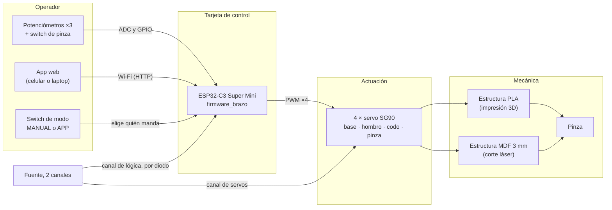

# Brazos robóticos

**Equipo de Integración Mecatrónica Otoño 2026**  
**Integrantes:** Juan Pablo Martha, Carlos Sebastián Ortega, Santiago Alejandro Velázquez

Contenido:
- [1. Proyecto y equipo](#descripción-del-proyecto) (esta página): problema, requisitos, bocetos, alternativas y arquitectura
- [2. Brazo impreso en 3D]({{ '/brazos/impresion-3d/' | relative_url }})
- [3. Brazo cortado con láser]({{ '/brazos/corte-laser/' | relative_url }})
- [4. Electrónica y programación]({{ '/brazos/electronica-programacion/' | relative_url }}) (común a los dos brazos)
- [5. Comparación y conclusiones]({{ '/brazos/comparacion/' | relative_url }})

---

## Descripción del proyecto

Como proyecto de la clase de **Integración Mecatrónica Otoño 2026**, el equipo diseña y manufactura **dos brazos robóticos** con dos procesos de fabricación distintos, controlados por la **misma tarjeta con ESP32-C3**:

- un brazo fabricado por **impresión 3D (FDM)** en PLA, y
- un brazo fabricado por **corte láser** en MDF de 3 mm.

El objetivo es documentar cada proceso de principio a fin (modelo, parámetros de fabricación, piezas, ensamble, electrónica y programa) y comparar los resultados.

### Brazos

| Brazo | Proceso | Diseño base | Piezas fabricadas | Control |
|:------|:--------|:------------|:-----------------:|:--------|
| [Brazo impreso en 3D]({{ '/brazos/impresion-3d/' | relative_url }}) | Impresión 3D (FDM, PLA) | Printables #449747, de RACBOTS | 9 | Tarjeta con ESP32-C3 |
| [Brazo cortado con láser]({{ '/brazos/corte-laser/' | relative_url }}) | Corte láser (MDF 3 mm) | MeArm v1.0, de Benjamin Gray | 36 | Tarjeta con ESP32-C3 |

> **Diseños mecánicos de terceros, electrónica y programa propios.** Las dos estructuras parten de modelos publicados con licencia abierta; cada página declara su autor, su fuente y su licencia. La tarjeta de control, el firmware, la app y la interfaz de escritorio son del equipo.

---

## 1) Problema, objetivos y requisitos (B01)

### Necesidad

Construir un **manipulador de escritorio** capaz de **tomar un objeto pequeño y moverlo**, y usarlo para comparar dos procesos de manufactura (impresión 3D y corte láser) con la misma electrónica y el mismo programa.

**Función general:** posicionar una pinza en el espacio de trabajo con tres articulaciones y cerrarla sobre el objeto sin soltarlo ni dañarlo. El objeto de prueba es la **pelota roja de espuma** del primer proyecto.

### Objetivos

1. Fabricar **dos versiones** del brazo, una por **impresión 3D (FDM)** y otra por **corte láser**.
2. Diseñar y fabricar una **tarjeta de control propia con ESP32-C3** que sirva para los dos brazos.
3. Programar **tres modos de operación**: manual con potenciómetros, app web desde el celular y control desde la computadora por USB.
4. Documentar cada versión de principio a fin: modelo, planos, parámetros de fabricación, ensamble, electrónica, programa y pruebas.
5. **Comparar** las dos versiones con los mismos criterios de fabricación, ensamble y desempeño.

### Requisitos

| # | Requisito | Valor objetivo | Cómo se verifica |
|:--|:----------|:---------------|:-----------------|
| RQ1 | Grados de libertad | **3 GDL + pinza** (base, hombro, codo) | Inspección del ensamble |
| RQ2 | Actuadores | **4 servos SG90**: uno por articulación y uno para la pinza | Lista de materiales |
| RQ3 | Procesos de fabricación | Un brazo por **impresión 3D** y uno por **corte láser** | Registro de fabricación |
| RQ4 | Tarea | Tomar la pelota de espuma, levantarla, girar la base y soltarla en otro punto | Prueba funcional |
| RQ5 | Control manual | **3 potenciómetros** (base, hombro, codo) y un **switch** (pinza) | Prueba de modos |
| RQ6 | Control inalámbrico | **App web** servida por el ESP32-C3 en su propia red Wi-Fi | Prueba de modos |
| RQ7 | Elegir el modo desde el hardware | Un **switch** en la tarjeta decide quién manda; la app no puede quitarle el mando al operador | Prueba de modos |
| RQ8 | Tarjeta propia | **PCB** diseñada por el equipo, fresada en el laboratorio | Proyecto de KiCad y archivos de fresado |
| RQ9 | Alimentación | **Dos canales separados**: lógica y servos, con tierra común; el ESP32-C3 protegido contra retorno al USB | Esquemático |
| RQ10 | Seguridad de movimiento | Ángulos limitados por software y velocidad máxima de **120 °/s** | Pruebas del firmware |

### Restricciones

- **Diseños de terceros con licencia abierta:** se respetan autor y licencia (CC BY 4.0) y no se republican archivos cuya licencia no está confirmada.
- **Máquinas del laboratorio:** impresora Creality Ender‑3 V3 KE (boquilla de 0.4 mm, cama de 220 × 220 mm) y cortadora láser de CO₂.
- **Material del láser:** MDF de 3 mm en hojas de 150 × 200 mm.
- **Actuadores pequeños:** el SG90 da alrededor de 1.8 kg·cm a 4.8 V; los eslabones deben ser ligeros y el objeto, de pocos gramos.
- **Corriente:** cuatro SG90 pueden pedir más de 2 A al arrancar juntos, más de lo que entrega un puerto USB.

---

## 2) Bocetos de la solución (B02)

Los bocetos de concepto muestran la disposición de los componentes principales: dónde va cada servo, cómo se unen los eslabones y cómo cierra la pinza. Las proporciones salen del CAD de cada brazo.

**Figura 1:** Brazo impreso. Un servo en cada articulación: giro dentro de la base, hombro en la horquilla de la tapa, codo al final del brazo 1 y pinza con un par de engranes.

**Figura 2:** Brazo de corte láser (MeArm). Los servos del hombro y el codo van abajo y mueven el brazo con un paralelogramo, que mantiene la pinza horizontal.

Los bocetos se generan con `tools/f8_bocetos.py`.

---

## 3) Alternativas y selección (B03)

### Alternativas evaluadas

| Subsistema | Alternativa | Ventajas | Desventajas | Decisión |
|:-----------|:------------|:---------|:------------|:---------|
| Estructura impresa | **Brazo serie de RACBOTS (#449747)** | 9 piezas, imprime sin soportes, pinza con engranes | Los servos cargan el peso de los siguientes | **Elegida** |
| | Brazo con reductores impresos y motores a pasos | Más precisión y par | Muchas piezas, horas de impresión, drivers de motor | Descartada: excede el alcance |
| Estructura de láser | **MeArm v1.0** | Todo en 2 hojas de 150 × 200 mm, guía de armado publicada | 36 piezas pequeñas, tornillería M3 | **Elegida** |
| | Brazo de placas con servos en cada articulación | Menos piezas | Eslabones de 3 mm cargando servos se flexionan | Descartada |
| Controlador | **ESP32-C3 Super Mini** | Wi-Fi integrado para la app, USB nativo, 13 GPIO, pequeño y económico | 3.3 V en el ADC | **Elegido** |
| | Arduino Uno | Muy conocido | Sin Wi-Fi, más grande, sin modo inalámbrico | Descartado |
| | ESP32 DevKit (WROOM) | Más pines y núcleos | Más grande de lo necesario | Descartado |
| Interfaz | **Potenciómetros + app web + GUI USB** | Cubre manual, celular y computadora con un solo firmware | Hay que arbitrar entre fuentes de mando | **Elegida** |
| | Control con joystick o mando | Intuitivo | Hardware extra, sin modo remoto | Descartado |

### Matriz de decisión del controlador

Calificación de 1 a 5, ponderada.

| Criterio | Peso | ESP32-C3 Super Mini | Arduino Uno | ESP32 DevKit |
|:---------|:----:|:-------------------:|:-----------:|:------------:|
| Conectividad inalámbrica para la app | 30 % | 5 | 1 | 5 |
| Tamaño sobre la tarjeta | 20 % | 5 | 2 | 3 |
| Pines suficientes (4 PWM, 3 ADC, 1 entrada) | 20 % | 4 | 4 | 5 |
| Costo | 15 % | 5 | 3 | 4 |
| USB para programar y para la GUI | 15 % | 5 | 4 | 4 |
| **Total** | | **4.80** | **2.55** | **4.30** |

### Justificación de los diseños mecánicos

| Criterio | Brazo impreso (RACBOTS #449747) | Brazo de láser (MeArm v1.0) |
|:---------|:--------------------------------|:----------------------------|
| Adecuación al proceso | Piezas volumétricas (base cilíndrica, horquilla, engranes) que solo salen por impresión 3D; todas imprimen **sin soportes** | **Piezas planas** de 3 mm: todo el brazo cabe en 2 hojas de 150 × 200 mm |
| Actuadores | 4 × SG90 | 4 × SG90 |
| Cinemática | Servos montados en cada articulación (serie) | Hombro y codo por **paralelogramo**, con los servos en la base |
| Pinza | Dos mordazas con **sector dentado** y piñón | Mordazas accionadas por eslabones |
| Licencia | CC BY 4.0 | CC BY 4.0 (guía del autor) |
| Archivos de partida | STL publicados en Printables | Hojas DXF de corte y guía oficial de armado de 13 pasos |

Usar **el mismo actuador (SG90) y la misma tarjeta en los dos brazos** hace que la comparación entre procesos sea justa: la diferencia de desempeño viene de la estructura, no del motor ni del control.

---

## 4) Arquitectura general (B04)

Los dos brazos comparten la arquitectura completa; solo cambia la estructura mecánica y los límites de cada articulación, que se eligen en el firmware.

**Figura 3:** Arquitectura general. La misma tarjeta y el mismo firmware controlan cualquiera de los dos brazos.

| Subsistema | Brazo impreso | Brazo de láser |
|:-----------|:--------------|:---------------|
| Mecánica | 9 piezas de PLA | 36 piezas de MDF de 3 mm |
| Actuación | 4 × SG90 | 4 × SG90 |
| Control | Tarjeta con ESP32-C3 Super Mini | La misma tarjeta |
| Interfaz | Potenciómetros y switches, o app web; el switch de modo elige | Igual |
| Comunicación | Wi-Fi propio (`Brazo-Impreso`); el USB solo programa y diagnostica | Wi-Fi propio (`Brazo-Laser`) |
| Alimentación | Dos canales por bornera: lógica y servos | Igual |

El detalle de la tarjeta y del programa está en [Electrónica y programación]({{ '/brazos/electronica-programacion/' | relative_url }}).

---

## Visores 3D

Las páginas de cada brazo incluyen **visores 3D interactivos** de las piezas (archivos STL) y del ensamble:

- **Girar:** arrastrar con el ratón o con un dedo.
- **Acercar:** rueda del ratón o pellizco.
- **Desplazar:** clic derecho o dos dedos.
- **Reiniciar vista:** botón en la esquina de cada visor.

Cada pieza tiene además un enlace para **descargar su STL**.

---

## Siguiente sección

[Brazo impreso en 3D]({{ '/brazos/impresion-3d/' | relative_url }})
