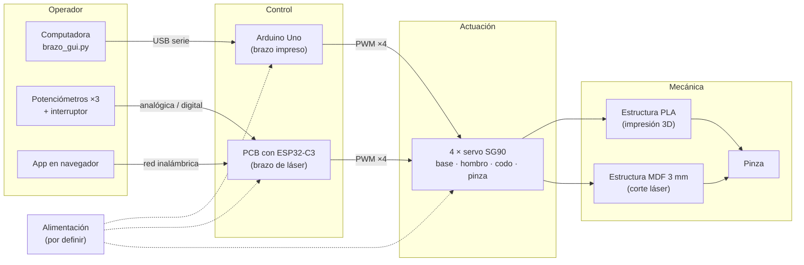

# Brazos robóticos

**Equipo de Integración Mecatrónica Otoño 2026**  
**Integrantes:** Juan Pablo Martha, Carlos Sebastián Ortega, Santiago Alejandro Velázquez

Contenido:
- [1. Proyecto y equipo](#descripción-del-proyecto) (esta página): problema, requisitos, bocetos, alternativas y arquitectura
- [2. Brazo impreso en 3D]({{ '/brazos/impresion-3d/' | relative_url }})
- [3. Brazo cortado con láser]({{ '/brazos/corte-laser/' | relative_url }})
- [4. Comparación y conclusiones]({{ '/brazos/comparacion/' | relative_url }})
- [5. Autoevaluación (rúbrica resumida)]({{ '/brazos/evaluacion/' | relative_url }})

> Estado: **en elaboración**. Los dos brazos tienen documentados su diseño, sus piezas con plano y render, y su ensamble 3D interactivo. Falta la **evidencia física** de ambos (fotos del proceso, del armado y de la electrónica, y videos de las pruebas) y el **código fuente**. Los recuadros punteados B## marcan el lugar donde va cada evidencia pendiente y el criterio de la rúbrica que cubre. El avance por criterio está en la [autoevaluación]({{ '/brazos/evaluacion/' | relative_url }}).

---

## Descripción del proyecto

Como proyecto de la clase de **Integración Mecatrónica Otoño 2026**, el equipo diseña y manufactura **dos brazos robóticos** con dos procesos de fabricación distintos:

- un brazo fabricado por **impresión 3D (FDM)** en PLA, y
- un brazo fabricado por **corte láser** a partir de placas.

El objetivo es documentar cada proceso de principio a fin (modelo, parámetros de fabricación, piezas y ensamble) y comparar los resultados.

### Brazos

| Brazo | Proceso | Diseño base | Control | Estado |
|:------|:--------|:------------|:--------|:-------|
| [Brazo impreso en 3D]({{ '/brazos/impresion-3d/' | relative_url }}) | Impresión 3D (FDM, PLA) | Printables #449747, de RACBOTS | Arduino Uno por USB | 9 piezas con plano, render y visor 3D |
| [Brazo cortado con láser]({{ '/brazos/corte-laser/' | relative_url }}) | Corte láser (MDF 3 mm) | MeArm v1.0, de Benjamin Gray | PCB propia con ESP32-C3 | 36 piezas con plano, DXF y render; visor 3D |

> **Ninguno de los dos diseños es original del equipo.** Ambos parten de modelos publicados por terceros; el aporte propio es la fabricación, el ensamble, la electrónica y las pruebas. Cada página declara su autor, su fuente y su licencia.

---

## 1) Problema, objetivos y requisitos (B01)

### Necesidad

Construir un **manipulador de escritorio** capaz de **tomar un objeto pequeño y moverlo**, y usarlo para comparar dos procesos de manufactura (impresión 3D y corte láser) y dos arquitecturas de control (control por computadora y control con tarjeta propia).

**Función general:** posicionar una pinza en el espacio de trabajo con tres articulaciones y cerrarla sobre el objeto sin soltarlo ni dañarlo. El objeto de prueba es la **pelota roja de espuma** del primer proyecto.

### Objetivos

1. Fabricar **dos versiones** del brazo, una por **impresión 3D (FDM)** y otra por **corte láser**.
2. Documentar cada versión de principio a fin: modelo, planos, parámetros de fabricación, ensamble, electrónica, programa y pruebas.
3. Controlar cada brazo con una **arquitectura distinta**: el impreso desde la computadora por USB, el de láser con una **PCB propia con ESP32-C3**, con control manual y una app.
4. **Comparar** las dos versiones con los mismos criterios de fabricación, ensamble y desempeño.

### Requisitos

| # | Requisito | Valor objetivo | Aplica a | Cómo se verifica |
|:--|:----------|:---------------|:---------|:-----------------|
| RQ1 | Grados de libertad | **3 GDL + pinza** (base, hombro, codo) | Ambos | Inspección del ensamble |
| RQ2 | Actuadores | **4 servos SG90**, uno por articulación y uno para la pinza | Ambos | Lista de materiales |
| RQ3 | Procesos de fabricación | Uno por **impresión 3D** y uno por **corte láser** | Uno cada uno | Registro de fabricación |
| RQ4 | Tomar el objeto de prueba | Tomar, levantar y soltar la pelota de espuma | Ambos | Prueba funcional con video |
| RQ5 | Control desde la computadora | GUI por **USB** (`brazo_gui.py` + Arduino Uno) | Impreso | Prueba de modos de operación |
| RQ6 | Control manual | **3 potenciómetros** (base, hombro, codo) y **1 interruptor** (pinza) | Láser | Prueba de modos de operación |
| RQ7 | Control remoto | **App** servida por el ESP32-C3 | Láser | Prueba de modos de operación |
| RQ8 | Tarjeta propia | **PCB** diseñada y fabricada por el equipo | Láser | Archivos de fabricación y fotos |
| RQ9 | Documentación | Archivos editables y de fabricación descargables | Ambos | [Autoevaluación]({{ '/brazos/evaluacion/' | relative_url }}) |

> **Origen de los requisitos.** Esta tabla se armó con lo que ya está decidido y documentado en este sitio. Falta compararla contra el **enunciado oficial** del proyecto: si el profesor pide valores concretos (alcance, carga, tiempo de la prueba), van aquí.

### Restricciones

- **Diseños de terceros con licencia abierta:** se respetan autor y licencia (CC BY 4.0) y no se republican archivos cuya licencia no está confirmada.
- **Máquinas del laboratorio:** impresora Creality Ender‑3 V3 KE con boquilla de 0.4 mm; cortadora láser **[pendiente de identificar]**.
- **Material del láser:** MDF de 3 mm en hojas de 150 × 200 mm.
- **Actuadores pequeños:** el SG90 limita el par en el hombro; los eslabones deben ser ligeros.



---

## 2) Bocetos de la solución (B02)

Los bocetos muestran la disposición de los componentes principales **antes** del CAD: dónde va cada servo, cómo se unen los eslabones y cómo abre la pinza.





---

## 3) Alternativas y selección (B03)

### Alternativas consideradas



### Justificación técnica de los diseños elegidos

| Criterio | Brazo impreso (RACBOTS #449747) | Brazo de láser (MeArm v1.0) |
|:---------|:--------------------------------|:----------------------------|
| Adecuación al proceso | Piezas volumétricas (base cilíndrica, horquilla, engranes) que solo salen por impresión 3D; todas imprimen **sin soportes** | **Piezas planas** de 3 mm: todo el brazo cabe en 2 hojas de 150 × 200 mm |
| Actuadores | 4 × SG90 | 4 × SG90 |
| Cinemática | Servos montados en cada articulación (serie) | Hombro y codo por **paralelogramo**, con los servos en la base |
| Pinza | Dos mordazas con **sector dentado** y piñón | Mordazas accionadas por eslabones |
| Licencia | CC BY 4.0 | CC BY 4.0 (guía del autor) |
| Archivos de partida | STL publicados en Printables | Hojas DXF de corte y guía oficial de armado de 13 pasos |

Usar **el mismo actuador (SG90) en los dos brazos** hace que la comparación entre procesos sea justa: la diferencia de desempeño viene de la estructura y del control, no del motor.

---

## 4) Arquitectura general (B04)

Los dos brazos comparten la misma estructura de subsistemas; cambian el proceso de fabricación y la tarjeta de control.

**Figura 1:** Arquitectura general. Las líneas punteadas de alimentación están **por definir**: falta documentar de dónde sale la corriente de los 4 servos en cada brazo.

| Subsistema | Brazo impreso | Brazo de láser |
|:-----------|:--------------|:---------------|
| Mecánica | 9 piezas de PLA | 36 piezas de MDF de 3 mm |
| Actuación | 4 × SG90 | 4 × SG90 |
| Control | Arduino Uno | PCB propia con ESP32-C3 Super Mini |
| Interfaz | GUI en la computadora (`brazo_gui.py`) | 3 potenciómetros + interruptor, y app |
| Comunicación | USB serie | Red inalámbrica del ESP32-C3 |
| Alimentación | **[Pendiente]** | Batería o fuente de laboratorio |

---

## Visores 3D

Las páginas de cada brazo incluyen **visores 3D interactivos** de las piezas (archivos STL) y del ensamble:

- **Girar:** arrastrar con el ratón o con un dedo.
- **Acercar:** rueda del ratón o pellizco.
- **Desplazar:** clic derecho o dos dedos.
- **Reiniciar vista:** botón en la esquina de cada visor.

Cada pieza tiene además un enlace para **descargar su STL**.

---

## Siguiente sección

[Brazo impreso en 3D]({{ '/brazos/impresion-3d/' | relative_url }})
